# 楽曲生成システム Toniq 仕様書（基本設計書の下書き）

> **基準のコード**：`main` のコミット `de538b7`（2026-11-12「Merge pull request #36 from Nay0631/feature/0022」）
>
> この文書は、基本設計書（`作成ファイル/04_2026_卒研_基本設計書(R4SA_アプリオリ).docx`）を仕上げるための下書きです。システムが固まるまではこの .md を更新し、最後に docx へ移します。進め方は [基本設計書の作成手順.md](基本設計書の作成手順.md) を参照してください。
>
> - 章立ては docx に合わせています。図の章は、docx と同じく機能設計（5章）と画面設計（10章）の間の 6〜9章（6 ユースケース（6.1 ユースケース図・6.2 ユースケース記述）、7 ロバストネス図、8 シーケンス図、9 クラス図）です。この .md では 7〜9章を1つの章にまとめて機能IDごとに3つの図を並べ、docx を作るときに図の種類ごとの3つの章に分けます。
> - 「状態」と書いたものは、アプリ内の状態（`AppState`）の項目名です。
> - 図で使う日本語の名前は、付録Aの「名前の対応表」に合わせます。

---

## 1. システム構築方針

### 1.1 システム開発の狙い

本システムは、ジャンルと雰囲気を選ぶだけで楽曲を自動生成できるルールベースの作曲アプリである。AI（機械学習）を使わず、音楽理論に基づくパターンDBと生成ルールで曲を組み立てる。

| 特徴 | 実現方法 |
|---|---|
| 生成後も編集が可能 | シンプルモードの結果をカスタムモードに引き継ぎ、パートの差し替え・アレンジ・ピアノロールでのメロディ編集・音量調整ができる |
| 不協和音を少なくする | コード進行をディグリーで管理し、メロディはペンタトニックを中心にコード構成音とスケール音から生成する。ピアノロールのスケールロックでスケール外の音を置けなくする |
| 著作権が生成者に帰属 | 既存曲の学習を行わず、汎用的なコード進行・リズム型と、自作の内部シンセ grow・シンセ音源（Tone.js）・自作のドラム音源だけで生成する |
| 初心者が学べる | 用語のツールチップと、初心者向けの音楽クイズを備える |

## 2. 制約条件・前提条件

- 対象OSは Windows とする（インストーラは NSIS 形式）。
- インターネット接続は不要とする（オフラインで動作する）。
- 音声出力デバイス（スピーカー・ヘッドホン）があること。
- 拍子は 4/4、1小節 16 ステップ固定とする（3/4・3連符は保留。スウィングは16分音符の裏拍を後ろへずらす形で扱う）。
- ジャンルは EDM／8bit／ローファイ／ゲームBGM／テクノ／ハウス／トランス／アンビエントの8種、雰囲気は 明るい／暗い／落ち着いた／切ない／激しいの5種とする。
- ターゲットは「音楽制作未経験者」「アイデアを得たい作曲経験者」とする。前者はシンプルモード、後者はカスタムモードを主な入口とする。
- 作った曲は、アプリ内（localStorage）に保存する。作業ファイル（.toniq.json）としてファイルにも保存できる。書き出したファイル（WAV・MP3・MIDI）と作業ファイルは、出力フォルダ（output/）に保存する（ブラウザで開いたときはダウンロード）。

## 3. システム概要

### 3.1 適用業務範囲

利用者が「曲の条件を選ぶ → 生成 → 試聴・編集 → 保存・ファイルに書き出す」までと、音楽の基礎の学習（クイズ）を範囲とする。

| 業務 | 対象画面 | 状況 |
|---|---|---|
| 雰囲気・ジャンル・テンポを選んで一曲生成 | シンプルモード | 実装済 |
| BPM・キー・スケール・コード進行・ドラム・音色を細かく設定 | カスタムモード | 実装済 |
| メロディの手入力 | ピアノロール | 実装済 |
| パートの配置・曲の構成（Aメロ／サビ） | アレンジャー | 実装済 |
| パート別の音量・ON/OFF | ミキサー（カスタムモードのアレンジャー） | 実装済 |
| MIDI・WAV・MP3 書き出し | 両モード | 実装済 |
| 作った曲の保存・一覧・再生・ファイルでの持ち運び | ミュージックリスト | 実装済 |
| 今の曲の作業ファイルへの保存・作業ファイルを開く・出力フォルダを開く | 両モード・メニュー・ミュージックリスト | 実装済 |
| 音楽の知識クイズ | 音楽クイズ | 実装済 |
| 見た目・音名の表記などの設定 | 設定 | 実装済 |

範囲外：歌詞・ボーカル、オーディオの録音、オンライン共有、ユーザー登録。

### 3.2 システム化の考え方

- **パターンDB＋ルールで生成**：コード進行 61 種・ドラム 42 種を JSON で持ち、ジャンル×雰囲気の表（シンプルモード表）から候補をランダムに選ぶ。ベース・アルペジオ・パッド・シグネチャー・メロディはコード進行とジャンル別の設定から自動で作る。
- **ディグリー管理**：コードは「Im・bVI・IV」のように度数で保存し、再生時にキーに合わせて実音へ変換する。キーを変えても同じ進行を使える。
- **曲の構成**：コード進行1周（周回）ごとに Aメロ／サビ のセクションを持ち、サビは別のコード進行（同じ長さ・スケール）と高めの音域のメロディで鳴らす。曲の最後はエンディング（主和音）で終わり、セクションの変わり目にドラムのフィルを入れる。
- **アレンジ**：ジャンルごとの標準アレンジ（8小節ずつのセクションを A → A → サビ → A の順に並べ、セクションごとに鳴らすパートを決める。セクションの後半でパートを足す・抜くこともあり、ブレイクでパートを抜くセクションもある）を自動で組む。
- **内部シンセ grow**：音は自作のシンセ grow（C++ で作り、WebAssembly にしてアプリの中で鳴らす）で出す。メロディ・コード・ベース・パッド・アルペジオ・シグネチャー・FX/SE・ドラムの音をジャンルごとの標準のプリセットで鳴らし、カスタムモードで音を作り替えられる（テスト中）。grow を読み込めないときは Tone.js の音色で鳴らす。アレンジャーでパートごとのブロックとセクションを編集できる。
- **グルーヴ**：スウィング（裏の16分音符を後ろへずらす）とサイドチェイン（キックに合わせてベース・コードなどを沈める）の量をジャンルごとに持ち、カスタムモードで調整できる。
- **2つの入口**：初心者はシンプルモードで三つ選んで生成し、経験者はカスタムモードで細部を決める。シンプルモードの結果はそのままカスタムモードに引き継ぐ。
- **状態の一元管理**：画面・設定値・曲の内容はすべて「アプリの状態」（AppState）に置き、画面はそれを描画するだけにする。元に戻す／やり直すは、アプリの状態のうち曲の内容の変更履歴で行う。

### 3.3 システム概要図

（未作成。利用者 → 画面（UI層）→ アプリの状態 → 生成エンジン → スピーカー／ファイル、の流れを描く）

## 4. システム構成

[開発言語] TypeScript（画面は HTML／CSS）。サーバーを持たないスタンドアロンのデスクトップアプリとする。

### 4.1 システム構成図

（未作成）構成は次の3層とする。

1. ハードウェア：Windows PC（スピーカー・ヘッドホン）
2. Electron：メインプロセス（ウィンドウ生成（1200×800、最小 800×600）と、出力フォルダへの保存・作業ファイルの保存／開くダイアログ）＋プリロード（画面にファイル操作を公開する）＋レンダラープロセス（Chromium）
3. アプリ：UI層（index.html・src/ui）→ エンジン層（src/engine、src/quiz、Tone.js、grow（WebAssembly を AudioWorklet で鳴らす））→ データ層（src/data の JSON、public/grow の grow.wasm、public/samples のドラム音源、localStorage）。音は Web Audio API で出力する。書き出したファイルと作業ファイルは出力フォルダ（output/ の audio・midi・projects）に保存する（ブラウザで開いたときはダウンロード）。

### 4.2 システム構成表

| 区分 | 構成要素 | バージョン | 用途 |
|---|---|---|---|
| ハードウェア | Windows PC | Windows 10/11 | 実行環境 |
| 実行基盤 | Electron | ^44.2.0 | デスクトップアプリ化 |
| 言語 | TypeScript | ^7.0.2 | アプリのソースコード |
| 言語 | C++ | ― | 内部シンセ grow（grow/core） |
| ビルド | Emscripten | 7.0.0 | grow を WebAssembly（public/grow/grow.wasm）にする |
| ビルド | Vite ＋ vite-plugin-electron | ^8.2.2 / ^1.1.2 | 開発サーバー・ビルド |
| 配布 | electron-builder | ^26.15.3 | Windows インストーラ（NSIS）作成 |
| 音声 | Tone.js | ^15.1.22 | シンセ音源・シーケンス・エフェクト・WAV レンダリング |
| MIDI | @tonejs/midi | ^2.0.28 | MIDI ファイル作成 |
| MP3 | @breezystack/lamejs | ^1.2.7 | WAV と同じ音声を MP3（192kbps）に変換 |
| 音声 | grow（自作） | ― | 内部シンセ。WebAssembly ＋ AudioWorklet で鳴らす |
| データ | JSON ファイル 8 種 | ― | パターンDB・ジャンル別の設定値（12章） |
| データ | WAV ファイル | ― | ドラムのワンショット音源（public/samples/drums） |
| 保存 | localStorage | ― | 楽曲データ・端末の設定 |
| 保存 | 出力フォルダ（output/） | ― | 書き出したファイル（audio・midi）と作業ファイル（projects） |
| 開発ツール | VS Code、Git | ― | 開発・構成管理 |
| 開発ツール | Vitest | ^5.0.5 | 自動テスト |

---

## 5. 機能設計

### 5.1 機能一覧

機能IDは「グループID＋枝番」とする。一度付けた ID は変えず、機能を足したらグループの最後の番号の次を使う。

機能はグループ（グループIDごとのシステム）に分け、システムごとの表に示す。表の1行目は、そのグループIDが何のシステムかを示す。M01・H01・U01 は、元の機能一覧になく、実装に合わせて足したシステムである。

**B01_曲の基本設定システム**

| 機能ID | 機能名 | 画面 | 説明 |
|---|---|---|---|
| B01-1 | BPM選択 | カスタム | BPMノブ（40〜220）でBPMを指定する |
| B01-2 | テンポ選択 | シンプル | ゆっくり／普通／速いの3段階から、ジャンルに合ったBPMを選ぶ |
| B01-3 | BPMクリック選択 | 両方 | タップボタンを押す間隔からBPMを決める |
| B01-4 | BPM試聴 | 両方 | 今のBPMでクリック音を鳴らす |
| B01-5 | 小節数選択 | カスタム | 曲全体の長さ（小節数）を選ぶ |
| B01-6 | ジャンル選択 | 両方 | 8ジャンルから選ぶ |
| B01-7 | ジャンル試聴 | シンプル | 選んだジャンル・雰囲気のサンプル曲を1周鳴らす |
| B01-8 | リード選択 | カスタム | メロディの音色を選ぶ |
| B01-9 | グルーヴ調整 | カスタム | スウィング・サイドチェインの量を調整する |
| B01-10 | grow音作り | カスタム | 内部シンセ grow で鳴らすパート（メロディ・コード・ベース・パッド・アルペジオ・シグネチャー）の音を、プリセットとつまみで作る（テスト中） |

**K01_キー・スケール設定システム**

| 機能ID | 機能名 | 画面 | 説明 |
|---|---|---|---|
| K01-1 | キー音選択 | カスタム | ルート音（C〜B）を選ぶ |
| K01-2 | スケール選択 | カスタム | スケールを選び、そのスケールのコード進行に切り替える |
| K01-3 | キー・スケール試聴 | カスタム | 選んだキー・スケールの音階を試聴する |

**C01_コード進行設定システム**

| 機能ID | 機能名 | 画面 | 説明 |
|---|---|---|---|
| C01-1 | コード進行カテゴリ選択 | カスタム | 雰囲気のカテゴリでコード進行を絞り込む |
| C01-2 | 雰囲気選択 | シンプル | 5つの雰囲気から選ぶ |
| C01-3 | コード進行選択 | 両方 | コード進行を選ぶ（カスタム）、または再抽選する（シンプル） |
| C01-4 | コード進行リズム選択 | カスタム | コードを鳴らすリズム（全音符／2分／4分／8分）を選ぶ |
| C01-5 | コード進行試聴 | カスタム | 選んだコード進行を1周分試聴する |
| C01-6 | コード音色選択 | カスタム | コードの音色（grow のプリセット）を選ぶ |
| C01-7 | サビ進行選択 | カスタム | サビで鳴らすコード進行を選ぶ・差し替える |

**D01_ドラム設定システム**

| 機能ID | 機能名 | 画面 | 説明 |
|---|---|---|---|
| D01-1 | ドラムカテゴリ選択 | カスタム | ジャンルのタグでドラムパターンを絞り込む |
| D01-2 | ドラムパターン選択 | 両方 | ドラムパターンを選ぶ（カスタム）、または再抽選する（シンプル） |
| D01-3 | ドラム試聴 | カスタム | 選んだドラムパターンを2小節分試聴する |

**S01_特殊音設定システム**

| 機能ID | 機能名 | 画面 | 説明 |
|---|---|---|---|
| S01-1 | 特殊音選択 | カスタム | パッド・アルペジオ・シグネチャーの ON/OFF と、FX/SE の種類を選ぶ |

**P01_メロディ編集システム**

| 機能ID | 機能名 | 画面 | 説明 |
|---|---|---|---|
| P01-1 | メロディ入力 | 両方 | ピアノロールでメロディを入力する |
| P01-2 | スケールロック | 両方 | スケール外の音を置けないようにする（カスタムモードではコード進行の候補も同じスケールに絞る） |
| P01-3 | ノーツ選択 | 両方 | ピアノロールの音を選び、位置・高さ・長さを変える・削除する |

**A01_アレンジ・書き出しシステム**

| 機能ID | 機能名 | 画面 | 説明 |
|---|---|---|---|
| A01-1 | パート配置 | カスタム | パートごとに鳴らす小節をブロックで配置する |
| A01-2 | パート別音量調節 | カスタム | 8パートの音量を 0〜100 で調整する |
| A01-3 | MIDIエクスポート | 両方 | 楽曲を MIDI ファイルで書き出す |
| A01-4 | MP3エクスポート | 両方 | 楽曲を MP3 ファイルで書き出す |
| A01-5 | WAVエクスポート | 両方 | 楽曲を WAV ファイルで書き出す |
| A01-6 | 再生開始位置選択 | カスタム | アレンジャーで再生を始める小節を選ぶ |
| A01-7 | セクション切替 | カスタム | 周回ごとに Aメロ／サビ を切り替える |
| A01-8 | テスト中の機能切替 | カスタム | エンディング・ドラムのフィル・ドラムの揺らぎを ON/OFF する（テスト中） |
| A01-9 | 自動チェック | カスタム | 今の曲を規則で調べた結果（コード構成音の割合・跳躍など）を表示する（テスト中） |

**L01_楽曲再生システム**

| 機能ID | 機能名 | 画面 | 説明 |
|---|---|---|---|
| L01-1 | 楽曲再生 | 両方・ミュージックリスト | 楽曲を再生・停止する |

**Q01_音楽クイズシステム**

| 機能ID | 機能名 | 画面 | 説明 |
|---|---|---|---|
| Q01-1 | 音楽クイズ | 音楽クイズ | 音楽の知識をクイズ形式で学ぶ |

**G01_自動作曲システム**

| 機能ID | 機能名 | 画面 | 説明 |
|---|---|---|---|
| G01-1 | 楽曲生成 | 両方 | 選んだ条件からコード進行・ドラム・メロディを決めて楽曲を生成する |

**M01_楽曲管理システム**

| 機能ID | 機能名 | 画面 | 説明 |
|---|---|---|---|
| M01-1 | 楽曲保存 | 両方 | 今の曲をミュージックリストに保存する（上書き保存を含む） |
| M01-2 | 新規作成 | 両方 | 曲の内容を初期状態に戻して新しい曲を作る |
| M01-3 | 楽曲検索 | ミュージックリスト | 曲名の検索・ジャンルの絞り込み・お気に入り表示・並び替え |
| M01-4 | 楽曲を開く | ミュージックリスト | 保存した曲を保存したモードの画面で開く |
| M01-5 | 楽曲情報変更 | ミュージックリスト | 曲名の変更・お気に入りの切り替え |
| M01-6 | 楽曲削除 | ミュージックリスト | 保存した曲を削除する |
| M01-7 | 曲ファイル書き出し | ミュージックリスト | 曲を曲ファイル（.toniq.json）に書き出す（1曲・すべて） |
| M01-8 | 曲ファイル読み込み | ミュージックリスト | 曲ファイルを読み込んでミュージックリストに追加する |
| M01-9 | 作業ファイル保存 | 両方 | 今の曲を作業ファイル（.toniq.json）に保存する |
| M01-10 | 作業ファイルを開く | メニュー・ミュージックリスト | 作業ファイルを今の曲として開き、続きから編集する |
| M01-11 | 出力フォルダを開く | ミュージックリスト | 書き出したファイルと作業ファイルを保存する出力フォルダを開く |

**H01_操作履歴システム**

| 機能ID | 機能名 | 画面 | 説明 |
|---|---|---|---|
| H01-1 | 元に戻す・やり直す | 両方 | 曲の内容の変更を元に戻す・やり直す |

**U01_環境設定システム**

| 機能ID | 機能名 | 画面 | 説明 |
|---|---|---|---|
| U01-1 | 配色選択 | 設定 | ライト／ダーク／OS に合わせる を選ぶ |
| U01-2 | スキン選択 | 設定 | カスタムモードの見た目（デフォルト／フラット／スタジオ／ポップ）を選ぶ |
| U01-3 | 音名表記選択 | 設定・音楽クイズ | 音名を CDE／ドレミ で表示する |
| U01-4 | ループ再生切替 | 設定 | 曲の終わりで先頭に戻って繰り返すかを選ぶ |
| U01-5 | ドラム音源選択 | 設定 | ドラムを grow／シンセ／サンプル音源のどれで鳴らすかを選ぶ（テスト中） |
| U01-6 | 用語ツールチップ切替 | 設定 | 用語の説明の表示を ON/OFF する |

### 5.2 機能

各機能の定義を示す。アクターは全機能とも「利用者」とする。帳票の入出力はない。入力・出力で書いていない項目（帳票・データベース・ファイル・その他）は「なし」とする。

#### B01_曲の基本設定システム

##### B01-1 BPM選択機能

| 項目 | 内容 |
|---|---|
| 事前条件 | カスタムモード画面が開いている |
| 事後条件 | bpm が更新され、tempoPreset が custom になる |
| 入力 | 画面：BPMノブ（40〜220、1刻み） |
| 出力 | 画面：BPM値・情報バー／その他：再生中ならテンポにすぐ反映する |
| 機能説明 | ノブでBPMを指定する。値は 20〜240 に丸める |
| 備考 | ― |

##### B01-2 テンポ選択機能

| 項目 | 内容 |
|---|---|
| 事前条件 | シンプルモード画面（生成前）が開いている |
| 事後条件 | tempoPreset と bpm が更新される |
| 入力 | 画面：ゆっくり／普通／速い のチップ／データベース：テンポマスタ |
| 出力 | 画面：選択中のチップと BPM 値／その他：ジャンルのサンプル再生中ならテンポにすぐ反映する |
| 機能説明 | ジャンルごとの3段階からBPMを決める（例：EDM 115/128/140、ローファイ 70/80/95）。ジャンルを変えると同じ段階のBPMに追従する |
| 備考 | ― |

##### B01-3 BPMクリック選択機能

| 項目 | 内容 |
|---|---|
| 事前条件 | シンプルモード画面またはカスタムモード画面が開いている |
| 事後条件 | bpm がタップ間隔から計算され、tempoPreset が custom になる |
| 入力 | 画面：「タップで調整」「タップ」ボタンの連続クリック |
| 出力 | 画面：BPM 値／その他：再生中（シンプルモードはサンプル再生中）ならテンポにすぐ反映する |
| 機能説明 | 2回目以降、直近最大8回の間隔の平均からBPMを求める。2秒以上空けるとリセットする。20〜240 に制限する |
| 備考 | ― |

##### B01-4 BPM試聴機能

| 項目 | 内容 |
|---|---|
| 事前条件 | BPM が決まっている |
| 事後条件 | クリック音が鳴る（もう一度押すと止まる） |
| 入力 | 画面：「クリックで試聴」「試聴」ボタン |
| 出力 | 画面：ボタンの表示（■ 停止）／その他：4/4 のクリック音（1拍目は高い音） |
| 機能説明 | 曲の再生とは別の音声で、今のBPMのクリック音を鳴らす。拍ごとにBPMを読むので、鳴らしたままBPMを変えるとすぐ反映される。鳴らし始めると曲の再生は止める |
| 備考 | 曲の再生・試聴の開始、画面の切り替え、生成で止まる |

##### B01-5 小節数選択機能

| 項目 | 内容 |
|---|---|
| 事前条件 | カスタムモード画面が開いている |
| 事後条件 | bars が更新される |
| 入力 | 画面：小節数ドロップダウン（8/16/24/32/48/64） |
| 出力 | 画面：情報バーの小節数／その他：再生中なら先頭から再生し直す |
| 機能説明 | 曲全体の長さ。再生はこの小節数で自動停止する（ループ再生なら先頭に戻る）。アレンジャーと書き出しの長さもこれに合わせる |
| 備考 | 初期値は 32 小節。シンプルモードでは生成のときに 32 小節に設定する |

##### B01-6 ジャンル選択機能

| 項目 | 内容 |
|---|---|
| 事前条件 | シンプルモード画面またはカスタムモード画面が開いている |
| 事後条件 | genre が更新される。テンポがプリセットなら bpm、カスタムモードでは drumCategory も追従する |
| 入力 | 画面：ジャンルのチップ（シンプル）／ドロップダウン（カスタム）／データベース：テンポマスタ |
| 出力 | 画面：選択状態・情報バー・ジャンルの一言の説明（シンプル）／その他：カスタムモードで再生中なら再生し直す。シンプルモードでサンプル再生中なら新しいジャンルのサンプルに切り替える |
| 機能説明 | ジャンルはテンポ・パターンの候補・メロディの性格・ベース・アルペジオ・シグネチャー・FX・grow の標準の音色・ミックス・標準アレンジを決める。シンプルモードでは、選んでいる雰囲気に合うジャンルのチップだけを雰囲気ごとの順に出し、「「○○」に合うジャンル」と添える（開いた曲のジャンルが雰囲気に合わなくても、選んでいるジャンルのチップは出す）。一言の説明の中の用語（サビ・チップチューン・4つ打ちなど）には用語のツールチップを付ける |
| 備考 | 雰囲気ごとのジャンル：明るい＝EDM・8bit・ゲームBGM・ハウス・トランス、暗い＝EDM・8bit・テクノ・トランス・アンビエント、切ない＝EDM・ローファイ・ゲームBGM・トランス・アンビエント、激しい＝EDM・8bit・テクノ・トランス、落ち着いた＝ローファイ・ゲームBGM・ハウス・アンビエント |

##### B01-7 ジャンル試聴機能

| 項目 | 内容 |
|---|---|
| 事前条件 | シンプルモード画面（生成前）が開いている |
| 事後条件 | 曲の内容は変わらない（試聴中だけ差し替え、止めたら元に戻す） |
| 入力 | 画面：「▷ ○○ のサンプルを聴く」ボタン／データベース：シンプルモード表マスタ・コード進行マスタ・ドラムパターンマスタ・メロディ設定マスタ |
| 出力 | 画面：ボタンの表示（■ サンプルを止める）／その他：サンプルの音 |
| 機能説明 | 選んでいるジャンル・雰囲気でパターンを選び、メロディを自動生成して、ドラム・コード・ベース・パッド・シグネチャー・メロディを同時に1周（4小節未満なら4小節）鳴らす |
| 備考 | 画面の切り替え・生成・ほかの再生で止まる |

##### B01-8 リード選択機能

| 項目 | 内容 |
|---|---|
| 事前条件 | カスタムモード画面が開いている |
| 事後条件 | melodyInstrument が更新される |
| 入力 | 画面：メロディの音色ドロップダウン／データベース：メロディ設定マスタ（「ジャンルに合わせる」のとき） |
| 出力 | その他：メロディの音色（再生中なら再生し直して反映する） |
| 機能説明 | grow／ジャンルに合わせる／SuperSaw リード／エレピ／ベル／スクエア／アシッド／シンセリード／プラック／ソフトサイン から選ぶ。初期値は grow（内部シンセ。音は B01-10 で作る）。grow を読み込めない（wasm がない）ときは、grow を選んでいてもジャンルの標準の音色で鳴らす |
| 備考 | 画面の項目名は「インスト」。以前の Toniq シンセ（廃止）を選んで保存した曲は、開くと「ジャンルに合わせる」になる |

##### B01-9 グルーヴ調整機能（追加）

| 項目 | 内容 |
|---|---|
| 事前条件 | カスタムモード画面が開いている |
| 事後条件 | swing／sidechain が更新される（「標準」で null に戻る） |
| 入力 | 画面：スウィング・サイドチェインのノブ（0〜100）と「標準」ボタン／データベース：ミックス設定マスタ（標準の量） |
| 出力 | 画面：ノブの値／その他：再生中もすぐ反映する |
| 機能説明 | スウィングは16分音符の裏拍を後ろへずらして跳ねたノリにする（100 で3連のシャッフルに近くなる）。サイドチェインはキックが鳴るたびにベース・パッド・コード・アルペジオ・シグネチャーの音量を一瞬下げる（100 で約 −14dB。メロディ・ドラム・FX は下げない）。null のときはジャンルの標準の量を使う |
| 備考 | シンプルモード・ジャンルのサンプルはジャンルの標準の量で鳴る。MIDI 書き出しはスウィングを発音位置に反映する |

##### B01-10 grow音作り機能（追加）

| 項目 | 内容 |
|---|---|
| 事前条件 | カスタムモード画面（設定タブ）が開いていて、grow を読み込めている |
| 事後条件 | 対象のパートの音作りの値が更新される（メロディ：growPreset・growParams、コード：growChordPreset・growChordParams、ベース・パッド・アルペジオ・シグネチャー：growSounds） |
| 入力 | 画面：grow のパネル（「対象」のドロップダウン、「プリセット」のドロップダウン、「プリセットに戻す」ボタン、モジュールごとのつまみ・セレクト・チェック）／データベース：grow プリセット |
| 出力 | 画面：つまみの値（単位付きで表示）、選んでいるプリセット、「プリセットから変更しています」の表示／その他：grow の音（鳴っているすべての grow にすぐ反映する） |
| 機能説明 | 「対象」で音を作るパートを選ぶ（コード・ベース・パッド・アルペジオ・シグネチャー。メロディは音色が grow のときだけ選べる）。プリセットを選ぶと、そのパートの音をプリセットの音にする（変えた値は捨てる）。メロディ以外は「ジャンルの標準（プリセット名）」も選べ、ジャンルを変えるとそのジャンルの標準の音になる。つまみ・セレクト・チェックを動かすと、そのパートの値を変え、鳴っている grow にすぐ反映する（作り直さない。再生し直さない）。「プリセットに戻す」は変えた値を捨ててプリセットの音に戻す（値を変えていないときは押せない）。つまみの並び・名前・範囲・プリセットは grow（wasm）から読む |
| 備考 | テスト中の暫定のパネル（最終的にはプリセットを選ぶだけにする予定）。パネルはいつも出す。grow を読み込んでいる間は「grow を読み込んでいます…」、読み込めない（wasm がない）ときはその旨を表示してつまみを出さない（そのあいだメロディはジャンルの標準の音色、コードはソフトパッド、ほかのパートは Tone.js の音色で鳴る）。音作りの値は曲と一緒に保存し、元に戻す・やり直すの対象になる。FX/SE・ドラムの grow の音はこのパネルでは変えない。MIDI 書き出しは音色を再現しない |

#### K01_キー・スケール設定システム

##### K01-1 キー音選択機能

| 項目 | 内容 |
|---|---|
| 事前条件 | カスタムモード画面が開いている |
| 事後条件 | key が更新される。自動生成のメロディがあれば作り直す |
| 入力 | 画面：ルート音ドロップダウン（C〜B。ドレミ表記なら読みを添える） |
| 出力 | 画面：情報バーのキー、コード名／その他：再生中なら再生し直す |
| 機能説明 | コード進行はディグリーで持つため、キーを変えるだけで移調できる |
| 備考 | シンプルモードにはキーの選択がない（初期値は A） |

##### K01-2 スケール選択機能

| 項目 | 内容 |
|---|---|
| 事前条件 | カスタムモード画面が開いている |
| 事後条件 | そのスケールのコード進行に切り替わる（chordPattern）。自動生成のメロディがあれば作り直す |
| 入力 | 画面：スケールドロップダウン／データベース：コード進行マスタ |
| 出力 | 画面：情報バー・コード進行の一覧／その他：再生中なら再生し直す |
| 機能説明 | 選択肢はコード進行マスタにあるスケール（major／minor／phrygian／dorian）。同じ雰囲気の進行を優先する |
| 備考 | スケールはコード進行の base_scale から決まり、別に持たない |

##### K01-3 キー・スケール試聴機能

| 項目 | 内容 |
|---|---|
| 事前条件 | カスタムモード画面が開いていて、キーとスケールが決まっている |
| 事後条件 | スケールの音が鳴る（もう一度押すと止まる）。曲の内容は変わらない |
| 入力 | 画面：「スケール・キー」欄の「響き」の「▷ 試聴」ボタン／データベース：スケールマスタ |
| 出力 | 画面：スケールの音名（今の音名の表記）と、鳴っている音の強調表示／その他：音階の音と主音の和音 |
| 機能説明 | 主音から1オクターブ上までの8音（主音は A3〜G#4）を低い順に鳴らし、最後に主音の和音を鳴らす。曲の再生とは別の音声で鳴らす。鳴らしたままキー・スケールを変えると鳴らし直す |
| 備考 | 曲の再生・試聴・サンプルの開始、BPM のクリック音、画面の切り替えで止まる |

#### C01_コード進行設定システム

##### C01-1 コード進行カテゴリ選択機能

| 項目 | 内容 |
|---|---|
| 事前条件 | カスタムモード画面が開いている |
| 事後条件 | mood が更新される。選択中の進行が候補になければ候補の先頭に切り替わる |
| 入力 | 画面：カテゴリドロップダウン（雰囲気5種）／データベース：コード進行マスタ |
| 出力 | 画面：絞り込んだコード進行の一覧／その他：再生中なら再生し直す |
| 機能説明 | スケールロックが有効なときは、今の進行と同じスケールの進行だけに絞る |
| 備考 | ― |

##### C01-2 雰囲気選択機能

| 項目 | 内容 |
|---|---|
| 事前条件 | シンプルモード画面（生成前）が開いている |
| 事後条件 | mood が更新される。選んでいたジャンルが雰囲気に合わなければ、genre（テンポがプリセットなら bpm も）が変わる |
| 入力 | 画面：雰囲気のチップ（明るい・暗い・切ない・激しい・落ち着いた）／データベース：テンポマスタ |
| 出力 | 画面：選択状態・情報バー・雰囲気に合うジャンルのチップ（B01-6）／その他：ジャンルが変わり、ジャンルのサンプルを再生中なら新しいジャンルのサンプルに切り替える |
| 機能説明 | 生成時、シンプルモード表の「ジャンル×雰囲気」の候補からコード進行とドラムを選ぶのに使う。ジャンルのチップは選んだ雰囲気に合うものだけを出す。選んでいたジャンルが雰囲気に合わなければ、合うジャンルの先頭に切り替える（テンポがプリセットなら、そのジャンルの同じ段階の BPM にする） |
| 備考 | 雰囲気ごとのジャンルは B01-6 の備考 |

##### C01-3 コード進行選択機能

| 項目 | 内容 |
|---|---|
| 事前条件 | カスタム：画面が開いている。シンプル：生成済み |
| 事後条件 | chordPattern が更新される。自動生成のメロディがあれば作り直す（シンプルモードは bars も更新）。サビの進行（chorusPattern）が新しい進行と長さ・スケールが合わなくなったら選び直す |
| 入力 | 画面：進行ドロップダウン・◀▶（カスタム）／「↻ 再抽選」ボタン（シンプル、アレンジャー）／データベース：コード進行マスタ・シンプルモード表マスタ |
| 出力 | 画面：キーに合わせたコード名（例：Am-F-C-G。サビの進行があれば併記）／その他：再生中なら再生し直す |
| 機能説明 | 再抽選は、ジャンル・雰囲気が合う候補のうち今の進行以外から選ぶ。シンプルモードの再抽選はサビの進行も選び直す |
| 備考 | サビの進行を「なし」にしているときは、そのまま「なし」にする |

##### C01-4 コード進行リズム選択機能

| 項目 | 内容 |
|---|---|
| 事前条件 | カスタムモード画面が開いている |
| 事後条件 | chordRhythm が更新される |
| 入力 | 画面：リズムドロップダウン（全音符・2分・4分・8分） |
| 出力 | その他：コードの発音間隔（再生中なら再生し直す） |
| 機能説明 | 全音符はコードの長さいっぱい伸ばす。それ以外は 8/4/2 ステップごとに刻む |
| 備考 | MIDI 書き出しにもリズムを反映する |

##### C01-5 コード進行試聴機能

| 項目 | 内容 |
|---|---|
| 事前条件 | コード進行が選択されている |
| 事後条件 | 試聴が終わると停止状態になる |
| 入力 | 画面：「▷ 試聴」ボタン |
| 出力 | その他：コードの音（進行1周分） |
| 機能説明 | 曲を再生中なら止めてから鳴らす。アレンジに関係なく鳴らす。試聴中にもう一度押すと最初から鳴らし直す |
| 備考 | ― |

##### C01-6 コード音色選択機能（追加）

| 項目 | 内容 |
|---|---|
| 事前条件 | カスタムモード画面が開いている |
| 事後条件 | growChordPreset が更新され（「ジャンルに合わせる」なら null）、growChordParams（grow のパネルで変えた値）は null に戻る |
| 入力 | 画面：コードの音色ドロップダウン／データベース：grow プリセット |
| 出力 | 画面：選んだ音色／その他：コードの音色（再生中なら再生し直して反映する） |
| 機能説明 | コードは grow で鳴らし、音色は grow のプリセットから選ぶ：ジャンルに合わせる（そのジャンルの標準のプリセット名を添える）／ソフトパッド／ワイドパッド／エレピ／ストリングス／オルガン／スクエア（8bit）／スーパーソウ／ハードパッド。ジャンルの標準は、パッドと重ならない和音の音（EDM・トランス＝スーパーソウ、8bit＝スクエア、ローファイ＝エレピ、ゲームBGM・アンビエント＝ストリングス、テクノ・ハウス＝オルガン）。grow のパネル（B01-10）でこれ以外のプリセットを選んでいるときは、その音も選択肢に出す |
| 備考 | grow を読み込めないときはソフトパッド（Tone.js）で鳴らす。以前の音色（soft・epiano・strings・organ・square・supersaw）で保存した曲は、開くと同じ音の grow のプリセットになる |

##### C01-7 サビ進行選択機能（追加）

| 項目 | 内容 |
|---|---|
| 事前条件 | カスタムモード画面が開いていて、コード進行が選択されている |
| 事後条件 | chorusPattern が更新される（「なし」なら null）。メロディがあればサビのメロディ（chorusMelodyNotes）だけ作り直す |
| 入力 | 画面：「コード進行」欄の「サビ」ドロップダウン、↻（差し替え）ボタン／データベース：コード進行マスタ |
| 出力 | 画面：サビの進行の表示（情報欄・アレンジャーのセクションの行）／その他：再生中なら再生し直す |
| 機能説明 | 候補は今の進行（Aメロ）と同じ長さ・スケールの進行で、ジャンル・雰囲気が合うものを先に並べる。差し替えは一番合う候補の中から今の進行以外をランダムに選ぶ。「なし」ならサビも Aメロと同じ進行で鳴らす |
| 備考 | 候補がないときは差し替えボタンを押せない。シンプルモードでは生成・再抽選のときに自動で選ぶ |

#### D01_ドラム設定システム

##### D01-1 ドラムカテゴリ選択機能

| 項目 | 内容 |
|---|---|
| 事前条件 | カスタムモード画面が開いている |
| 事後条件 | drumCategory が更新される。選択中のパターンが候補になければ候補の先頭に切り替わる |
| 入力 | 画面：カテゴリドロップダウン／データベース：ドラムパターンマスタ |
| 出力 | 画面：絞り込んだドラムパターンの一覧／その他：再生中なら再生し直す |
| 機能説明 | アプリのジャンルを先頭に、マスタにあるそれ以外のタグを後ろに並べる |
| 備考 | ― |

##### D01-2 ドラムパターン選択機能

| 項目 | 内容 |
|---|---|
| 事前条件 | カスタム：画面が開いている。シンプル：生成済み |
| 事後条件 | drumPattern が更新される |
| 入力 | 画面：パターンドロップダウン・◀▶（カスタム）／「↻ 再抽選」（シンプル、アレンジャー）／データベース：ドラムパターンマスタ・シンプルモード表マスタ |
| 出力 | 画面：「#番号 パターン名」／その他：再生中なら再生し直す |
| 機能説明 | 16ステップのパターンをループする。アレンジャーのドラムのブロックごとに別のパターンも選べる（A01-1） |
| 備考 | ― |

##### D01-3 ドラム試聴機能

| 項目 | 内容 |
|---|---|
| 事前条件 | ドラムパターンが選択されている |
| 事後条件 | 試聴が終わると停止状態になる |
| 入力 | 画面：「▷ 試聴」ボタン／ファイル：ドラム音源ファイル（サンプル音源のとき） |
| 出力 | その他：ドラムの音（2小節） |
| 機能説明 | 曲を再生中なら止めてから鳴らす。ジャンルのドラムキットで鳴らす。試聴中にもう一度押すと最初から鳴らし直す |
| 備考 | ― |

#### S01_特殊音設定システム

##### S01-1 特殊音選択機能

| 項目 | 内容 |
|---|---|
| 事前条件 | カスタムモード画面が開いている |
| 事後条件 | parts.pad／parts.arp／parts.signature、または fxType が更新される |
| 入力 | 画面：パッド・アルペジオ・シグネチャーの ON/OFF ボタン、FX/SE の種類ドロップダウン・試聴ボタン |
| 出力 | 画面：ON/OFF 表示、ミキサーのグレー表示／その他：再生中に ON にするとすぐ鳴る（アレンジでブロックのある小節から） |
| 機能説明 | シグネチャーはジャンルの特徴を出すパート（EDM のコードスタブ、ローファイのレコードノイズなど）。FX/SE はループの継ぎ目の効果音（ライザー／ライザー＋インパクト／インパクト／ダウンリフター／リバースシンバル／チップSE、標準はジャンルで決まる）。FX/SE の試聴は、ループの終わりの盛り上げから次のループの頭の1小節まで鳴らす |
| 備考 | パッド・アルペジオ・シグネチャーの初期値は ON（全パートが ON）。保存した曲は保存した ON/OFF のまま開く |

#### P01_メロディ編集システム

##### P01-1 メロディ入力機能

| 項目 | 内容 |
|---|---|
| 事前条件 | ピアノロールタブが開いている |
| 事後条件 | melodyNotes（サビを選んでいるときは chorusMelodyNotes）が更新され、melodyMethod が manual になる |
| 入力 | 画面：ピアノロールのクリック・ドラッグ、キーボード（A〜K、W E T Y U が黒鍵、Z/X でオクターブ）、音符の長さ（2分〜16分）、オクターブ、編集するセクション（Aメロ／サビ） |
| 出力 | 画面：音符の表示／その他：置いた音の試聴音（今のメロディの音色で鳴らす）。再生中ならメロディだけ読み込み直してすぐ反映する |
| 機能説明 | コード進行1周分を表示する（サビはサビの進行のコード）。メロディは単音なので、重なる音は手前で切るか消す。「自動生成」で Aメロとサビの両方を自動生成のメロディに置き換え、「クリア」ですべて消す。「自動生成」は手入力のメロディがあるとき、「クリア」は音があるとき、確認ダイアログを出す（取り消すと何もしない）。スケールロック中はスケール外の音を置けない |
| 備考 | サビのメロディが空のときは、サビでも Aメロのメロディを鳴らす |

##### P01-2 スケールロック機能

| 項目 | 内容 |
|---|---|
| 事前条件 | ― |
| 事後条件 | pianoRollScaleLock（ピアノロール）／scaleLock（コード進行）が切り替わる |
| 入力 | 画面：ピアノロールの「スケールロック」ボタン、カスタムモードのスケールロックのスイッチ |
| 出力 | 画面：有効／無効の表示、置ける音の表示、絞り込んだコード進行の一覧 |
| 機能説明 | ピアノロール：キーとスケールの7音以外は置けない。動かしたときはスケール音に寄せる。カスタムモード：コード進行の候補を今と同じスケールに絞る |
| 備考 | 初期値はどちらも有効 |

##### P01-3 ノーツ選択機能

| 項目 | 内容 |
|---|---|
| 事前条件 | ピアノロールに音がある |
| 事後条件 | 選んだ音の位置・高さ・長さが更新される（または削除される） |
| 入力 | 画面：音符のクリック・ドラッグ（右端で長さ）、右クリック・Delete キー |
| 出力 | 画面：選択表示／その他：試聴音、再生中ならメロディを読み込み直す |
| 機能説明 | スケールロック中はスケール音に寄せる |
| 備考 | ― |

#### A01_アレンジ・書き出しシステム

##### A01-1 パート配置機能

| 項目 | 内容 |
|---|---|
| 事前条件 | カスタムモード画面のアレンジャータブが開いている |
| 事後条件 | arrangement が更新される（null ならジャンルの標準アレンジ） |
| 入力 | 画面：タイムラインのクリック（周回1周分のブロックを置く）・ドラッグ（移動・長さ変更）・右クリック／×／Delete（削除）、ドラム・FX のブロックのパターン／種類、「標準に戻す」／データベース：標準アレンジマスタ |
| 出力 | 画面：タイムライン／その他：再生中も次に鳴らすところから反映する |
| 機能説明 | 各パートは鳴らすたびにアレンジを見て、ブロックの外の小節では鳴らさない。OFF のパートにブロックを置くと ON になる。標準アレンジは曲を8小節ずつのセクションに分けて A → A → サビ → A の順に並べ（32小節で1回り。長い曲は A → サビ → A をくり返す）、セクションごとに鳴らすパートを決める。同じ A が続いても単調にならないよう、セクションの後半でパートを足す・抜く。サビの前の1小節だけパートを抜く・ブレイクの終わりの1小節だけドラムを戻す、といった抜き差しも含む |
| 備考 | 「標準に戻す」はセクション（A01-7）も標準に戻す |

##### A01-2 パート別音量調節機能

| 項目 | 内容 |
|---|---|
| 事前条件 | カスタムモード画面のアレンジャータブ（ミキサー）が開いている |
| 事後条件 | volumes が更新される |
| 入力 | 画面：8パートのフェーダー（0〜100）、ON ボタン（ON/OFF） |
| 出力 | 画面：数値・レベルメーター（再生中）／その他：音量にすぐ反映する |
| 機能説明 | 値は 20×log10(値/100) dB に変換する。0 は無音。初期値：ドラム80・コード65・ベース70・アルペジオ60・パッド50・シグネチャー60・メロディ75・FX55 |
| 備考 | ― |

##### A01-3 MIDIエクスポート機能

| 項目 | 内容 |
|---|---|
| 事前条件 | 曲が生成されている |
| 事後条件 | .mid ファイルが出力フォルダ（output/midi）に保存される（ブラウザではダウンロード） |
| 入力 | 画面：「MIDIで書き出す」「MIDI」ボタン、ファイル名のダイアログ |
| 出力 | 画面：ファイル名のダイアログ、保存した場所の確認ダイアログ／ファイル：MIDIファイル（.mid） |
| 機能説明 | 始めにファイル名のダイアログを出す（初期値はミュージックリストの曲なら曲名、未保存なら toniq_ジャンル_雰囲気（カスタムモードは toniq_ジャンル_キー）。拡張子は固定）。「キャンセル」・Esc・ダイアログの外のクリックでは書き出さない。名前が空のまま「書き出す」を押すと「ファイル名を入力してください」と出して待つ。ファイル名に使えない文字は「_」に置き換える。曲全体（小節数分）を、再生と同じ音の並びで書き出す。テンポ・4/4・Melody／Chord／Pad／Arpeggio／Bass／Drums の6トラック（ドラムはチャンネル10）。セクション・エンディング・アレンジ・パートの ON/OFF・コードのリズム・ドラムのフィル・スウィングを反映する。出力フォルダに同じ名前のファイルがあれば「 (2)」などを付けて上書きしない。保存したら「「ファイル名」を output/midi フォルダに保存しました。フォルダを開きますか？」と確認し、OK ならそのファイルをエクスプローラーで表示する |
| 備考 | シグネチャー・FX/SE は書き出さない。音色（GM の番号）は目安で、強さの揺らぎ・ストラムは入れない。ブラウザで開いたときは出力フォルダを使わずダウンロードにする（保存した場所の確認は出さない） |

##### A01-4 MP3エクスポート機能

| 項目 | 内容 |
|---|---|
| 事前条件 | 曲が生成されている |
| 事後条件 | .mp3 ファイルが出力フォルダ（output/audio）に保存される（ブラウザではダウンロード）。再生中なら停止する |
| 入力 | 画面：「MP3で書き出す」「MP3」ボタン、ファイル名のダイアログ／ファイル：ドラム音源ファイル（サンプル音源のとき）／データベース：ミックス設定マスタ・grow プリセット |
| 出力 | 画面：ファイル名のダイアログ、書き出しの進み具合のダイアログ（目安・段階・進み具合・経過時間）、保存した場所の確認ダイアログ／ファイル：MP3ファイル（.mp3） |
| 機能説明 | 始めにファイル名のダイアログを出す（A01-3 と同じ。キャンセルなら書き出さない）。WAV と同じ手順で合成した音声を MP3（192kbps）に変換する。変換は区切りながら行い、進み具合を表示する。終わったら進み具合のダイアログを閉じ、出力フォルダに保存する（同じ名前があれば「 (2)」などを付ける）。保存したら「「ファイル名」を output/audio フォルダに保存しました。フォルダを開きますか？」と確認し、OK ならそのファイルをエクスプローラーで表示する |
| 備考 | 失敗したときはメッセージで知らせる。ブラウザで開いたときはダウンロードにする |

##### A01-5 WAVエクスポート機能

| 項目 | 内容 |
|---|---|
| 事前条件 | 曲が生成されている |
| 事後条件 | .wav ファイルが出力フォルダ（output/audio）に保存される（ブラウザではダウンロード）。再生中なら停止する |
| 入力 | 画面：「WAVで書き出す」「WAV」ボタン、ファイル名のダイアログ／ファイル：ドラム音源ファイル（サンプル音源のとき）／データベース：ミックス設定マスタ・grow プリセット |
| 出力 | 画面：ファイル名のダイアログ、書き出しの進み具合のダイアログ（目安・段階・進み具合・経過時間）、保存した場所の確認ダイアログ／ファイル：WAVファイル（.wav） |
| 機能説明 | 始めにファイル名のダイアログを出す（A01-3 と同じ。キャンセルなら書き出さない）。曲の長さ＋2秒をオフラインでレンダリングし、16bit PCM に変換する。ON のパートだけ含める。段階（準備 → 演奏の予定の組み立て → 音声の合成 → WAV に変換）と進み具合を表示する。終わったら進み具合のダイアログを閉じ、出力フォルダに保存する（同じ名前があれば「 (2)」などを付ける）。保存したら「「ファイル名」を output/audio フォルダに保存しました。フォルダを開きますか？」と確認し、OK ならそのファイルをエクスプローラーで表示する |
| 備考 | 失敗したときはメッセージで知らせる。ブラウザで開いたときはダウンロードにする。grow の音は準備（grow の読み込み）を待ってから合成する |

##### A01-6 再生開始位置選択機能（追加）

| 項目 | 内容 |
|---|---|
| 事前条件 | カスタムモード画面のアレンジャータブが開いている |
| 事後条件 | startBar が更新される |
| 入力 | 画面：小節番号の目盛りのクリック、「⏮ 先頭へ」ボタン |
| 出力 | 画面：再生ボタンの表示（「▷ ○小節目から」）／その他：再生中ならその位置から再生し直す |
| 機能説明 | アレンジャータブの再生は開始位置から、ほかのタブでは先頭から始める |
| 備考 | ― |

##### A01-7 セクション切替機能（追加）

| 項目 | 内容 |
|---|---|
| 事前条件 | カスタムモード画面のアレンジャータブが開いている |
| 事後条件 | sections が更新される（「標準に戻す」で null） |
| 入力 | 画面：タイムラインの一番上の「セクション」の行の、周回ごとのボタン／データベース：標準アレンジマスタ（null のときのセクション） |
| 出力 | 画面：周回ごとの「Aメロ」「サビ」の表示、サビの進行の番号／その他：再生中なら再生し直す |
| 機能説明 | クリックするたびに、その周回を Aメロ ⇄ サビ で切り替える。サビの周回はサビの進行（C01-7）とサビのメロディで鳴らす |
| 備考 | サビの進行がないときは、サビも Aメロと同じ進行で鳴らす |

##### A01-8 テスト中の機能切替機能（追加）

| 項目 | 内容 |
|---|---|
| 事前条件 | カスタムモード画面のアレンジャータブが開いている |
| 事後条件 | endingEnabled／drumFill／drumHumanize が更新され、端末の設定データに保存される |
| 入力 | 画面：「テスト中の機能」欄のエンディング・ドラムのフィル・ドラムの揺らぎのスイッチ |
| 出力 | その他：フィル・揺らぎは再生中もすぐ反映する。エンディングは再生中なら再生し直す |
| 機能説明 | エンディング：曲の最後の小節を主和音（メジャーは I、それ以外は Im）の全音符で終わらせる。ドラムのフィル：サビの前・ドラムが抜ける前・8小節ごとなどの小節の終わりにフィルを入れる。ドラムの揺らぎ：強さ・タイミングを少し揺らし、ジャンルによってはスネアのゴーストノートを入れる |
| 備考 | テスト中（聴き比べ用）。初期値はすべて ON。曲には保存しない |

##### A01-9 自動チェック機能（追加）

| 項目 | 内容 |
|---|---|
| 事前条件 | カスタムモード画面のアレンジャータブが開いている |
| 事後条件 | ― （曲の内容は変わらない） |
| 入力 | データベース：コード進行マスタ・メロディ設定マスタ |
| 出力 | 画面：「自動チェック」欄の項目ごとの結果 |
| 機能説明 | アレンジャータブを表示するたびに、今の曲を規則で調べて数字で表示する。項目：強拍（1・3拍目）のコード構成音の割合（75% 以上）、周回の最後の音が主音・構成音か、最大の跳躍（9半音以内）、サビの平均の高さが Aメロより高いか、セクション、アレンジの抜き差し、エンディング・フィルの回数、コード進行マスタの整合（全進行が実音にできるか・サビの相方があるか・長さが8小節のセクションに合うか（1・2・4・8 小節かその倍数で、コードが長さちょうどを埋めているか））、メロディのリズムDB（メロディ設定マスタのリズムが16ステップの書式か、フレーズ形式が英字だけか） |
| 備考 | テスト中。曲の内容を変えると表示が更新される。同じ数値と合否の基準は、開発者が全ジャンル×雰囲気の曲をまとめて測る一括計測（npm run quality）でも使う |

#### L01_楽曲再生システム

##### L01-1 楽曲再生機能

| 項目 | 内容 |
|---|---|
| 事前条件 | 曲が生成されている、またはミュージックリストに保存した曲がある |
| 事後条件 | 再生中になる。小節数に達すると自動停止する（ループ再生なら先頭に戻る） |
| 入力 | 画面：再生／停止ボタン（両モード）、スペースキー（カスタムモードのアレンジャータブ）、曲の再生ボタン（ミュージックリスト）／データベース：楽曲データ |
| 出力 | その他：音声／画面：再生位置・周回数・波形風の表示（シンプル）・再生位置の時間と曲全体の長さ（アレンジャー）・再生位置のバー（ミュージックリスト） |
| 機能説明 | ミュージックリストで再生すると、その曲を今の曲として読み込む（未保存の曲があれば確認し、取り消すと読み込まず再生しない）。再生中の曲の再生ボタンを押すと止める。エンディングがあるときは、最後の和音の余韻のため1小節あとに止める。カスタムモードのアレンジャータブでは、スペースキーで再生（再生開始位置から）／停止を切り替える（文字の入力欄・ドロップダウンの操作中と、ダイアログの表示中は効かない。押し続けても繰り返さない） |
| 備考 | grow の音は準備（grow の読み込み）を待ってから鳴らす |

#### Q01_音楽クイズシステム

##### Q01-1 音楽クイズ機能

| 項目 | 内容 |
|---|---|
| 事前条件 | 音楽クイズ画面が開いている |
| 事後条件 | 正誤・解説が表示され、正解数・連続正解数が更新される |
| 入力 | 画面：カテゴリ・出題モード、出題設定、音の再生ボタン、回答（選択肢／鍵盤を1つ／鍵盤で複数選んで決定）、次の問題 |
| 出力 | 画面：問題・正誤・解説・成績／その他：問題の音 |
| 機能説明 | 4カテゴリ（音の高さ7・コード・スケール8・リズム・音響2・用語2 の計19モード）。初心者向けにやさしい順に並べる。音を使わない問題や、答えたあとにだけ音の再生ボタンが出る問題もある |
| 備考 | 成績と出題設定は保存しない |

#### G01_自動作曲システム

##### G01-1 楽曲生成機能

| 項目 | 内容 |
|---|---|
| 事前条件 | ジャンル・雰囲気・テンポが決まっている |
| 事後条件 | chordPattern・chorusPattern・drumPattern・melodyNotes・chorusMelodyNotes・bars（32）が決まり、generated が true になる。songId・arrangement・sections は null に戻る |
| 入力 | 画面：「✦ 生成する」「✦ もう一度生成する」ボタン（シンプル）、メロディの差し替え ↻（カスタム）／データベース：シンプルモード表マスタ・コード進行マスタ・ドラムパターンマスタ・メロディ設定マスタ |
| 出力 | 画面：生成結果（波形風の表示・各パートの内容。コードはサビの進行も併記） |
| 機能説明 | コード進行とドラムを候補からランダムに選び、サビの進行（同じ長さ・スケール）を選び、Aメロとサビのメロディを生成する。メロディはペンタトニック中心で、フレーズ全体を山型・上昇などの輪郭で動かす。強拍はコード構成音、進行の最後は主音で終わり、前半の終わりは主音を避ける。サビは Aメロより高めの音域で、Aメロの最後の音から大きく跳ばずに始める。リズムとフレーズ形式はメロディ設定マスタに従う（サビは拍の頭から始まり長く伸ばす音の多い、Aメロと違うリズム）。シンプルモードの曲の長さは 32 小節にする |
| 備考 | カスタムモードには「生成する」ボタンがなく、設定はその場で反映される |

#### M01_楽曲管理システム

##### M01-1 楽曲保存機能（追加）

| 項目 | 内容 |
|---|---|
| 事前条件 | シンプルモード画面またはカスタムモード画面が開いている |
| 事後条件 | 楽曲データに保存され、songId が設定される |
| 入力 | 画面：「♪ 保存」「♪ 上書き保存」ボタン |
| 出力 | 画面：「✓ 保存しました」／データベース：楽曲データ |
| 機能説明 | リストから開いた曲は上書き、それ以外は「ジャンル・雰囲気 #番号」の名前で新しく追加する。保存したらボタンを少しの間「✓ 保存しました」にする。楽曲データに書き込めない（保存容量がいっぱいなど）ときは、楽曲データと今の曲（songId）を変えずに「ミュージックリストの保存容量がいっぱいです（または「ミュージックリストに書き込めませんでした」）。この曲はミュージックリストに保存されていません。」と整理の案内を出し、「代わりに今の曲を作業ファイル（.toniq.json）に保存しますか？」と確認する。OK なら作業ファイルに保存する（M01-9）、取り消すと何もしない |
| 備考 | ― |

##### M01-2 新規作成機能（追加）

| 項目 | 内容 |
|---|---|
| 事前条件 | シンプルモード画面またはカスタムモード画面が開いている |
| 事後条件 | 曲の内容が初期状態に戻り、songId が null になる |
| 入力 | 画面：「＋ 新規作成」ボタン、確認ダイアログ |
| 出力 | 画面：設定タブ（シンプルモードは生成前の画面） |
| 機能説明 | 確認ダイアログで取り消すと何もしない。OK なら再生を止め、パターンは初期のジャンル・雰囲気で選び直す。メロディは空にする |
| 備考 | ― |

##### M01-3 楽曲検索機能（追加）

| 項目 | 内容 |
|---|---|
| 事前条件 | ミュージックリスト画面が開いている |
| 事後条件 | musicListQuery・musicListGenre・musicListFavorites・musicListSort が更新される |
| 入力 | 画面：検索欄、ジャンルのチップ、お気に入りボタン、並び替えボタン／データベース：楽曲データ |
| 出力 | 画面：絞り込んだ曲の一覧（曲名・長さ・日付） |
| 機能説明 | 並び順は 新しい順／古い順／名前順 |
| 備考 | ― |

##### M01-4 楽曲を開く機能（追加）

| 項目 | 内容 |
|---|---|
| 事前条件 | ミュージックリストに曲がある |
| 事後条件 | その曲が今の曲になり、保存したモードの画面が開く |
| 入力 | 画面：曲の ⋮ メニューの「○○モードで開く」／データベース：楽曲データ |
| 出力 | 画面：シンプルモード画面（生成後）またはカスタムモード画面 |
| 機能説明 | 未保存の曲があれば確認する（取り消すと開かない）。元に戻すの履歴は捨てる |
| 備考 | ― |

##### M01-5 楽曲情報変更機能（追加）

| 項目 | 内容 |
|---|---|
| 事前条件 | ミュージックリストに曲がある |
| 事後条件 | 曲名・お気に入りが更新される |
| 入力 | 画面：⋮ メニューの「名前を変更」（Enter かほかの所をクリックで確定、Esc で取り消し）、☆ ボタン |
| 出力 | 画面：曲の一覧／データベース：楽曲データ |
| 機能説明 | 楽曲データに書き込めない（保存容量がいっぱいなど）ときは、「ミュージックリストの保存容量がいっぱいです（または「ミュージックリストに書き込めませんでした」）。変更は保存されていません。」と整理の案内を知らせ、曲名・お気に入りは変えない |
| 備考 | ― |

##### M01-6 楽曲削除機能（追加）

| 項目 | 内容 |
|---|---|
| 事前条件 | ミュージックリストに曲がある |
| 事後条件 | 楽曲データから削除される |
| 入力 | 画面：⋮ メニューの「削除」、確認ダイアログ |
| 出力 | 画面：曲の一覧／データベース：楽曲データ |
| 機能説明 | 確認ダイアログで取り消すと削除しない。再生中の曲なら止める。楽曲データに書き込めない（保存容量がいっぱいなど）ときは、「…。変更は保存されていません。」と整理の案内を知らせ、削除しない |
| 備考 | ― |

##### M01-7 曲ファイル書き出し機能（追加）

| 項目 | 内容 |
|---|---|
| 事前条件 | ミュージックリストに曲がある |
| 事後条件 | 曲ファイルが保存される |
| 入力 | 画面：⋮ メニューの「ファイルに書き出す」、「すべて書き出す」ボタン／データベース：楽曲データ |
| 出力 | ファイル：曲ファイル（.toniq.json） |
| 機能説明 | バックアップや別の PC への持ち運びに使う。曲が1つもないときに「すべて書き出す」を押すと「書き出す曲がありません」と知らせる |
| 備考 | ― |

##### M01-8 曲ファイル読み込み機能（追加）

| 項目 | 内容 |
|---|---|
| 事前条件 | ミュージックリスト画面が開いている |
| 事後条件 | 読み込んだ曲が新しい ID で楽曲データに追加される（上書きしない） |
| 入力 | 画面：「ファイルを読み込む」ボタン／ファイル：曲ファイル（複数選択可） |
| 出力 | 画面：追加した曲数・読み込めなかった曲数の通知／データベース：楽曲データ |
| 機能説明 | 鳴らすのに必要な項目がない曲は飛ばし、足りない項目は初期値で補う。読み込めないファイル（形式が違うなど）はファイル名と理由を知らせる。1曲も追加できなければ「読み込める曲がありませんでした。」と知らせる |
| 備考 | ― |

##### M01-9 作業ファイル保存機能（追加）

| 項目 | 内容 |
|---|---|
| 事前条件 | シンプルモード画面またはカスタムモード画面が開いている |
| 事後条件 | 今の曲が作業ファイル（.toniq.json）に保存され、projectPath（保存した場所）が設定される |
| 入力 | 画面：情報バーの「⇩ 作業ファイル」ボタン、保存先を選ぶダイアログ |
| 出力 | 画面：ボタンの表示（「✓ 保存しました」）／ファイル：作業ファイル（.toniq.json） |
| 機能説明 | 今の曲1曲分を曲ファイルと同じ形式で保存する。ファイル名の初期値は、ミュージックリストの曲なら曲名、未保存なら「ジャンル・雰囲気」。保存先を選ぶダイアログは、前回の保存先（開いた作業ファイル）があればその場所、なければ出力フォルダの output/projects を最初に出す。ダイアログで取り消すと保存しない。保存したらボタンを少しの間「✓ 保存しました」にし、ボタンの説明（title）に保存した場所を出す。保存に失敗したら「作業ファイルの保存に失敗しました。」と理由を知らせる |
| 備考 | ミュージックリストには追加しない。ブラウザで開いたときはダウンロードにする（保存先のダイアログは出さない）。ミュージックリストに保存できなかったとき（M01-1）からも呼ばれる |

##### M01-10 作業ファイルを開く機能（追加）

| 項目 | 内容 |
|---|---|
| 事前条件 | メニュー画面またはミュージックリスト画面が開いている |
| 事後条件 | 作業ファイルの曲が今の曲になり（songId は null、projectPath は開いた場所）、保存したモードの画面が設定タブで開く |
| 入力 | 画面：「作業ファイルを開く」カード（メニュー）・ボタン（ミュージックリスト）、確認ダイアログ、ファイルを選ぶダイアログ／ファイル：作業ファイル（.toniq.json） |
| 出力 | 画面：シンプルモード画面（生成後）またはカスタムモード画面 |
| 機能説明 | 今の曲がミュージックリストの曲・開いた作業ファイルの曲・シンプルモードの生成前のどれでもなければ、「編集中の曲は保存されていません。作業ファイルを開くと失われますが、よろしいですか？」と確認する（取り消すと開かない）。ファイルを選ぶダイアログは output/projects を最初に出し、取り消すと開かない。開くときは再生を止め、曲の内容を読み込む（足りない項目は初期値で補い、BPM は 20〜240、小節数は 1〜256 に収める）。曲が複数入ったファイル（すべて書き出す）なら最初の曲を開く。元に戻すの履歴は捨てる。開けないファイルは「作業ファイルを開けませんでした。」と理由（「ファイルの形式が正しくありません（JSON として読めません）」「Toniq の作業ファイルではありません」）を知らせる |
| 備考 | ミュージックリストには追加しない（保存するときは M01-1）。ブラウザで開いたときはファイルの選択で開く |

##### M01-11 出力フォルダを開く機能（追加）

| 項目 | 内容 |
|---|---|
| 事前条件 | ミュージックリスト画面が開いていて、アプリ（Electron）で起動している |
| 事後条件 | ― （曲の内容は変わらない） |
| 入力 | 画面：「出力フォルダ」ボタン |
| 出力 | その他：エクスプローラーで出力フォルダ（output/）を開く |
| 機能説明 | 書き出したファイル（audio・midi）と作業ファイル（projects）を保存する出力フォルダを開く。出力フォルダは、開発時は toniq フォルダの output、インストール版は Toniq.exe と同じ場所の output（書き込めなければ「ドキュメント/Toniq/output」）で、起動時に作る |
| 備考 | ブラウザで開いたときはボタンを出さない |

#### H01_操作履歴システム

##### H01-1 元に戻す・やり直す機能（追加）

| 項目 | 内容 |
|---|---|
| 事前条件 | シンプルモード画面またはカスタムモード画面が開いている |
| 事後条件 | 曲の内容が1つ前（後）の状態になる |
| 入力 | 画面：↶ ↷ ボタン、Ctrl+Z／Ctrl+Shift+Z・Ctrl+Y |
| 出力 | 画面：各画面の表示／その他：再生中なら反映する（アレンジ・音量・ON/OFF・メロディ以外は再生し直す） |
| 機能説明 | 曲の内容が変わる直前の状態を最大100件積む。ドラッグ中・600ms 以内の続けた変更は1つにまとめる。戻す（やり直す）履歴がないときはボタンを押せない |
| 備考 | 曲を開いた・新規作成・起動時は履歴を捨てる |

#### U01_環境設定システム

##### U01-1 配色選択機能（追加）

| 項目 | 内容 |
|---|---|
| 事前条件 | 設定画面が開いている |
| 事後条件 | themeMode・theme が更新され、端末の設定データに保存される |
| 入力 | 画面：ライト／ダーク／OS に合わせる |
| 出力 | 画面：全画面の配色 |
| 機能説明 | 「OS に合わせる」は OS の配色の変更にも追従する |
| 備考 | 曲には保存しない（U01 は共通） |

##### U01-2 スキン選択機能（追加）

| 項目 | 内容 |
|---|---|
| 事前条件 | 設定画面が開いている |
| 事後条件 | skin が更新され、端末の設定データに保存される |
| 入力 | 画面：デフォルト／フラット／スタジオ／ポップ |
| 出力 | 画面：カスタムモードの見た目 |
| 機能説明 | ― |
| 備考 | カスタムモードの情報バーの切り替えボタンは廃止した（2026-11-10 時点） |

##### U01-3 音名表記選択機能（追加）

| 項目 | 内容 |
|---|---|
| 事前条件 | 設定画面または音楽クイズ画面が開いている |
| 事後条件 | noteNames が更新され、端末の設定データに保存される |
| 入力 | 画面：C D E／ド レ ミ |
| 出力 | 画面：ピアノロールの鍵盤・音符、ルート音の読み、クイズの音名 |
| 機能説明 | 単音だけを変え、コード名・キー名は CDE 表記のままにする。クイズでは新しい問題を出す |
| 備考 | ― |

##### U01-4 ループ再生切替機能（追加）

| 項目 | 内容 |
|---|---|
| 事前条件 | 設定画面が開いている |
| 事後条件 | loopPlayback が更新され、端末の設定データに保存される |
| 入力 | 画面：ループ再生のスイッチ |
| 出力 | その他：再生中でもすぐ反映する |
| 機能説明 | ON なら曲の終わりで先頭に戻る。試聴・サンプル・WAV 書き出しはループしない |
| 備考 | ― |

##### U01-5 ドラム音源選択機能（追加）

| 項目 | 内容 |
|---|---|
| 事前条件 | 設定画面が開いている |
| 事後条件 | drumSource が更新され、端末の設定データに保存される |
| 入力 | 画面：grow／シンセ／サンプル音源／ファイル：ドラム音源ファイル／データベース：grow プリセット |
| 出力 | その他：ドラムの音（再生中ならドラムだけ読み込み直す） |
| 機能説明 | grow はトラックごとに grow のドラムのプリセットで鳴らし、ジャンルのドラムキットに合わせて音の高さ・長さなどを変える（grow で鳴らせないトラックはシンセで鳴らす）。シンセは Tone.js のシンセで鳴らす。サンプル音源はジャンルごとのフォルダから読み込み、ない音は default フォルダ、それもなければシンセで鳴らす。grow・サンプル音源は準備（読み込み）を待ってからドラムを読み込み直す |
| 備考 | テスト中。初期値は grow（以前の初期値のシンセを保存していた端末はシンセのまま） |

##### U01-6 用語ツールチップ切替機能（追加）

| 項目 | 内容 |
|---|---|
| 事前条件 | 設定画面が開いている |
| 事後条件 | tooltips が更新され、端末の設定データに保存される |
| 入力 | 画面：用語の説明のスイッチ |
| 出力 | 画面：点線の下線と、カーソルを乗せたときの説明 |
| 機能説明 | 初心者向けの1〜2文の説明を出す |
| 備考 | ― |

---

## 6. ユースケース

### 6.1 ユースケース図

全体と、グループ（システム）ごとのユースケース図を示す。ファイル名の決まりは [図/CLAUDE.md](図/CLAUDE.md)。

#### 全体_楽曲生成システムToniq

#### B01_曲の基本設定システム

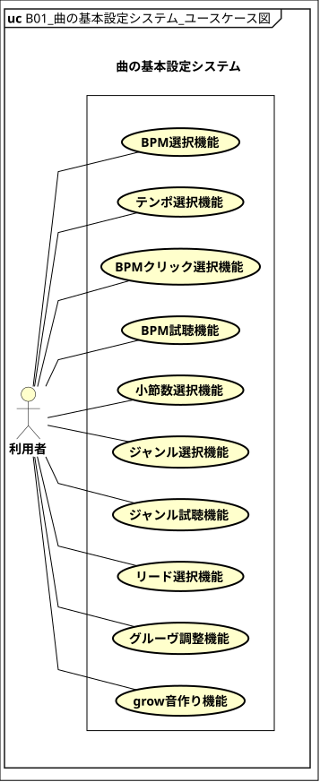

#### K01_キー・スケール設定システム

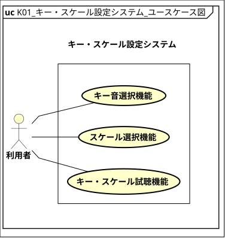

#### C01_コード進行設定システム

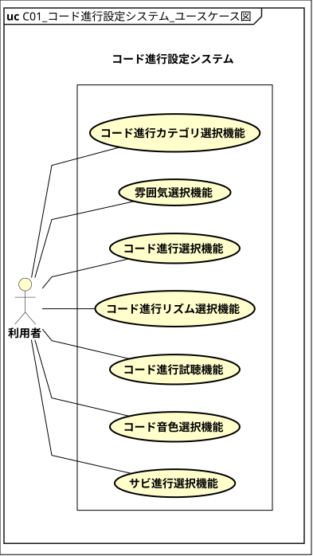

#### D01_ドラム設定システム

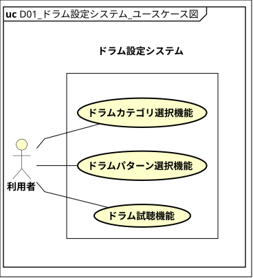

#### S01_特殊音設定システム

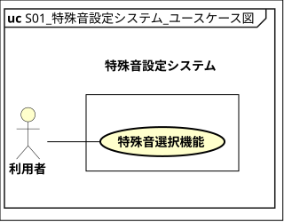

#### P01_メロディ編集システム

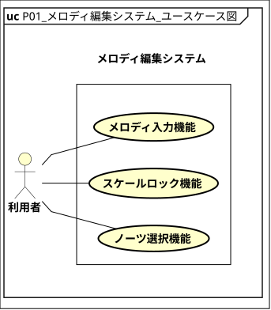

#### A01_アレンジ・書き出しシステム

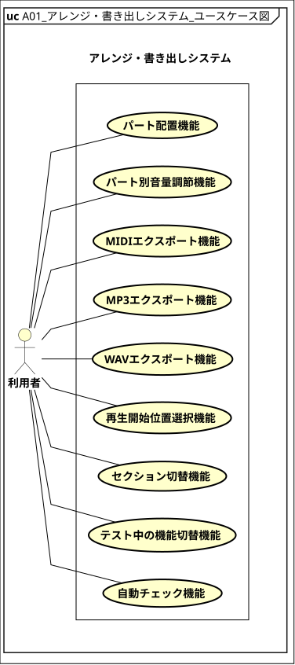

#### L01_楽曲再生システム

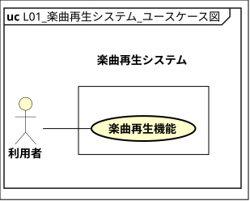

#### Q01_音楽クイズシステム

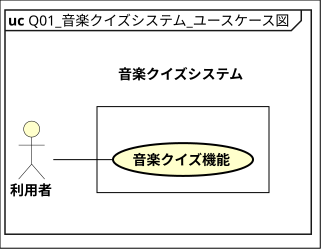

#### G01_自動作曲システム

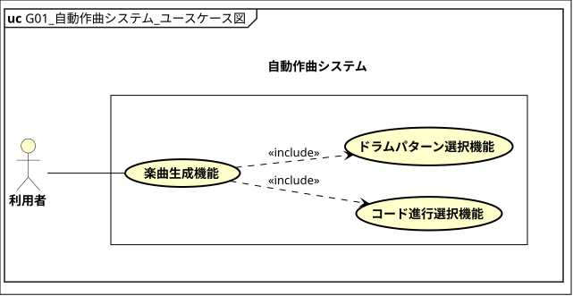

#### M01_楽曲管理システム

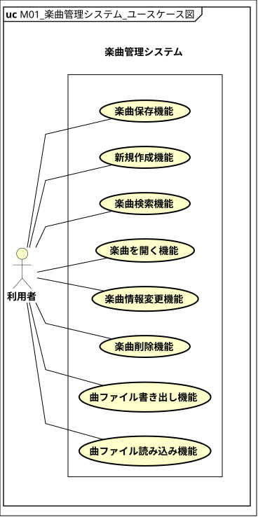

#### H01_操作履歴システム

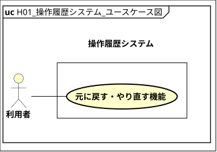

#### U01_環境設定システム

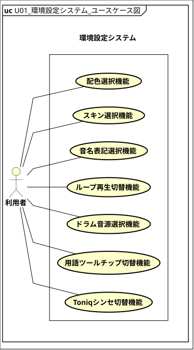

### 6.2 ユースケース記述

グループ（システム）ごとに、各機能のユースケース記述を示す。

#### B01_曲の基本設定システム

##### B01-1 BPM選択機能

| 項目 | 記述 |
|---|---|
| 作成日 | 2026/11/11 |
| 版数 | 1 |
| 作者 | 西薗 |
| ユースケース名 | BPM選択機能 |
| 概要 | BPMノブで曲のテンポ（BPM）を指定する機能 |
| 主アクタ | 利用者 |
| 支援アクタ | なし |
| 事前条件 | カスタムモード画面が開いている |
| 事後条件 | BPM が更新され、テンポの段階が「カスタム」になる |
| トリガー | BPMノブが操作される |
| 基本フロー | 1. 利用者は BPMノブを回して BPM を指定する 2. システムは BPM を 20〜240 に丸めて更新する 3. システムは BPM の値と情報バーの表示を更新する |
| 代替フロー | 3a. 再生中の場合、システムは新しい BPM をテンポにすぐ反映する |
| 例外フロー | なし |
| 備考・注記 | ノブの範囲は 40〜220（1刻み） |

##### B01-2 テンポ選択機能

| 項目 | 記述 |
|---|---|
| 作成日 | 2026/11/11 |
| 版数 | 1 |
| 作者 | 西薗 |
| ユースケース名 | テンポ選択機能 |
| 概要 | ゆっくり／普通／速いの3段階から、ジャンルに合った BPM を選ぶ機能 |
| 主アクタ | 利用者 |
| 支援アクタ | なし |
| 事前条件 | シンプルモード画面（生成前）が開いている |
| 事後条件 | テンポの段階と BPM が更新される |
| トリガー | テンポのチップが押下される |
| 基本フロー | 1. 利用者は「ゆっくり」「普通」「速い」のチップから1つを押下する 2. システムはテンポマスタから、今のジャンルのその段階の BPM を読み込んで更新する 3. システムは選択中のチップと BPM の値を表示する |
| 代替フロー | 3a. ジャンルのサンプルを再生中の場合、システムは新しい BPM をテンポにすぐ反映する |
| 例外フロー | なし |
| 備考・注記 | 例：EDM は 115／128／140、ローファイは 70／80／95。ジャンルを変えると同じ段階の BPM に追従する |

##### B01-3 BPMクリック選択機能

| 項目 | 記述 |
|---|---|
| 作成日 | 2026/11/11 |
| 版数 | 1 |
| 作者 | 西薗 |
| ユースケース名 | BPMクリック選択機能 |
| 概要 | タップボタンを押す間隔から BPM を決める機能 |
| 主アクタ | 利用者 |
| 支援アクタ | なし |
| 事前条件 | シンプルモード画面またはカスタムモード画面が開いている |
| 事後条件 | BPM がタップの間隔から計算され、テンポの段階が「カスタム」になる |
| トリガー | 「タップで調整」「タップ」ボタンが押下される |
| 基本フロー | 1. 利用者はタップボタンを曲に合わせて続けて押下する 2. システムは2回目以降、直近最大8回の間隔の平均から BPM を求める 3. システムは BPM を 20〜240 に収めて更新し、値を表示する |
| 代替フロー | 1a. 前の押下から2秒以上空いた場合、システムは数え直す（1回目として扱う） 3a. 再生中（シンプルモードはサンプル再生中）の場合、システムは新しい BPM をテンポにすぐ反映する |
| 例外フロー | なし |
| 備考・注記 | なし |

##### B01-4 BPM試聴機能

| 項目 | 記述 |
|---|---|
| 作成日 | 2026/11/11 |
| 版数 | 1 |
| 作者 | 西薗 |
| ユースケース名 | BPM試聴機能 |
| 概要 | 今の BPM でクリック音を鳴らす機能 |
| 主アクタ | 利用者 |
| 支援アクタ | なし |
| 事前条件 | BPM が決まっている |
| 事後条件 | クリック音が鳴る（もう一度押すと止まる） |
| トリガー | 「♪ クリックで試聴」「♪ 試聴」ボタンが押下される |
| 基本フロー | 1. 利用者は試聴ボタンを押下する 2. システムは曲の再生を止め、曲の再生とは別の音声で 4/4 のクリック音（1拍目は高い音）を鳴らす 3. システムはボタンを「■ 停止」の表示にする 4. 利用者はもう一度ボタンを押下し、クリック音を止める |
| 代替フロー | 2a. 鳴らしたまま BPM が変わった場合、システムは次の拍から新しい BPM で鳴らす 4a. 曲の再生・試聴の開始、画面の切り替え、生成が行われた場合、システムはクリック音を止める |
| 例外フロー | なし |
| 備考・注記 | なし |

##### B01-5 小節数選択機能

| 項目 | 記述 |
|---|---|
| 作成日 | 2026/11/12 |
| 版数 | 2 |
| 作者 | 西薗 |
| ユースケース名 | 小節数選択機能 |
| 概要 | 曲全体の長さ（小節数）を選ぶ機能 |
| 主アクタ | 利用者 |
| 支援アクタ | なし |
| 事前条件 | カスタムモード画面が開いている |
| 事後条件 | 小節数が更新される |
| トリガー | 小節数のドロップダウンで値が選択される |
| 基本フロー | 1. 利用者は小節数のドロップダウンから 8／16／24／32／48／64 のいずれかを選択する 2. システムは小節数を更新し、情報バーに表示する 3. システムは再生・アレンジャーのタイムライン・書き出しの長さを新しい小節数に合わせる |
| 代替フロー | 2a. 再生中の場合、システムは先頭から再生し直す |
| 例外フロー | なし |
| 備考・注記 | 再生はこの小節数で自動停止する（ループ再生なら先頭に戻る）。初期値は 32 小節。シンプルモードでは生成のときに 32 小節に設定する |

##### B01-6 ジャンル選択機能

| 項目 | 記述 |
|---|---|
| 作成日 | 2026/11/12 |
| 版数 | 2 |
| 作者 | 西薗 |
| ユースケース名 | ジャンル選択機能 |
| 概要 | 8つのジャンルから曲のジャンルを選ぶ機能 |
| 主アクタ | 利用者 |
| 支援アクタ | なし |
| 事前条件 | シンプルモード画面またはカスタムモード画面が開いている |
| 事後条件 | ジャンルが更新される。テンポを段階で選んでいれば BPM、カスタムモードではドラムのカテゴリも追従する |
| トリガー | ジャンルのチップ（シンプルモード）またはドロップダウン（カスタムモード）でジャンルが選択される |
| 基本フロー | 1. 利用者はジャンルを選択する 2. システムはジャンルを更新し、テンポを段階で選んでいればテンポマスタから同じ段階の BPM に変える 3. システムは選択状態・情報バー・ジャンルの一言の説明（シンプルモード）を表示する |
| 代替フロー | 1a. シンプルモードの場合、利用者は選んでいる雰囲気に合うジャンルのチップ（「「○○」に合うジャンル」と添えたもの）から選ぶ 2a. カスタムモードの場合、システムはドラムのカテゴリもジャンルに合わせる 3a. カスタムモードで再生中の場合、システムは再生し直す 3b. シンプルモードでジャンルのサンプルを再生中の場合、システムは新しいジャンルのサンプルに切り替える 3c. シンプルモードの場合、システムは一言の説明の中の用語に用語のツールチップを付ける |
| 例外フロー | なし |
| 備考・注記 | ジャンルはテンポ・パターンの候補・メロディの性格・ベース・アルペジオ・シグネチャー・FX・grow の標準の音色・ミックス・標準アレンジを決める。シンプルモードでは、開いた曲のジャンルが雰囲気に合わなくても、選んでいるジャンルのチップは出す |

##### B01-7 ジャンル試聴機能

| 項目 | 記述 |
|---|---|
| 作成日 | 2026/11/11 |
| 版数 | 1 |
| 作者 | 西薗 |
| ユースケース名 | ジャンル試聴機能 |
| 概要 | 選んだジャンル・雰囲気のサンプル曲を1周鳴らす機能 |
| 主アクタ | 利用者 |
| 支援アクタ | なし |
| 事前条件 | シンプルモード画面（生成前）が開いている |
| 事後条件 | 曲の内容は変わらない（試聴中だけ差し替え、止めたら元に戻す） |
| トリガー | 「▷ ○○ のサンプルを聴く」ボタンが押下される |
| 基本フロー | 1. 利用者はサンプルのボタンを押下する 2. システムはシンプルモード表マスタ・コード進行マスタ・ドラムパターンマスタから、選んでいるジャンル・雰囲気のパターンを選ぶ 3. システムはメロディ設定マスタに従ってメロディを自動生成する 4. システムはボタンを「■ サンプルを止める」の表示にし、ドラム・コード・ベース・パッド・シグネチャー・メロディを同時にコード進行1周（4小節未満なら4小節）鳴らす 5. 鳴らし終わると、システムは曲の内容を元に戻す |
| 代替フロー | 4a. 「■ サンプルを止める」が押下された場合、システムは止めて曲の内容を元に戻す 4b. 鳴らしている間にジャンルが選び直された場合、システムはそのジャンルのサンプルに切り替える |
| 例外フロー | なし |
| 備考・注記 | 画面の切り替え・生成・ほかの再生で止まる |

##### B01-8 リード選択機能

| 項目 | 記述 |
|---|---|
| 作成日 | 2026/11/12 |
| 版数 | 3 |
| 作者 | 西薗 |
| ユースケース名 | リード選択機能 |
| 概要 | メロディの音色を選ぶ機能 |
| 主アクタ | 利用者 |
| 支援アクタ | なし |
| 事前条件 | カスタムモード画面が開いている |
| 事後条件 | メロディの音色が更新される |
| トリガー | メロディの音色（インスト）のドロップダウンで音色が選択される |
| 基本フロー | 1. 利用者は grow／ジャンルに合わせる／SuperSaw リード／エレピ／ベル／スクエア／アシッド／シンセリード／プラック／ソフトサイン から音色を選択する 2. システムはメロディの音色を更新する 3. 次に再生するとき、システムは選んだ音色でメロディを鳴らす |
| 代替フロー | 2a. 「ジャンルに合わせる」の場合、システムはメロディ設定マスタにあるジャンルの標準の音色を使う 3a. 再生中の場合、システムは再生し直して新しい音色を反映する 3b. grow を選んでいて grow を読み込めない（wasm がない）場合、システムはジャンルの標準の音色で鳴らす |
| 例外フロー | なし |
| 備考・注記 | 画面の項目名は「インスト」。初期値は grow で、grow の音は grow音作り機能で作る。以前の Toniq シンセ（廃止）を選んで保存した曲は、開くと「ジャンルに合わせる」になる |

##### B01-9 グルーヴ調整機能（追加）

| 項目 | 記述 |
|---|---|
| 作成日 | 2026/11/11 |
| 版数 | 1 |
| 作者 | 西薗 |
| ユースケース名 | グルーヴ調整機能 |
| 概要 | スウィング・サイドチェインの量を調整する機能 |
| 主アクタ | 利用者 |
| 支援アクタ | なし |
| 事前条件 | カスタムモード画面が開いている |
| 事後条件 | スウィング・サイドチェインの量が更新される（「標準」でジャンルの標準の量に戻る） |
| トリガー | スウィングまたはサイドチェインのノブが操作される |
| 基本フロー | 1. 利用者はスウィングまたはサイドチェインのノブを 0〜100 で回す 2. システムは量を更新し、ノブの値を表示する 3. システムは次に鳴らす音から新しい量を使う（再生中もすぐ反映する） |
| 代替フロー | 1a. 「標準」ボタンが押下された場合、システムはミックス設定マスタにあるジャンルの標準の量に戻す |
| 例外フロー | なし |
| 備考・注記 | スウィングは16分音符の裏拍を後ろへずらす（100 で3連のシャッフルに近い）。サイドチェインはキックのたびにベース・パッド・コード・アルペジオ・シグネチャーの音量を一瞬下げる（100 で約 −14dB）。シンプルモード・ジャンルのサンプルはジャンルの標準の量で鳴る |

##### B01-10 grow音作り機能（追加）

| 項目 | 記述 |
|---|---|
| 作成日 | 2026/11/12 |
| 版数 | 2 |
| 作者 | 西薗 |
| ユースケース名 | grow音作り機能 |
| 概要 | 内部シンセ grow で鳴らすパート（メロディ・コード・ベース・パッド・アルペジオ・シグネチャー）の音を、プリセットとつまみで作る機能 |
| 主アクタ | 利用者 |
| 支援アクタ | なし |
| 事前条件 | カスタムモード画面（設定タブ）が開いていて、grow を読み込めている |
| 事後条件 | 対象のパートの音作りの値（プリセットと変えた値）が更新される |
| トリガー | grow のパネルの対象・プリセット・つまみが操作される |
| 基本フロー | 1. 利用者は「対象」で音を作るパートを選ぶ 2. システムはそのパートのプリセットとつまみの値を表示する 3. 利用者はプリセットを選ぶ 4. システムはそのパートの音をプリセットの音にし（変えた値は捨てる）、鳴っている grow にすぐ反映する 5. 利用者はつまみ・セレクト・チェックを動かす 6. システムはそのパートの値を変えて「プリセットから変更しています」と表示し、鳴っている grow にすぐ反映する（再生し直さない） |
| 代替フロー | 1a. メロディの音色が grow でない場合、「対象」にメロディは出ない 3a. メロディ以外で「ジャンルの標準（プリセット名）」を選んだ場合、システムはそのパートをジャンルの標準の音にする（ジャンルを変えるとそのジャンルの標準の音になる） 5a. 「プリセットに戻す」が押下された場合、システムは変えた値を捨ててプリセットの音に戻す（値を変えていないときは押せない） |
| 例外フロー | 2a. grow を読み込んでいる間、システムは「grow を読み込んでいます…」と表示する 2b. grow を読み込めない（wasm がない）場合、システムはその旨を表示してつまみを出さない（メロディはジャンルの標準の音色、コードはソフトパッド、ほかのパートは Tone.js の音色で鳴る） |
| 備考・注記 | テスト中の暫定のパネル（最終的にはプリセットを選ぶだけにする予定）。音作りの値は曲と一緒に保存し、元に戻す・やり直すの対象になる。つまみの並び・名前・範囲・プリセットは grow から読む。FX/SE・ドラムの音はこのパネルでは変えない |

#### K01_キー・スケール設定システム

##### K01-1 キー音選択機能

| 項目 | 記述 |
|---|---|
| 作成日 | 2026/11/11 |
| 版数 | 1 |
| 作者 | 西薗 |
| ユースケース名 | キー音選択機能 |
| 概要 | 曲のキーのルート音（C〜B）を選ぶ機能 |
| 主アクタ | 利用者 |
| 支援アクタ | なし |
| 事前条件 | カスタムモード画面が開いている |
| 事後条件 | キーが更新される。自動生成のメロディがあれば作り直される |
| トリガー | ルート音のドロップダウンで音が選択される |
| 基本フロー | 1. 利用者は C〜B からルート音を選択する 2. システムはキーを更新する 3. システムは情報バーのキーと、新しいキーに合わせたコード名を表示する |
| 代替フロー | 2a. 自動生成のメロディがある場合、システムは新しいキーでメロディを作り直す 3a. 再生中の場合、システムは再生し直す |
| 例外フロー | なし |
| 備考・注記 | コード進行はディグリーで持つため、キーを変えるだけで移調できる。ドレミ表記のときは選択肢に読みを添える。シンプルモードにはキーの選択がない（A） |

##### K01-2 スケール選択機能

| 項目 | 記述 |
|---|---|
| 作成日 | 2026/11/11 |
| 版数 | 1 |
| 作者 | 西薗 |
| ユースケース名 | スケール選択機能 |
| 概要 | スケールを選び、そのスケールのコード進行に切り替える機能 |
| 主アクタ | 利用者 |
| 支援アクタ | なし |
| 事前条件 | カスタムモード画面が開いている |
| 事後条件 | そのスケールのコード進行に切り替わる。自動生成のメロディがあれば作り直される |
| トリガー | スケールのドロップダウンでスケールが選択される |
| 基本フロー | 1. 利用者は major／minor／phrygian／dorian からスケールを選択する 2. システムはコード進行マスタから、そのスケールのコード進行を選ぶ（同じ雰囲気の進行を優先する） 3. システムは情報バーとコード進行の一覧を更新する |
| 代替フロー | 2a. 自動生成のメロディがある場合、システムは新しいコード進行でメロディを作り直す 3a. 再生中の場合、システムは再生し直す |
| 例外フロー | なし |
| 備考・注記 | スケールはコード進行の base_scale から決まり、別に持たない |

##### K01-3 キー・スケール試聴機能

| 項目 | 記述 |
|---|---|
| 作成日 | 2026/11/11 |
| 版数 | 1 |
| 作者 | 西薗 |
| ユースケース名 | キー・スケール試聴機能 |
| 概要 | 選んだキー・スケールの音階を試聴する機能 |
| 主アクタ | 利用者 |
| 支援アクタ | なし |
| 事前条件 | カスタムモード画面が開いていて、キーとスケールが決まっている |
| 事後条件 | スケールの音が鳴る（もう一度押すと止まる）。曲の内容は変わらない |
| トリガー | 「スケール・キー」欄の「響き」の「▷ 試聴」ボタンが押下される |
| 基本フロー | 1. 利用者は「▷ 試聴」ボタンを押下する 2. システムはスケールマスタから今のキー・スケールの7音を求め、音名を今の表記で表示する 3. システムは主音から1オクターブ上までの8音（主音は A3〜G#4）を低い順に鳴らし、鳴っている音名を強調表示する 4. システムは最後に主音の和音を鳴らす |
| 代替フロー | 1a. 鳴っているときにもう一度押下された場合、システムは音を止める 3a. 鳴らしたままキー・スケールが変わった場合、システムは新しいキー・スケールで鳴らし直す |
| 例外フロー | なし |
| 備考・注記 | 曲の再生とは別の音声で鳴らす。曲の再生・試聴・サンプルの開始、BPM のクリック音、画面の切り替えで止まる |

#### C01_コード進行設定システム

##### C01-1 コード進行カテゴリ選択機能

| 項目 | 記述 |
|---|---|
| 作成日 | 2026/11/11 |
| 版数 | 1 |
| 作者 | 西薗 |
| ユースケース名 | コード進行カテゴリ選択機能 |
| 概要 | 雰囲気のカテゴリでコード進行を絞り込む機能 |
| 主アクタ | 利用者 |
| 支援アクタ | なし |
| 事前条件 | カスタムモード画面が開いている |
| 事後条件 | 雰囲気が更新される。選択中の進行が候補になければ候補の先頭に切り替わる |
| トリガー | カテゴリのドロップダウンで雰囲気が選択される |
| 基本フロー | 1. 利用者は5つの雰囲気からカテゴリを選択する 2. システムはコード進行マスタから、その雰囲気のコード進行に絞り込む 3. システムは絞り込んだコード進行の一覧を表示する |
| 代替フロー | 2a. スケールロックが有効な場合、システムは今の進行と同じスケールの進行だけに絞る 3a. 選択中の進行が候補にない場合、システムは候補の先頭の進行に切り替える 3b. 再生中の場合、システムは再生し直す |
| 例外フロー | なし |
| 備考・注記 | なし |

##### C01-2 雰囲気選択機能

| 項目 | 記述 |
|---|---|
| 作成日 | 2026/11/12 |
| 版数 | 2 |
| 作者 | 西薗 |
| ユースケース名 | 雰囲気選択機能 |
| 概要 | 5つの雰囲気から曲の雰囲気を選ぶ機能 |
| 主アクタ | 利用者 |
| 支援アクタ | なし |
| 事前条件 | シンプルモード画面（生成前）が開いている |
| 事後条件 | 雰囲気が更新される。選んでいたジャンルが雰囲気に合わなければ、ジャンル（テンポを段階で選んでいれば BPM も）が変わる |
| トリガー | 雰囲気のチップが押下される |
| 基本フロー | 1. 利用者は明るい・暗い・切ない・激しい・落ち着いた から雰囲気を1つ押下する 2. システムは雰囲気を更新し、選択状態と情報バーを表示する 3. システムはジャンルのチップを、その雰囲気に合うものだけにして表示する |
| 代替フロー | 2a. 選んでいたジャンルが雰囲気に合わない場合、システムはジャンルを合うジャンルの先頭に切り替える（テンポを段階で選んでいれば、テンポマスタからそのジャンルの同じ段階の BPM にする） 3a. 2a でジャンルが変わり、ジャンルのサンプルを再生中の場合、システムは新しいジャンルのサンプルに切り替える |
| 例外フロー | なし |
| 備考・注記 | 生成時、シンプルモード表の「ジャンル×雰囲気」の候補からコード進行とドラムを選ぶのに使う。雰囲気ごとのジャンルは 5.2 の B01-6 の備考 |

##### C01-3 コード進行選択機能

| 項目 | 記述 |
|---|---|
| 作成日 | 2026/11/11 |
| 版数 | 1 |
| 作者 | 西薗 |
| ユースケース名 | コード進行選択機能 |
| 概要 | コード進行を選ぶ（カスタムモード）、または再抽選する（シンプルモード）機能 |
| 主アクタ | 利用者 |
| 支援アクタ | なし |
| 事前条件 | カスタムモード：画面が開いている。シンプルモード：生成済み |
| 事後条件 | コード進行が更新される。自動生成のメロディがあれば作り直される。サビの進行が合わなくなったら選び直される |
| トリガー | 進行のドロップダウン・◀▶（カスタムモード）で進行が選択される、または「↻ 再抽選」ボタン（シンプルモード・アレンジャー）が押下される |
| 基本フロー | 1. 利用者はコード進行のドロップダウンまたは ◀▶ で進行を選択する 2. システムはコード進行マスタから選んだ進行を読み込んで更新する 3. システムはキーに合わせたコード名（例：Am-F-C-G。サビの進行があれば併記）を表示する |
| 代替フロー | 1a. 「↻ 再抽選」が押下された場合、システムはシンプルモード表マスタ・コード進行マスタから、ジャンル・雰囲気が合う候補のうち今の進行以外を選ぶ（シンプルモードはサビの進行も選び直し、小節数も更新する） 2a. 自動生成のメロディがある場合、システムはメロディを作り直す 2b. サビの進行が新しい進行と長さ・スケールが合わなくなった場合、システムはサビの進行を選び直す 3a. 再生中の場合、システムは再生し直す |
| 例外フロー | なし |
| 備考・注記 | サビの進行を「なし」にしているときは、そのまま「なし」にする |

##### C01-4 コード進行リズム選択機能

| 項目 | 記述 |
|---|---|
| 作成日 | 2026/11/11 |
| 版数 | 1 |
| 作者 | 西薗 |
| ユースケース名 | コード進行リズム選択機能 |
| 概要 | コードを鳴らすリズム（全音符／2分／4分／8分）を選ぶ機能 |
| 主アクタ | 利用者 |
| 支援アクタ | なし |
| 事前条件 | カスタムモード画面が開いている |
| 事後条件 | コードのリズムが更新される |
| トリガー | リズムのドロップダウンでリズムが選択される |
| 基本フロー | 1. 利用者は全音符・2分・4分・8分 からリズムを選択する 2. システムはコードのリズムを更新する 3. 次に再生するとき、システムは全音符ならコードの長さいっぱい伸ばし、それ以外は 8／4／2 ステップごとに刻んでコードを鳴らす |
| 代替フロー | 3a. 再生中の場合、システムは再生し直す |
| 例外フロー | なし |
| 備考・注記 | MIDI 書き出しにもリズムを反映する |

##### C01-5 コード進行試聴機能

| 項目 | 記述 |
|---|---|
| 作成日 | 2026/11/11 |
| 版数 | 1 |
| 作者 | 西薗 |
| ユースケース名 | コード進行試聴機能 |
| 概要 | 選んだコード進行を1周分試聴する機能 |
| 主アクタ | 利用者 |
| 支援アクタ | なし |
| 事前条件 | コード進行が選択されている |
| 事後条件 | 試聴が終わると停止状態になる |
| トリガー | コード進行の「▷ 試聴」ボタンが押下される |
| 基本フロー | 1. 利用者は「▷ 試聴」ボタンを押下する 2. システムはアレンジに関係なく、コード進行1周分のコードを鳴らす 3. 鳴らし終わると、システムは停止状態にする |
| 代替フロー | 2a. 曲を再生中の場合、システムは再生を止めてから鳴らす 2b. 試聴中にもう一度押下された場合、システムは最初から鳴らし直す |
| 例外フロー | なし |
| 備考・注記 | なし |

##### C01-6 コード音色選択機能（追加）

| 項目 | 記述 |
|---|---|
| 作成日 | 2026/11/12 |
| 版数 | 2 |
| 作者 | 西薗 |
| ユースケース名 | コード音色選択機能 |
| 概要 | コードの音色を選ぶ機能 |
| 主アクタ | 利用者 |
| 支援アクタ | なし |
| 事前条件 | カスタムモード画面が開いている |
| 事後条件 | コードの音色（grow のプリセット）が更新され、grow のパネルで変えた値は捨てられる |
| トリガー | コードの音色のドロップダウンで音色が選択される |
| 基本フロー | 1. 利用者はジャンルに合わせる（標準のプリセット名を添える）／ソフトパッド／ワイドパッド／エレピ／ストリングス／オルガン／スクエア（8bit）／スーパーソウ／ハードパッド から音色を選択する 2. システムはコードの音色を更新し、grow のパネルで変えた値を捨てる 3. 次に再生するとき、システムは選んだ grow のプリセットでコードを鳴らす |
| 代替フロー | 1a. grow のパネルでこれ以外のプリセットを選んでいる場合、利用者はその音も選択できる 3a. 「ジャンルに合わせる」の場合、システムはジャンルの標準のプリセットで鳴らす 3b. 再生中の場合、システムは再生し直して新しい音色を反映する 3c. grow を読み込めない場合、システムはソフトパッド（Tone.js）で鳴らす |
| 例外フロー | なし |
| 備考・注記 | ジャンルの標準：EDM・トランス＝スーパーソウ、8bit＝スクエア、ローファイ＝エレピ、ゲームBGM・アンビエント＝ストリングス、テクノ・ハウス＝オルガン。以前の音色で保存した曲は、開くと同じ音の grow のプリセットになる |

##### C01-7 サビ進行選択機能（追加）

| 項目 | 記述 |
|---|---|
| 作成日 | 2026/11/11 |
| 版数 | 1 |
| 作者 | 西薗 |
| ユースケース名 | サビ進行選択機能 |
| 概要 | サビで鳴らすコード進行を選ぶ・差し替える機能 |
| 主アクタ | 利用者 |
| 支援アクタ | なし |
| 事前条件 | カスタムモード画面が開いていて、コード進行が選択されている |
| 事後条件 | サビの進行が更新される（「なし」なら Aメロと同じ進行で鳴る）。メロディがあればサビのメロディだけ作り直される |
| トリガー | 「コード進行」欄の「サビ」ドロップダウンで進行が選択される、または ↻（差し替え）ボタンが押下される |
| 基本フロー | 1. 利用者は「サビ」のドロップダウンを開く 2. システムはコード進行マスタから、今の進行（Aメロ）と同じ長さ・スケールの進行を、ジャンル・雰囲気が合うものを先にして並べる 3. 利用者は候補から進行を選択する 4. システムはサビの進行を更新し、情報欄とアレンジャーのセクションの行に表示する |
| 代替フロー | 3a. ↻（差し替え）ボタンが押下された場合、システムは一番合う候補の中から今の進行以外をランダムに選ぶ 3b. 「なし」が選択された場合、システムはサビも Aメロと同じ進行で鳴らす 4a. メロディがある場合、システムはサビのメロディだけ作り直す 4b. 再生中の場合、システムは再生し直す |
| 例外フロー | 2a. 候補がない場合、差し替えボタンは押下できない |
| 備考・注記 | シンプルモードでは生成・再抽選のときに自動で選ぶ |

#### D01_ドラム設定システム

##### D01-1 ドラムカテゴリ選択機能

| 項目 | 記述 |
|---|---|
| 作成日 | 2026/11/11 |
| 版数 | 1 |
| 作者 | 西薗 |
| ユースケース名 | ドラムカテゴリ選択機能 |
| 概要 | ジャンルのタグでドラムパターンを絞り込む機能 |
| 主アクタ | 利用者 |
| 支援アクタ | なし |
| 事前条件 | カスタムモード画面が開いている |
| 事後条件 | ドラムのカテゴリが更新される。選択中のパターンが候補になければ候補の先頭に切り替わる |
| トリガー | ドラムのカテゴリのドロップダウンでカテゴリが選択される |
| 基本フロー | 1. 利用者はカテゴリのドロップダウンを開く 2. システムはアプリのジャンルを先頭に、ドラムパターンマスタにあるそれ以外のタグを後ろに並べる 3. 利用者はカテゴリを選択する 4. システムはそのタグのドラムパターンに絞り込み、一覧を表示する |
| 代替フロー | 4a. 選択中のパターンが候補にない場合、システムは候補の先頭のパターンに切り替える 4b. 再生中の場合、システムは再生し直す |
| 例外フロー | なし |
| 備考・注記 | なし |

##### D01-2 ドラムパターン選択機能

| 項目 | 記述 |
|---|---|
| 作成日 | 2026/11/11 |
| 版数 | 1 |
| 作者 | 西薗 |
| ユースケース名 | ドラムパターン選択機能 |
| 概要 | ドラムパターンを選ぶ（カスタムモード）、または再抽選する（シンプルモード）機能 |
| 主アクタ | 利用者 |
| 支援アクタ | なし |
| 事前条件 | カスタムモード：画面が開いている。シンプルモード：生成済み |
| 事後条件 | ドラムパターンが更新される |
| トリガー | パターンのドロップダウン・◀▶（カスタムモード）でパターンが選択される、または「↻ 再抽選」ボタン（シンプルモード・アレンジャー）が押下される |
| 基本フロー | 1. 利用者はパターンのドロップダウンまたは ◀▶ でパターンを選択する 2. システムはドラムパターンマスタから選んだパターンを読み込んで更新する 3. システムは「#番号 パターン名」を表示する |
| 代替フロー | 1a. 「↻ 再抽選」が押下された場合、システムはシンプルモード表マスタ・ドラムパターンマスタの候補からパターンを選び直す 3a. 再生中の場合、システムは再生し直す |
| 例外フロー | なし |
| 備考・注記 | 16ステップのパターンをループする。アレンジャーのドラムのブロックごとに別のパターンも選べる（A01-1） |

##### D01-3 ドラム試聴機能

| 項目 | 記述 |
|---|---|
| 作成日 | 2026/11/11 |
| 版数 | 1 |
| 作者 | 西薗 |
| ユースケース名 | ドラム試聴機能 |
| 概要 | 選んだドラムパターンを2小節分試聴する機能 |
| 主アクタ | 利用者 |
| 支援アクタ | なし |
| 事前条件 | ドラムパターンが選択されている |
| 事後条件 | 試聴が終わると停止状態になる |
| トリガー | ドラムの「▷ 試聴」ボタンが押下される |
| 基本フロー | 1. 利用者は「▷ 試聴」ボタンを押下する 2. システムはジャンルのドラムキットで、選んだパターンを2小節鳴らす 3. 鳴らし終わると、システムは停止状態にする |
| 代替フロー | 2a. 曲を再生中の場合、システムは再生を止めてから鳴らす 2b. ドラムの音源がサンプル音源の場合、システムはドラム音源ファイルを読み込んでから鳴らす 2c. 試聴中にもう一度押下された場合、システムは最初から鳴らし直す |
| 例外フロー | なし |
| 備考・注記 | なし |

#### S01_特殊音設定システム

##### S01-1 特殊音選択機能

| 項目 | 記述 |
|---|---|
| 作成日 | 2026/11/12 |
| 版数 | 2 |
| 作者 | 西薗 |
| ユースケース名 | 特殊音選択機能 |
| 概要 | パッド・アルペジオ・シグネチャーの ON/OFF と、FX/SE の種類を選ぶ機能 |
| 主アクタ | 利用者 |
| 支援アクタ | なし |
| 事前条件 | カスタムモード画面が開いている |
| 事後条件 | パッド・アルペジオ・シグネチャーの ON/OFF、または FX/SE の種類が更新される |
| トリガー | パッド・アルペジオ・シグネチャーの ON/OFF ボタン、または FX/SE の種類のドロップダウンが操作される |
| 基本フロー | 1. 利用者はパッド・アルペジオ・シグネチャーの ON/OFF ボタンを押下する 2. システムはそのパートの ON/OFF を切り替え、ボタンの表示とミキサーのグレー表示を更新する |
| 代替フロー | 1a. FX/SE の種類のドロップダウンで種類が選択された場合、システムは FX/SE の種類を更新する 1b. FX/SE の試聴ボタンが押下された場合、システムはループの終わりの盛り上げから次のループの頭の1小節まで鳴らす 2a. 再生中に ON にした場合、システムはアレンジでブロックのある小節からすぐ鳴らす |
| 例外フロー | なし |
| 備考・注記 | パッド・アルペジオ・シグネチャーの初期値は ON（全パートが ON）。シグネチャーはジャンルの特徴を出すパート（EDM のコードスタブ、ローファイのレコードノイズなど）。FX/SE はループの継ぎ目の効果音（ライザー／ライザー＋インパクト／インパクト／ダウンリフター／リバースシンバル／チップSE。標準はジャンルで決まる） |

#### P01_メロディ編集システム

##### P01-1 メロディ入力機能

| 項目 | 記述 |
|---|---|
| 作成日 | 2026/11/12 |
| 版数 | 2 |
| 作者 | 西薗 |
| ユースケース名 | メロディ入力機能 |
| 概要 | ピアノロールでメロディを入力する機能 |
| 主アクタ | 利用者 |
| 支援アクタ | なし |
| 事前条件 | ピアノロールタブが開いている |
| 事後条件 | メロディ（サビを選んでいるときはサビのメロディ）が更新され、メロディの作り方が手入力になる |
| トリガー | ピアノロールがクリックされる、またはキーボードで鍵盤入力される |
| 基本フロー | 1. 利用者は編集するセクション（Aメロ／サビ）・音符の長さ（2分〜16分）・オクターブを選ぶ 2. システムはコード進行1周分（サビはサビの進行のコード）のピアノロールを表示する 3. 利用者はピアノロールをクリックして音を置く（そのままドラッグして長さを決める） 4. システムは置いた音を今のメロディの音色で試聴音として鳴らし、音符を表示する 5. システムは重なる音を手前で切るか消して、メロディを更新する |
| 代替フロー | 3a. キーボード（A〜K、W E T Y U が黒鍵、Z／X でオクターブ）で入力した場合、システムは目盛りで決めた位置に音を置く 3b. 「自動生成」が押下された場合、システムは Aメロとサビの両方を自動生成のメロディに置き換える（手入力のメロディがあるときは先に確認ダイアログを表示する） 3c. 「クリア」が押下された場合、システムはメロディをすべて消す（音があるときは先に確認ダイアログを表示する） 5a. 再生中の場合、システムはメロディだけ読み込み直してすぐ反映する |
| 例外フロー | 3d. スケールロックが有効でスケール外の音の場合、音は置けない（P01-2） 3e. 「自動生成」「クリア」の確認ダイアログで取り消した場合、システムは何もしない |
| 備考・注記 | メロディは単音。サビのメロディが空のときは、サビでも Aメロのメロディを鳴らす |

##### P01-2 スケールロック機能

| 項目 | 記述 |
|---|---|
| 作成日 | 2026/11/11 |
| 版数 | 1 |
| 作者 | 西薗 |
| ユースケース名 | スケールロック機能 |
| 概要 | スケール外の音を置けないようにする（カスタムモードではコード進行の候補も同じスケールに絞る）機能 |
| 主アクタ | 利用者 |
| 支援アクタ | なし |
| 事前条件 | なし |
| 事後条件 | ピアノロールのスケールロック、またはコード進行のスケールロックが切り替わる |
| トリガー | ピアノロールの「スケールロック」ボタン、またはカスタムモードのスケールロックのスイッチが操作される |
| 基本フロー | 1. 利用者はピアノロールの「スケールロック」ボタンを押下する 2. システムは有効／無効を切り替えて表示する 3. 有効にした場合、システムはキーとスケールの7音だけを置ける音として表示する |
| 代替フロー | 1a. カスタムモードのスケールロックのスイッチが切り替えられた場合、システムはコード進行の候補を今と同じスケールに絞り（無効なら絞らず）、一覧を表示し直す |
| 例外フロー | なし |
| 備考・注記 | 初期値はどちらも有効。有効のとき、音を動かすとスケール音に寄せる |

##### P01-3 ノーツ選択機能

| 項目 | 記述 |
|---|---|
| 作成日 | 2026/11/11 |
| 版数 | 1 |
| 作者 | 西薗 |
| ユースケース名 | ノーツ選択機能 |
| 概要 | ピアノロールの音を選び、位置・高さ・長さを変える・削除する機能 |
| 主アクタ | 利用者 |
| 支援アクタ | なし |
| 事前条件 | ピアノロールに音がある |
| 事後条件 | 選んだ音の位置・高さ・長さが更新される（または削除される） |
| トリガー | ピアノロールの音符がクリックされる |
| 基本フロー | 1. 利用者は音符をクリックして選ぶ 2. システムは選んだ音を選択表示にする 3. 利用者は音符をドラッグして位置・高さを変える 4. システムは試聴音を鳴らし、音の位置・高さを更新する |
| 代替フロー | 3a. 音符の右端をドラッグした場合、システムは音の長さを変える 3b. 右クリックまたは Delete キーが押下された場合、システムは音を削除する 4a. スケールロックが有効な場合、システムは音をスケール音に寄せる 4b. 再生中の場合、システムはメロディを読み込み直す |
| 例外フロー | なし |
| 備考・注記 | なし |

#### A01_アレンジ・書き出しシステム

##### A01-1 パート配置機能

| 項目 | 記述 |
|---|---|
| 作成日 | 2026/11/12 |
| 版数 | 2 |
| 作者 | 西薗 |
| ユースケース名 | パート配置機能 |
| 概要 | パートごとに鳴らす小節をブロックで配置する機能 |
| 主アクタ | 利用者 |
| 支援アクタ | なし |
| 事前条件 | カスタムモード画面のアレンジャータブが開いている |
| 事後条件 | アレンジが更新される（編集していなければジャンルの標準アレンジ） |
| トリガー | アレンジャーのタイムラインが操作される |
| 基本フロー | 1. 利用者はタイムラインのパートの行の空いた所をクリックする 2. システムはその位置に周回1周分のブロックを置き、タイムラインを表示する 3. 利用者はブロックをドラッグして移動・長さ変更する 4. システムはアレンジを更新する（各パートはブロックの外の小節では鳴らさない） |
| 代替フロー | 1a. 右クリック・×ボタン・Delete キーでブロックを削除した場合、システムはそのブロックを消す 1b. ドラム・FX のブロックのセレクトでパターン・種類を選んだ場合、システムはそのブロックだけ選んだパターン・種類で鳴らす 1c. 「標準に戻す」が押下された場合、システムは標準アレンジマスタのジャンルの標準アレンジに戻す（セクションも戻す） 2a. OFF のパートにブロックを置いた場合、システムはそのパートを ON にする 4a. 再生中の場合、システムは次に鳴らすところから反映する |
| 例外フロー | なし |
| 備考・注記 | 標準アレンジは8小節ずつのセクションを A → A → サビ → A の順に並べ（長い曲は A → サビ → A をくり返す）、セクションごとに鳴らすパートを決める。セクションの後半でパートを足す・抜く、サビの前の1小節だけパートを抜く・ブレイクの終わりの1小節だけドラムを戻す、といった抜き差しを含む |

##### A01-2 パート別音量調節機能

| 項目 | 記述 |
|---|---|
| 作成日 | 2026/11/11 |
| 版数 | 1 |
| 作者 | 西薗 |
| ユースケース名 | パート別音量調節機能 |
| 概要 | 8パートの音量を 0〜100 で調整する機能 |
| 主アクタ | 利用者 |
| 支援アクタ | なし |
| 事前条件 | カスタムモード画面のアレンジャータブ（ミキサー）が開いている |
| 事後条件 | パートの音量が更新される |
| トリガー | ミキサーのフェーダーが操作される |
| 基本フロー | 1. 利用者はパートのフェーダーを 0〜100 で動かす 2. システムは値を 20×log10(値/100) dB に変換し、そのパートの音量にすぐ当てる 3. システムはフェーダーの数値を表示する |
| 代替フロー | 1a. ON ボタンが押下された場合、システムはそのパートの ON/OFF を切り替える 3a. 再生中の場合、システムはパートとマスターのレベルメーターを表示する |
| 例外フロー | なし |
| 備考・注記 | 0 は無音。初期値：ドラム80・コード65・ベース70・アルペジオ60・パッド50・シグネチャー60・メロディ75・FX55 |

##### A01-3 MIDIエクスポート機能

| 項目 | 記述 |
|---|---|
| 作成日 | 2026/11/12 |
| 版数 | 2 |
| 作者 | 西薗 |
| ユースケース名 | MIDIエクスポート機能 |
| 概要 | 楽曲を MIDI ファイルで書き出す機能 |
| 主アクタ | 利用者 |
| 支援アクタ | なし |
| 事前条件 | 曲が生成されている |
| 事後条件 | MIDI ファイルが出力フォルダ（output/midi）に保存される |
| トリガー | 「MIDIで書き出す」「MIDI」ボタンが押下される |
| 基本フロー | 1. 利用者は MIDI の書き出しボタンを押下する 2. システムはファイル名のダイアログを表示する（初期値はミュージックリストの曲なら曲名、未保存なら toniq_ジャンル_雰囲気（カスタムモードは toniq_ジャンル_キー）） 3. 利用者はファイル名を決めて「書き出す」を押下する 4. システムは曲全体（小節数分）を再生と同じ音の並びで、Melody／Chord／Pad／Arpeggio／Bass／Drums の6トラック（ドラムはチャンネル10）に変換する 5. システムは MIDI ファイルを出力フォルダの output/midi に保存し、「「ファイル名」を output/midi フォルダに保存しました。フォルダを開きますか？」と確認する 6. 利用者は OK を押下する 7. システムはそのファイルをエクスプローラーで表示する |
| 代替フロー | 3a. ファイル名に使えない文字がある場合、システムは「_」に置き換える 5a. 同じ名前のファイルがある場合、システムは「 (2)」などを付けて上書きしない 5b. ブラウザで開いている場合、システムはダウンロードとして保存し、6・7 は行わない 6a. 確認で取り消した場合、システムはフォルダを開かない |
| 例外フロー | 3b. 「キャンセル」・Esc・ダイアログの外のクリックの場合、システムは書き出さない 3c. 名前が空のまま「書き出す」が押下された場合、システムは「ファイル名を入力してください」と表示して 3 に戻る |
| 備考・注記 | セクション・エンディング・アレンジ・パートの ON/OFF・コードのリズム・ドラムのフィル・スウィングを反映する。シグネチャー・FX/SE は書き出さない。音色（GM の番号）は目安で、強さの揺らぎ・ストラムは入れない |

##### A01-4 MP3エクスポート機能

| 項目 | 記述 |
|---|---|
| 作成日 | 2026/11/12 |
| 版数 | 2 |
| 作者 | 西薗 |
| ユースケース名 | MP3エクスポート機能 |
| 概要 | 楽曲を MP3 ファイルで書き出す機能 |
| 主アクタ | 利用者 |
| 支援アクタ | なし |
| 事前条件 | 曲が生成されている |
| 事後条件 | MP3 ファイルが出力フォルダ（output/audio）に保存される。再生中なら停止する |
| トリガー | 「MP3で書き出す」「MP3」ボタンが押下される |
| 基本フロー | 1. 利用者は MP3 の書き出しボタンを押下する 2. システムはファイル名のダイアログを表示し、利用者はファイル名を決めて「書き出す」を押下する（MIDIエクスポート機能と同じ） 3. システムは書き出しの進み具合のダイアログ（目安・段階・進み具合・経過時間）を表示する 4. システムはミックス設定マスタを使い、WAV と同じ手順で曲を合成する 5. システムは合成した音声を区切りながら MP3（192kbps）に変換し、進み具合を表示する 6. システムは進み具合のダイアログを閉じ、MP3 ファイルを出力フォルダの output/audio に保存して「「ファイル名」を output/audio フォルダに保存しました。フォルダを開きますか？」と確認する 7. 利用者は OK を押下し、システムはそのファイルをエクスプローラーで表示する |
| 代替フロー | 3a. 再生中の場合、システムは再生を止める 4a. ドラムの音源がサンプル音源の場合、システムはドラム音源ファイルを読み込んでから合成する 6a. 同じ名前のファイルがある場合、システムは「 (2)」などを付けて上書きしない 6b. ブラウザで開いている場合、システムはダウンロードとして保存し、7 は行わない 7a. 確認で取り消した場合、システムはフォルダを開かない |
| 例外フロー | 2a. ファイル名のダイアログでキャンセルした場合、システムは書き出さない 4b. 書き出しに失敗した場合、システムはメッセージで知らせる |
| 備考・注記 | ファイル名の決め方・入力の確かめ方は MIDIエクスポート機能と同じ |

##### A01-5 WAVエクスポート機能

| 項目 | 記述 |
|---|---|
| 作成日 | 2026/11/12 |
| 版数 | 2 |
| 作者 | 西薗 |
| ユースケース名 | WAVエクスポート機能 |
| 概要 | 楽曲を WAV ファイルで書き出す機能 |
| 主アクタ | 利用者 |
| 支援アクタ | なし |
| 事前条件 | 曲が生成されている |
| 事後条件 | WAV ファイルが出力フォルダ（output/audio）に保存される。再生中なら停止する |
| トリガー | 「WAVで書き出す」「WAV」ボタンが押下される |
| 基本フロー | 1. 利用者は WAV の書き出しボタンを押下する 2. システムはファイル名のダイアログを表示し、利用者はファイル名を決めて「書き出す」を押下する（MIDIエクスポート機能と同じ） 3. システムは書き出しの進み具合のダイアログ（目安・段階・進み具合・経過時間）を表示する 4. システムはミックス設定マスタを使い、ON のパートだけで曲の長さ＋2秒をオフラインで合成する（準備 → 演奏の予定の組み立て → 音声の合成 → WAV に変換 の段階と進み具合を表示する） 5. システムは進み具合のダイアログを閉じ、16bit PCM の WAV ファイルを出力フォルダの output/audio に保存して「「ファイル名」を output/audio フォルダに保存しました。フォルダを開きますか？」と確認する 6. 利用者は OK を押下し、システムはそのファイルをエクスプローラーで表示する |
| 代替フロー | 3a. 再生中の場合、システムは再生を止める 4a. ドラムの音源がサンプル音源の場合、システムはドラム音源ファイルを読み込んでから合成する 5a. 同じ名前のファイルがある場合、システムは「 (2)」などを付けて上書きしない 5b. ブラウザで開いている場合、システムはダウンロードとして保存し、6 は行わない 6a. 確認で取り消した場合、システムはフォルダを開かない |
| 例外フロー | 2a. ファイル名のダイアログでキャンセルした場合、システムは書き出さない 4b. 書き出しに失敗した場合、システムはメッセージで知らせる |
| 備考・注記 | ファイル名の決め方・入力の確かめ方は MIDIエクスポート機能と同じ。grow の音は準備（grow の読み込み）を待ってから合成する |

##### A01-6 再生開始位置選択機能（追加）

| 項目 | 記述 |
|---|---|
| 作成日 | 2026/11/11 |
| 版数 | 1 |
| 作者 | 西薗 |
| ユースケース名 | 再生開始位置選択機能 |
| 概要 | アレンジャーで再生を始める小節を選ぶ機能 |
| 主アクタ | 利用者 |
| 支援アクタ | なし |
| 事前条件 | カスタムモード画面のアレンジャータブが開いている |
| 事後条件 | 再生開始位置が更新される |
| トリガー | 小節番号の目盛りがクリックされる |
| 基本フロー | 1. 利用者は小節番号の目盛りをクリックする 2. システムは再生開始位置を更新し、再生ボタンを「▷ ○小節目から」の表示にする 3. 利用者が再生ボタンを押下すると、システムはその小節から再生する |
| 代替フロー | 1a. 「⏮ 先頭へ」ボタンが押下された場合、システムは再生開始位置を先頭に戻す 2a. 再生中の場合、システムはその位置から再生し直す |
| 例外フロー | なし |
| 備考・注記 | アレンジャータブの再生は開始位置から、ほかのタブでは先頭から始める |

##### A01-7 セクション切替機能（追加）

| 項目 | 記述 |
|---|---|
| 作成日 | 2026/11/11 |
| 版数 | 1 |
| 作者 | 西薗 |
| ユースケース名 | セクション切替機能 |
| 概要 | 周回ごとに Aメロ／サビ を切り替える機能 |
| 主アクタ | 利用者 |
| 支援アクタ | なし |
| 事前条件 | カスタムモード画面のアレンジャータブが開いている |
| 事後条件 | 周回ごとのセクションが更新される（「標準に戻す」で標準アレンジのセクションに戻る） |
| トリガー | タイムラインの一番上の「セクション」の行の周回のボタンが押下される |
| 基本フロー | 1. 利用者は「セクション」の行の、切り替えたい周回のボタンを押下する 2. システムはその周回を Aメロ ⇄ サビ で切り替え、周回ごとの「Aメロ」「サビ」の表示とサビの進行の番号を更新する 3. 次に再生するとき、システムはサビの周回をサビの進行（C01-7）とサビのメロディで鳴らす |
| 代替フロー | 2a. 再生中の場合、システムは再生し直す 3a. サビの進行がない場合、システムはサビも Aメロと同じ進行で鳴らす |
| 例外フロー | なし |
| 備考・注記 | 一度も切り替えていないときは、標準アレンジマスタのセクションを使う |

##### A01-8 テスト中の機能切替機能（追加）

| 項目 | 記述 |
|---|---|
| 作成日 | 2026/11/11 |
| 版数 | 1 |
| 作者 | 西薗 |
| ユースケース名 | テスト中の機能切替機能 |
| 概要 | エンディング・ドラムのフィル・ドラムの揺らぎを ON/OFF する機能 |
| 主アクタ | 利用者 |
| 支援アクタ | なし |
| 事前条件 | カスタムモード画面のアレンジャータブが開いている |
| 事後条件 | エンディング・ドラムのフィル・ドラムの揺らぎの ON/OFF が更新され、端末の設定データに保存される |
| トリガー | 「テスト中の機能」欄のスイッチが切り替えられる |
| 基本フロー | 1. 利用者はエンディング・ドラムのフィル・ドラムの揺らぎのスイッチを切り替える 2. システムは ON/OFF を更新し、端末の設定データに保存する 3. システムはドラムのフィル・揺らぎを、再生中も次に鳴らす音からすぐ反映する |
| 代替フロー | 3a. エンディングを切り替えたとき再生中の場合、システムは再生し直す |
| 例外フロー | なし |
| 備考・注記 | テスト中（聴き比べ用）。初期値はすべて ON。曲には保存しない。エンディングは曲の最後の小節を主和音の全音符で終わらせる。フィルはサビの前・ドラムが抜ける前・8小節ごとなどの小節の終わりに入れる。揺らぎは強さ・タイミングを少し揺らす |

##### A01-9 自動チェック機能（追加）

| 項目 | 記述 |
|---|---|
| 作成日 | 2026/11/12 |
| 版数 | 2 |
| 作者 | 西薗 |
| ユースケース名 | 自動チェック機能 |
| 概要 | 今の曲を規則で調べた結果（コード構成音の割合・跳躍など）を表示する機能 |
| 主アクタ | 利用者 |
| 支援アクタ | なし |
| 事前条件 | カスタムモード画面のアレンジャータブが開いている |
| 事後条件 | なし（曲の内容は変わらない） |
| トリガー | アレンジャータブが表示される |
| 基本フロー | 1. 利用者はアレンジャータブを開く 2. システムは今の曲とコード進行マスタ・メロディ設定マスタを規則で調べる 3. システムは「自動チェック」欄に項目ごとの結果を数字で表示する |
| 代替フロー | 1a. アレンジャータブを表示したまま曲の内容が変わった場合、システムは調べ直して表示を更新する |
| 例外フロー | なし |
| 備考・注記 | テスト中。項目：強拍（1・3拍目）のコード構成音の割合（75% 以上）、周回の最後の音が主音・構成音か、最大の跳躍（9半音以内）、サビの平均の高さが Aメロより高いか、セクション、アレンジの抜き差し、エンディング・フィルの回数、コード進行マスタの整合（長さが8小節のセクションに合うかを含む）、メロディのリズムDB（メロディ設定マスタの書式） |

#### L01_楽曲再生システム

##### L01-1 楽曲再生機能

| 項目 | 記述 |
|---|---|
| 作成日 | 2026/11/12 |
| 版数 | 2 |
| 作者 | 西薗 |
| ユースケース名 | 楽曲再生機能 |
| 概要 | 楽曲を再生・停止する機能 |
| 主アクタ | 利用者 |
| 支援アクタ | なし |
| 事前条件 | 曲が生成されている、またはミュージックリストに保存した曲がある |
| 事後条件 | 再生中になる。小節数に達すると自動停止する（ループ再生なら先頭に戻る） |
| トリガー | 再生ボタンが押下される |
| 基本フロー | 1. 利用者はシンプルモード画面またはカスタムモード画面の再生ボタンを押下する 2. システムは ON のパートを読み込み、曲を鳴らす 3. システムは再生位置・周回数（シンプルモードは波形風の表示、アレンジャーは再生位置の時間と曲全体の長さ）を表示する 4. 小節数に達すると、システムは再生を止める |
| 代替フロー | 1a. ミュージックリストで曲の再生ボタンが押下された場合、システムは楽曲データからその曲を今の曲として読み込んでから鳴らし、再生位置のバーを表示する（未保存の曲があれば確認する） 1b. 再生中の曲の再生ボタンが押下された場合、システムは再生を止める 1d. カスタムモードのアレンジャータブでスペースキーが押下された場合、システムは再生開始位置から鳴らす（再生中なら止める） 4a. ループ再生が ON の場合、システムは先頭に戻って繰り返す 4b. エンディングがある場合、システムは最後の和音の余韻のため1小節あとに止める 4c. 停止ボタンが押下された場合、システムは再生を止める |
| 例外フロー | 1c. 1a の未保存の曲の確認で取り消した場合、システムは曲を読み込まず、再生しない 1e. 文字の入力欄・ドロップダウンの操作中、またはダイアログの表示中にスペースキーが押下された場合、システムは再生・停止しない |
| 備考・注記 | スペースキーは押し続けても繰り返さない。grow の音は準備（grow の読み込み）を待ってから鳴らす |

#### Q01_音楽クイズシステム

##### Q01-1 音楽クイズ機能

| 項目 | 記述 |
|---|---|
| 作成日 | 2026/11/11 |
| 版数 | 1 |
| 作者 | 西薗 |
| ユースケース名 | 音楽クイズ機能 |
| 概要 | 音楽の知識をクイズ形式で学ぶ機能 |
| 主アクタ | 利用者 |
| 支援アクタ | なし |
| 事前条件 | 音楽クイズ画面が開いている |
| 事後条件 | 正誤・解説が表示され、正解数・連続正解数が更新される |
| トリガー | カテゴリ・出題モードが選択される |
| 基本フロー | 1. 利用者はカテゴリと出題モードを選択する 2. システムは問題を出す 3. 利用者は音の再生ボタンを押下して問題の音を聴く 4. 利用者は回答する（選択肢／鍵盤を1つ／鍵盤で複数選んで決定） 5. システムは正誤と解説を表示し、正解数・連続正解数を更新する 6. 利用者は「次の問題」を押下し、2 に戻る |
| 代替フロー | 1a. 出題設定が変えられた場合、システムはその設定で問題を出す 3a. 音を使わない問題の場合、3 は行わない 3b. 答えたあとにだけ再生ボタンを出す問題の場合、利用者は 5 のあとに音を聴く |
| 例外フロー | なし |
| 備考・注記 | 4カテゴリ（音の高さ7・コード・スケール8・リズム・音響2・用語2 の計19モード）。初心者向けにやさしい順に並べる。成績と出題設定は保存しない |

#### G01_自動作曲システム

##### G01-1 楽曲生成機能

| 項目 | 記述 |
|---|---|
| 作成日 | 2026/11/12 |
| 版数 | 2 |
| 作者 | 西薗 |
| ユースケース名 | 楽曲生成機能 |
| 概要 | 選んだ条件からコード進行・ドラム・メロディを決めて楽曲を生成する機能 |
| 主アクタ | 利用者 |
| 支援アクタ | なし |
| 事前条件 | ジャンル・雰囲気・テンポが決まっている |
| 事後条件 | コード進行・サビの進行・ドラム・メロディ・サビのメロディ・小節数（32）が決まり、生成済みになる。保存先の曲・アレンジ・セクションは未設定（標準）に戻る |
| トリガー | 「✦ 生成する」ボタンが押下される |
| 基本フロー | 1. 利用者はシンプルモード画面の「✦ 生成する」ボタンを押下する 2. システムはシンプルモード表マスタ・コード進行マスタ・ドラムパターンマスタから、ジャンル・雰囲気に合うコード進行とドラムをランダムに選ぶ 3. システムは同じ長さ・スケールのサビの進行を選ぶ 4. システムはメロディ設定マスタに従って Aメロとサビのメロディを生成する 5. システムは生成結果（波形風の表示・各パートの内容。コードはサビの進行も併記）を表示する |
| 代替フロー | 1a. 「✦ もう一度生成する」が押下された場合、システムは 2 から同じ手順で作り直す 1b. カスタムモードでメロディの差し替え ↻ が押下された場合、システムは 4 だけを行う |
| 例外フロー | なし |
| 備考・注記 | メロディはペンタトニック中心で、フレーズ全体を山型・上昇などの輪郭で動かす。強拍はコード構成音、進行の最後は主音で終わり、前半の終わりは主音を避ける。サビは Aメロより高めの音域で、Aメロの最後の音から大きく跳ばずに始め、Aメロと違うリズム（拍の頭から始まり長く伸ばす音の多いもの）にする。シンプルモードの曲の長さは 32 小節。カスタムモードには「生成する」ボタンがなく、設定はその場で反映される |

#### M01_楽曲管理システム

##### M01-1 楽曲保存機能（追加）

| 項目 | 記述 |
|---|---|
| 作成日 | 2026/11/12 |
| 版数 | 2 |
| 作者 | 西薗 |
| ユースケース名 | 楽曲保存機能 |
| 概要 | 今の曲をミュージックリストに保存する（上書き保存を含む）機能 |
| 主アクタ | 利用者 |
| 支援アクタ | なし |
| 事前条件 | シンプルモード画面またはカスタムモード画面が開いている |
| 事後条件 | 楽曲データに保存され、今の曲が保存した曲になる |
| トリガー | 「♪ 保存」「♪ 上書き保存」ボタンが押下される |
| 基本フロー | 1. 利用者は「♪ 保存」ボタンを押下する 2. システムは「ジャンル・雰囲気 #番号」の名前で楽曲データに新しく追加し、今の曲をその曲にする 3. システムは「✓ 保存しました」と表示する |
| 代替フロー | 1a. リストから開いた曲（「♪ 上書き保存」）の場合、システムは楽曲データのその曲を上書きする |
| 例外フロー | 2a. 楽曲データに書き込めない（保存容量がいっぱいなど）場合、システムは楽曲データと今の曲を変えず、保存されていないことと整理の案内を表示して「代わりに今の曲を作業ファイル（.toniq.json）に保存しますか？」と確認する 2b. 2a で OK が押下された場合、システムは作業ファイル保存機能で今の曲を保存する 2c. 2a で取り消した場合、システムは何もしない |
| 備考・注記 | 通知文は「ミュージックリストの保存容量がいっぱいです」（容量オーバー）または「ミュージックリストに書き込めませんでした」に「。この曲はミュージックリストに保存されていません。」を続ける |

##### M01-2 新規作成機能（追加）

| 項目 | 記述 |
|---|---|
| 作成日 | 2026/11/11 |
| 版数 | 1 |
| 作者 | 西薗 |
| ユースケース名 | 新規作成機能 |
| 概要 | 曲の内容を初期状態に戻して新しい曲を作る機能 |
| 主アクタ | 利用者 |
| 支援アクタ | なし |
| 事前条件 | シンプルモード画面またはカスタムモード画面が開いている |
| 事後条件 | 曲の内容が初期状態に戻り、今の曲は未保存になる |
| トリガー | 「＋ 新規作成」ボタンが押下される |
| 基本フロー | 1. 利用者は「＋ 新規作成」ボタンを押下する 2. システムは確認ダイアログを表示する 3. 利用者は OK を押下する 4. システムは再生を止め、曲の内容を初期状態に戻す（パターンは初期のジャンル・雰囲気で選び直し、メロディは空にする） 5. システムは設定タブ（シンプルモードは生成前の画面）を表示する |
| 代替フロー | なし |
| 例外フロー | 3a. 確認ダイアログで取り消した場合、システムは何もしない |
| 備考・注記 | モードはそのまま。元に戻すの履歴は捨てる |

##### M01-3 楽曲検索機能（追加）

| 項目 | 記述 |
|---|---|
| 作成日 | 2026/11/11 |
| 版数 | 1 |
| 作者 | 西薗 |
| ユースケース名 | 楽曲検索機能 |
| 概要 | 曲名の検索・ジャンルの絞り込み・お気に入り表示・並び替えを行う機能 |
| 主アクタ | 利用者 |
| 支援アクタ | なし |
| 事前条件 | ミュージックリスト画面が開いている |
| 事後条件 | 検索語・ジャンル・お気に入り表示・並び順が更新される |
| トリガー | 検索欄に文字が入力される |
| 基本フロー | 1. 利用者は検索欄に曲名を入力する 2. システムは楽曲データから曲名が合う曲に絞り込む 3. システムは絞り込んだ曲の一覧（曲名・長さ・日付）を表示する |
| 代替フロー | 1a. ジャンルのチップが押下された場合、システムはそのジャンルの曲に絞り込む 1b. お気に入りボタンが押下された場合、システムはお気に入りの曲だけに絞り込む 1c. 並び替えボタンが押下された場合、システムは 新しい順／古い順／名前順 に並べ替える |
| 例外フロー | なし |
| 備考・注記 | なし |

##### M01-4 楽曲を開く機能（追加）

| 項目 | 記述 |
|---|---|
| 作成日 | 2026/11/11 |
| 版数 | 1 |
| 作者 | 西薗 |
| ユースケース名 | 楽曲を開く機能 |
| 概要 | 保存した曲を保存したモードの画面で開く機能 |
| 主アクタ | 利用者 |
| 支援アクタ | なし |
| 事前条件 | ミュージックリストに曲がある |
| 事後条件 | その曲が今の曲になり、保存したモードの画面が開く |
| トリガー | 曲の ⋮ メニューの「○○モードで開く」が押下される |
| 基本フロー | 1. 利用者は曲の ⋮ メニューを開き、「○○モードで開く」を押下する 2. システムは楽曲データからその曲を読み込み、今の曲にする（元に戻すの履歴は捨てる） 3. システムは保存したモードの画面（シンプルモードは生成後の画面）を開く |
| 代替フロー | 1a. 未保存の曲がある場合、システムは確認ダイアログを表示する |
| 例外フロー | 1b. 確認ダイアログで取り消した場合、システムは曲を開かない |
| 備考・注記 | なし |

##### M01-5 楽曲情報変更機能（追加）

| 項目 | 記述 |
|---|---|
| 作成日 | 2026/11/12 |
| 版数 | 2 |
| 作者 | 西薗 |
| ユースケース名 | 楽曲情報変更機能 |
| 概要 | 曲名の変更・お気に入りの切り替えを行う機能 |
| 主アクタ | 利用者 |
| 支援アクタ | なし |
| 事前条件 | ミュージックリストに曲がある |
| 事後条件 | 曲名・お気に入りが更新される |
| トリガー | ⋮ メニューの「名前を変更」、または ☆ ボタンが押下される |
| 基本フロー | 1. 利用者は曲の ⋮ メニューの「名前を変更」を押下する 2. システムは曲名の入力欄を表示する 3. 利用者は新しい曲名を入力して Enter キーを押下する（ほかの所をクリックしても確定する） 4. システムは楽曲データの曲名を更新し、曲の一覧を表示する |
| 代替フロー | 1a. ☆ ボタンが押下された場合、システムはお気に入りを切り替えて楽曲データに保存する |
| 例外フロー | 3a. Esc キーが押下された場合、システムは変更を取り消す 4a. 楽曲データに書き込めない（保存容量がいっぱいなど）場合、システムは「…。変更は保存されていません。」と整理の案内を知らせ、曲名・お気に入りを変えない |
| 備考・注記 | なし |

##### M01-6 楽曲削除機能（追加）

| 項目 | 記述 |
|---|---|
| 作成日 | 2026/11/12 |
| 版数 | 2 |
| 作者 | 西薗 |
| ユースケース名 | 楽曲削除機能 |
| 概要 | 保存した曲を削除する機能 |
| 主アクタ | 利用者 |
| 支援アクタ | なし |
| 事前条件 | ミュージックリストに曲がある |
| 事後条件 | 楽曲データから削除される |
| トリガー | 曲の ⋮ メニューの「削除」が押下される |
| 基本フロー | 1. 利用者は曲の ⋮ メニューの「削除」を押下する 2. システムは確認ダイアログを表示する 3. 利用者は OK を押下する 4. システムは楽曲データからその曲を削除し、曲の一覧を表示する |
| 代替フロー | 4a. 再生中の曲の場合、システムは再生を止める |
| 例外フロー | 3a. 確認ダイアログで取り消した場合、システムは削除しない 4b. 楽曲データに書き込めない（保存容量がいっぱいなど）場合、システムは「…。変更は保存されていません。」と整理の案内を知らせ、削除しない |
| 備考・注記 | なし |

##### M01-7 曲ファイル書き出し機能（追加）

| 項目 | 記述 |
|---|---|
| 作成日 | 2026/11/11 |
| 版数 | 1 |
| 作者 | 西薗 |
| ユースケース名 | 曲ファイル書き出し機能 |
| 概要 | 曲を曲ファイル（.toniq.json）に書き出す（1曲・すべて）機能 |
| 主アクタ | 利用者 |
| 支援アクタ | なし |
| 事前条件 | ミュージックリストに曲がある |
| 事後条件 | 曲ファイルが保存される |
| トリガー | 曲の ⋮ メニューの「ファイルに書き出す」、または「すべて書き出す」ボタンが押下される |
| 基本フロー | 1. 利用者は曲の ⋮ メニューの「ファイルに書き出す」を押下する 2. システムは楽曲データからその曲を読み出し、曲ファイル（.toniq.json）として保存する |
| 代替フロー | 1a. 「すべて書き出す」ボタンが押下された場合、システムはすべての曲を1つの曲ファイルに書き出す |
| 例外フロー | 1b. 曲が1つもないときに「すべて書き出す」が押下された場合、システムは「書き出す曲がありません」と知らせる |
| 備考・注記 | バックアップや別の PC への持ち運びに使う |

##### M01-8 曲ファイル読み込み機能（追加）

| 項目 | 記述 |
|---|---|
| 作成日 | 2026/11/11 |
| 版数 | 1 |
| 作者 | 西薗 |
| ユースケース名 | 曲ファイル読み込み機能 |
| 概要 | 曲ファイルを読み込んでミュージックリストに追加する機能 |
| 主アクタ | 利用者 |
| 支援アクタ | なし |
| 事前条件 | ミュージックリスト画面が開いている |
| 事後条件 | 読み込んだ曲が新しい ID で楽曲データに追加される（上書きしない） |
| トリガー | 「ファイルを読み込む」ボタンが押下される |
| 基本フロー | 1. 利用者は「ファイルを読み込む」ボタンを押下する 2. 利用者は曲ファイルを選ぶ（複数選択可） 3. システムは曲ファイルの曲を新しい ID で楽曲データに追加する（足りない項目は初期値で補う） 4. システムは追加した曲数・読み込めなかった曲数を通知する |
| 代替フロー | なし |
| 例外フロー | 3a. 鳴らすのに必要な項目がない曲の場合、システムはその曲を飛ばし、読み込めなかった曲数に数える 3b. 読み込めないファイル（形式が違うなど）の場合、システムはファイル名と理由を通知に含める 4a. 1曲も追加できなかった場合、システムは「読み込める曲がありませんでした。」と通知する |
| 備考・注記 | なし |

##### M01-9 作業ファイル保存機能（追加）

| 項目 | 記述 |
|---|---|
| 作成日 | 2026/11/12 |
| 版数 | 1 |
| 作者 | 西薗 |
| ユースケース名 | 作業ファイル保存機能 |
| 概要 | 今の曲を作業ファイル（.toniq.json）に保存する機能 |
| 主アクタ | 利用者 |
| 支援アクタ | なし |
| 事前条件 | シンプルモード画面またはカスタムモード画面が開いている |
| 事後条件 | 今の曲が作業ファイルに保存され、保存した場所が今の曲の作業ファイルの場所になる |
| トリガー | 情報バーの「⇩ 作業ファイル」ボタンが押下される |
| 基本フロー | 1. 利用者は「⇩ 作業ファイル」ボタンを押下する 2. システムは保存先を選ぶダイアログを、出力フォルダの output/projects とファイル名（ミュージックリストの曲なら曲名、未保存なら「ジャンル・雰囲気」）で表示する 3. 利用者は保存先とファイル名を決めて保存する 4. システムは今の曲1曲分を曲ファイルと同じ形式で保存する 5. システムはボタンを少しの間「✓ 保存しました」にし、ボタンの説明に保存した場所を出す |
| 代替フロー | 2a. 前に作業ファイルを保存した・開いた場合、システムはその場所をダイアログに最初に出す 2b. ブラウザで開いている場合、システムはダイアログを出さずにダウンロードとして保存し、5 に進む |
| 例外フロー | 3a. ダイアログで取り消した場合、システムは保存しない 4a. 保存に失敗した場合、システムは「作業ファイルの保存に失敗しました。」と理由を知らせる |
| 備考・注記 | ミュージックリストには追加しない。楽曲保存機能でミュージックリストに保存できなかったときにも使う |

##### M01-10 作業ファイルを開く機能（追加）

| 項目 | 記述 |
|---|---|
| 作成日 | 2026/11/12 |
| 版数 | 1 |
| 作者 | 西薗 |
| ユースケース名 | 作業ファイルを開く機能 |
| 概要 | 作業ファイルを今の曲として開き、続きから編集する機能 |
| 主アクタ | 利用者 |
| 支援アクタ | なし |
| 事前条件 | メニュー画面またはミュージックリスト画面が開いている |
| 事後条件 | 作業ファイルの曲が今の曲（ミュージックリストに未保存の曲）になり、保存したモードの画面が設定タブで開く |
| トリガー | 「作業ファイルを開く」カード（メニュー）またはボタン（ミュージックリスト）が押下される |
| 基本フロー | 1. 利用者は「作業ファイルを開く」を押下する 2. システムはファイルを選ぶダイアログを、出力フォルダの output/projects で表示する 3. 利用者は作業ファイルを選ぶ 4. システムは再生を止め、作業ファイルの曲を今の曲として読み込む（足りない項目は初期値で補い、元に戻すの履歴は捨てる） 5. システムは保存したモードの画面（シンプルモードは生成後の画面）を設定タブで表示する |
| 代替フロー | 1a. 今の曲がミュージックリストの曲・開いた作業ファイルの曲・シンプルモードの生成前のどれでもない場合、システムは「編集中の曲は保存されていません。作業ファイルを開くと失われますが、よろしいですか？」と確認し、利用者は OK を押下する 2a. ブラウザで開いている場合、システムはファイルの選択を表示する 4a. 曲が複数入ったファイルの場合、システムは最初の曲を読み込む |
| 例外フロー | 1b. 1a の確認で取り消した場合、システムは開かない 3a. ダイアログで取り消した場合、システムは開かない 4b. 開けないファイルの場合、システムは「作業ファイルを開けませんでした。」と理由（「ファイルの形式が正しくありません（JSON として読めません）」「Toniq の作業ファイルではありません」）を知らせる |
| 備考・注記 | ミュージックリストには追加しない（リストに入れるときは楽曲保存機能で保存する） |

##### M01-11 出力フォルダを開く機能（追加）

| 項目 | 記述 |
|---|---|
| 作成日 | 2026/11/12 |
| 版数 | 1 |
| 作者 | 西薗 |
| ユースケース名 | 出力フォルダを開く機能 |
| 概要 | 書き出したファイルと作業ファイルを保存する出力フォルダを開く機能 |
| 主アクタ | 利用者 |
| 支援アクタ | なし |
| 事前条件 | ミュージックリスト画面が開いていて、アプリ（Electron）で起動している |
| 事後条件 | なし（曲の内容は変わらない） |
| トリガー | 「出力フォルダ」ボタンが押下される |
| 基本フロー | 1. 利用者は「出力フォルダ」ボタンを押下する 2. システムはエクスプローラーで出力フォルダ（output/）を開く |
| 代替フロー | なし |
| 例外フロー | なし |
| 備考・注記 | 出力フォルダは、開発時は toniq フォルダの output、インストール版は Toniq.exe と同じ場所の output（書き込めなければ「ドキュメント/Toniq/output」）。ブラウザで開いたときはボタンを出さない |

#### H01_操作履歴システム

##### H01-1 元に戻す・やり直す機能（追加）

| 項目 | 記述 |
|---|---|
| 作成日 | 2026/11/11 |
| 版数 | 1 |
| 作者 | 西薗 |
| ユースケース名 | 元に戻す・やり直す機能 |
| 概要 | 曲の内容の変更を元に戻す・やり直す機能 |
| 主アクタ | 利用者 |
| 支援アクタ | なし |
| 事前条件 | シンプルモード画面またはカスタムモード画面が開いている |
| 事後条件 | 曲の内容が1つ前（後）の状態になる |
| トリガー | ↶ ボタンが押下される、または Ctrl+Z が押下される |
| 基本フロー | 1. 利用者は ↶ ボタン（Ctrl+Z）を押下する 2. システムは履歴から曲の内容を1つ前の状態に戻す 3. システムは各画面の表示を更新する |
| 代替フロー | 1a. ↷ ボタン（Ctrl+Shift+Z・Ctrl+Y）が押下された場合、システムは1つ後の状態に進める（やり直す） 3a. 再生中の場合、システムは変更を反映する（アレンジ・音量・ON/OFF・メロディ以外の変更は再生し直す） |
| 例外フロー | 1b. 戻す（やり直す）履歴がない場合、↶（↷）ボタンは押下できない |
| 備考・注記 | 曲の内容が変わる直前の状態を最大100件積む。ドラッグ中・600ms 以内の続けた変更は1つにまとめる。曲を開いた・新規作成・起動時は履歴を捨てる。文字の入力欄ではブラウザ標準の元に戻すになる |

#### U01_環境設定システム

##### U01-1 配色選択機能（追加）

| 項目 | 記述 |
|---|---|
| 作成日 | 2026/11/11 |
| 版数 | 1 |
| 作者 | 西薗 |
| ユースケース名 | 配色選択機能 |
| 概要 | ライト／ダーク／OS に合わせる を選ぶ機能 |
| 主アクタ | 利用者 |
| 支援アクタ | なし |
| 事前条件 | 設定画面が開いている |
| 事後条件 | 配色が更新され、端末の設定データに保存される |
| トリガー | 配色の選択肢が押下される |
| 基本フロー | 1. 利用者はライト／ダーク／OS に合わせる から配色を選ぶ 2. システムは全画面の配色を変え、端末の設定データに保存する |
| 代替フロー | 2a. 「OS に合わせる」の場合、システムは OS の配色に合わせ、OS の配色が変わったら追従する |
| 例外フロー | なし |
| 備考・注記 | 曲には保存しない |

##### U01-2 スキン選択機能（追加）

| 項目 | 記述 |
|---|---|
| 作成日 | 2026/11/11 |
| 版数 | 1 |
| 作者 | 西薗 |
| ユースケース名 | スキン選択機能 |
| 概要 | カスタムモードの見た目（デフォルト／フラット／スタジオ／ポップ）を選ぶ機能 |
| 主アクタ | 利用者 |
| 支援アクタ | なし |
| 事前条件 | 設定画面が開いている |
| 事後条件 | スキンが更新され、端末の設定データに保存される |
| トリガー | スキンの選択肢が押下される |
| 基本フロー | 1. 利用者はデフォルト／フラット／スタジオ／ポップ からスキンを選ぶ 2. システムはカスタムモードの見た目を変え、端末の設定データに保存する |
| 代替フロー | なし |
| 例外フロー | なし |
| 備考・注記 | 曲には保存しない |

##### U01-3 音名表記選択機能（追加）

| 項目 | 記述 |
|---|---|
| 作成日 | 2026/11/11 |
| 版数 | 1 |
| 作者 | 西薗 |
| ユースケース名 | 音名表記選択機能 |
| 概要 | 音名を CDE／ドレミ で表示する機能 |
| 主アクタ | 利用者 |
| 支援アクタ | なし |
| 事前条件 | 設定画面または音楽クイズ画面が開いている |
| 事後条件 | 音名の表記が更新され、端末の設定データに保存される |
| トリガー | 「C D E」「ド レ ミ」の選択肢が押下される |
| 基本フロー | 1. 利用者は設定画面で C D E／ド レ ミ を選ぶ 2. システムは音名の表記を更新し、端末の設定データに保存する 3. システムはピアノロールの鍵盤・音符、ルート音の読み、クイズの音名を新しい表記で表示する |
| 代替フロー | 1a. 音楽クイズ画面のツールバーで切り替えた場合、システムは新しい表記で新しい問題を出す |
| 例外フロー | なし |
| 備考・注記 | 単音だけを変え、コード名・キー名は CDE 表記のままにする |

##### U01-4 ループ再生切替機能（追加）

| 項目 | 記述 |
|---|---|
| 作成日 | 2026/11/11 |
| 版数 | 1 |
| 作者 | 西薗 |
| ユースケース名 | ループ再生切替機能 |
| 概要 | 曲の終わりで先頭に戻って繰り返すかを選ぶ機能 |
| 主アクタ | 利用者 |
| 支援アクタ | なし |
| 事前条件 | 設定画面が開いている |
| 事後条件 | ループ再生の ON/OFF が更新され、端末の設定データに保存される |
| トリガー | ループ再生のスイッチが切り替えられる |
| 基本フロー | 1. 利用者はループ再生のスイッチを切り替える 2. システムは ON/OFF を更新し、端末の設定データに保存する 3. ON の場合、システムは曲の終わりで先頭に戻って繰り返す（再生中もすぐ反映する） |
| 代替フロー | 3a. OFF の場合、システムは曲の終わりで再生を止める |
| 例外フロー | なし |
| 備考・注記 | 試聴・サンプル・WAV 書き出しはループしない |

##### U01-5 ドラム音源選択機能（追加）

| 項目 | 記述 |
|---|---|
| 作成日 | 2026/11/12 |
| 版数 | 2 |
| 作者 | 西薗 |
| ユースケース名 | ドラム音源選択機能 |
| 概要 | ドラムを grow／シンセ／サンプル音源のどれで鳴らすかを選ぶ機能 |
| 主アクタ | 利用者 |
| 支援アクタ | なし |
| 事前条件 | 設定画面が開いている |
| 事後条件 | ドラムの音源が更新され、端末の設定データに保存される |
| トリガー | ドラムの音源の選択肢が押下される |
| 基本フロー | 1. 利用者は grow／シンセ／サンプル音源 からドラムの音源を選ぶ 2. システムはドラムの音源を更新し、端末の設定データに保存する 3. 次に鳴らすとき、システムは選んだ音源でドラムを鳴らす |
| 代替フロー | 2a. grow の場合、システムは grow の準備を待ち、トラックごとに grow のドラムのプリセットをジャンルのドラムキットに合わせて鳴らす（grow で鳴らせないトラックはシンセで鳴らす） 2b. サンプル音源の場合、システムはジャンルのフォルダからドラム音源ファイルを読み込む（ない音は default フォルダ、それもなければシンセで鳴らす） 3a. 再生中の場合、システムはドラムだけ読み込み直す |
| 例外フロー | なし |
| 備考・注記 | テスト中。初期値は grow（以前の初期値のシンセを保存していた端末はシンセのまま） |

##### U01-6 用語ツールチップ切替機能（追加）

| 項目 | 記述 |
|---|---|
| 作成日 | 2026/11/11 |
| 版数 | 1 |
| 作者 | 西薗 |
| ユースケース名 | 用語ツールチップ切替機能 |
| 概要 | 用語の説明の表示を ON/OFF する機能 |
| 主アクタ | 利用者 |
| 支援アクタ | なし |
| 事前条件 | 設定画面が開いている |
| 事後条件 | 用語の説明の ON/OFF が更新され、端末の設定データに保存される |
| トリガー | 用語の説明のスイッチが切り替えられる |
| 基本フロー | 1. 利用者は用語の説明のスイッチを切り替える 2. システムは ON/OFF を更新し、端末の設定データに保存する 3. ON の場合、システムは用語に点線の下線を付け、カーソルを乗せると初心者向けの1〜2文の説明を出す |
| 代替フロー | 3a. OFF の場合、システムは下線も説明も出さない |
| 例外フロー | なし |
| 備考・注記 | なし |

## 7. ロバストネス図／8. シーケンス図／9. クラス図

実装済みの機能ごとに作り、グループ（システム）ごとにまとめる。ファイル名は `<機能ID>_<機能名>機能_<図の種類>`。docx に移すときは、図の種類ごとの章に分けて、システムごと・機能IDの順に並べる。

### 全体のクラス図

画面の中の処理（BPM設定・楽曲生成・音符編集など）は1つにまとめて描いている。個々の処理は機能ごとのクラス図を参照。

### B01_曲の基本設定システム

#### B01-1_BPM選択機能

#### B01-2_テンポ選択機能

#### B01-3_BPMクリック選択機能

#### B01-4_BPM試聴機能

#### B01-5_小節数選択機能

#### B01-6_ジャンル選択機能

#### B01-7_ジャンル試聴機能

#### B01-8_リード選択機能

#### B01-9_グルーヴ調整機能

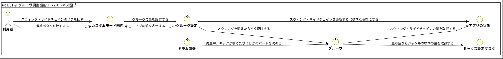

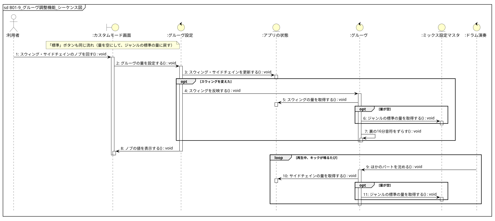

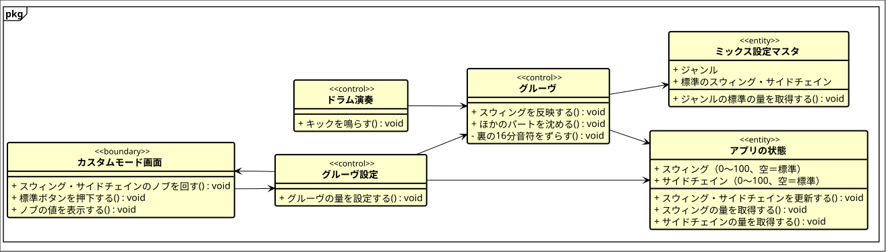

#### B01-10_Toniqシンセ音作り機能

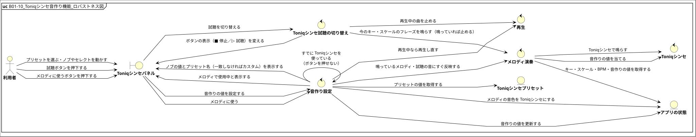

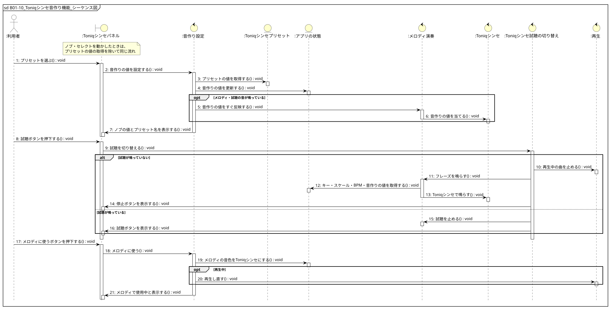

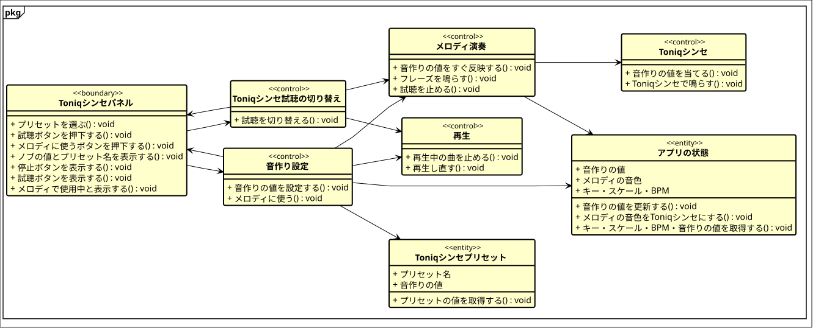

### K01_キー・スケール設定システム

#### K01-1_キー音選択機能

#### K01-2_スケール選択機能

#### K01-3_キー・スケール試聴機能

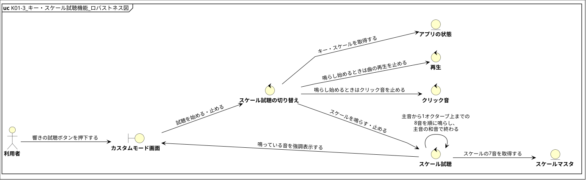

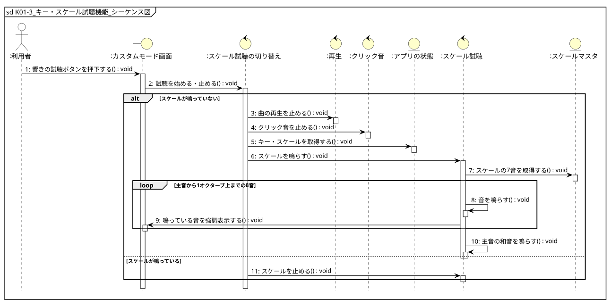

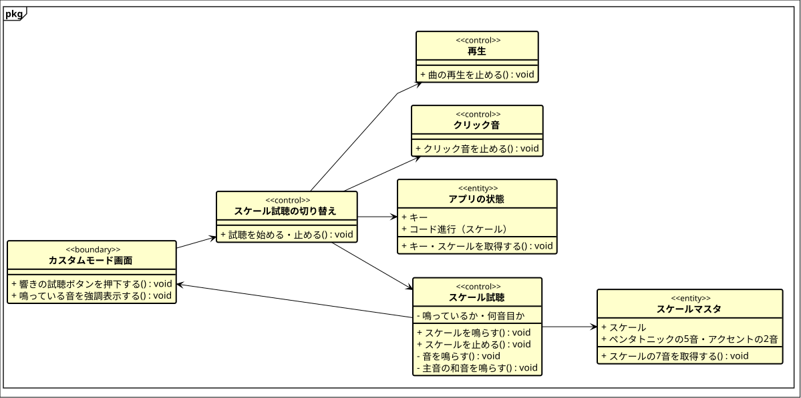

### C01_コード進行設定システム

#### C01-1_コード進行カテゴリ選択機能

#### C01-2_雰囲気選択機能

#### C01-3_コード進行選択機能

#### C01-4_コード進行リズム選択機能

#### C01-5_コード進行試聴機能

#### C01-6_コード音色選択機能

#### C01-7_サビ進行選択機能

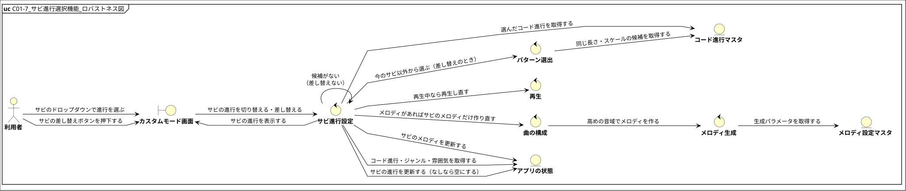

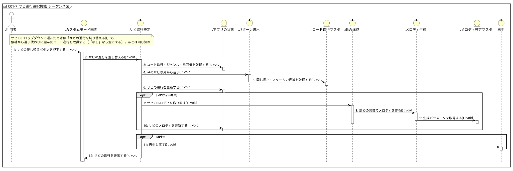

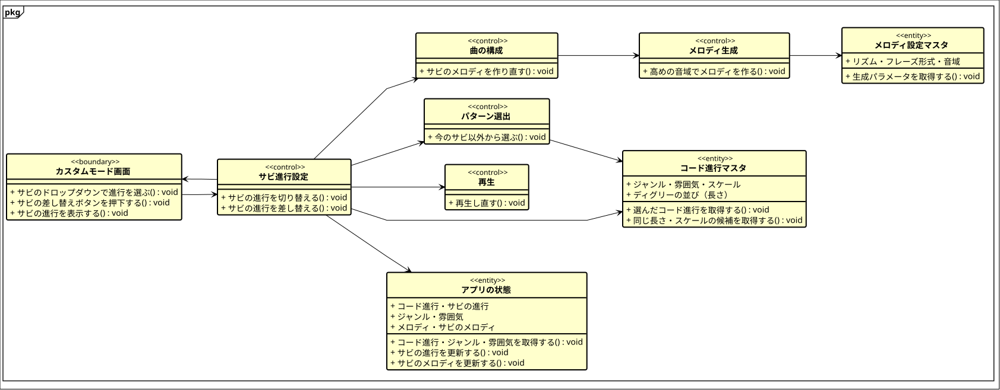

### D01_ドラム設定システム

#### D01-1_ドラムカテゴリ選択機能

#### D01-2_ドラムパターン選択機能

#### D01-3_ドラム試聴機能

### S01_特殊音設定システム

#### S01-1_特殊音選択機能

### P01_メロディ編集システム

#### P01-1_メロディ入力機能

#### P01-2_スケールロック機能

#### P01-3_ノーツ選択機能

### A01_アレンジ・書き出しシステム

#### A01-1_パート配置機能

#### A01-2_パート別音量調節機能

#### A01-3_MIDIエクスポート機能

#### A01-4_MP3エクスポート機能

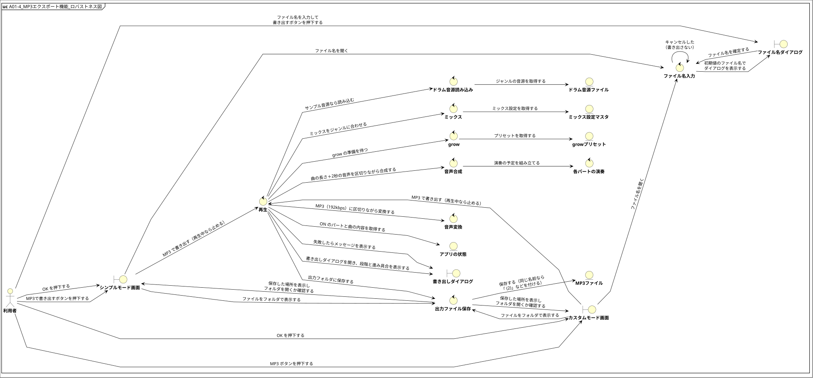

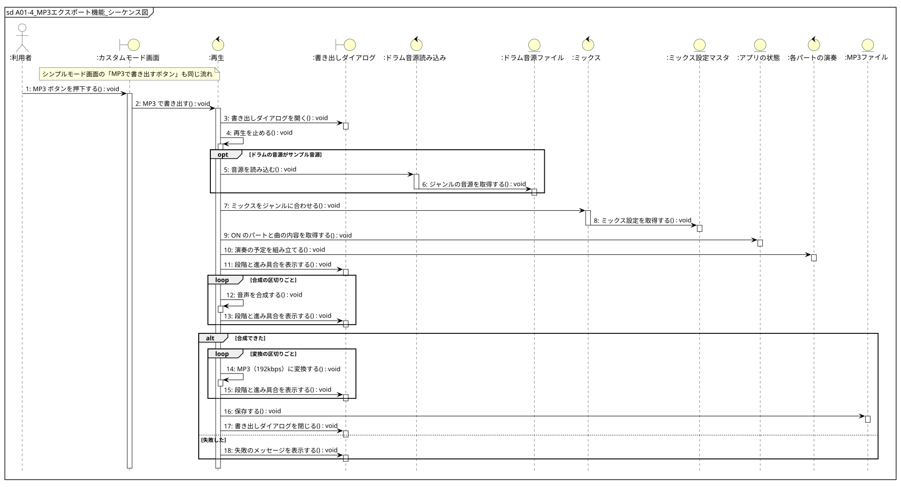

#### A01-5_WAVエクスポート機能

#### A01-6_再生開始位置選択機能

#### A01-7_セクション切替機能

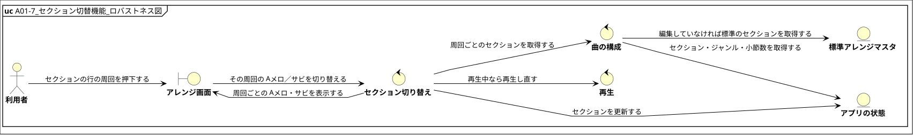

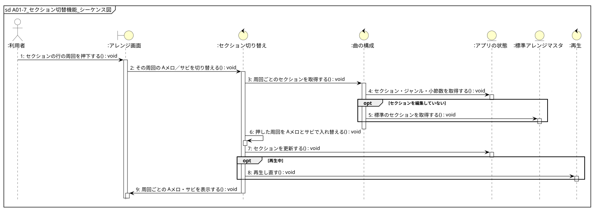

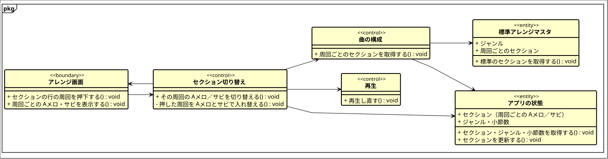

#### A01-8_テスト中の機能切替機能

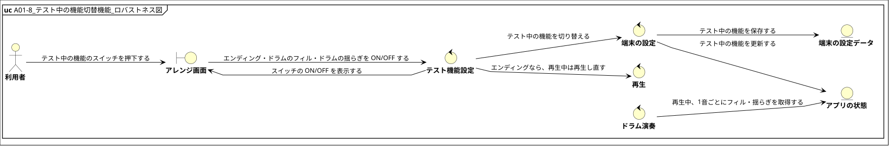

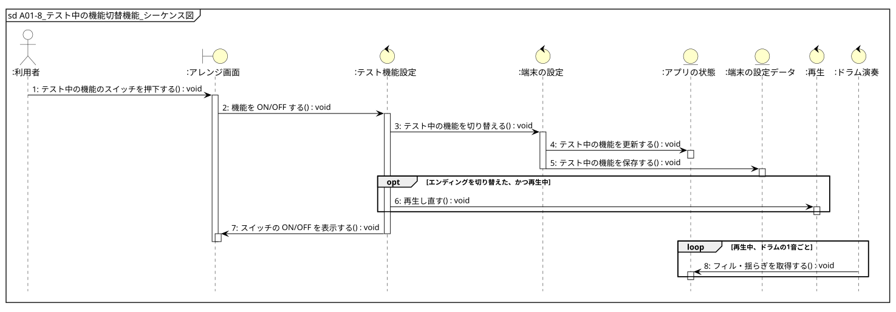

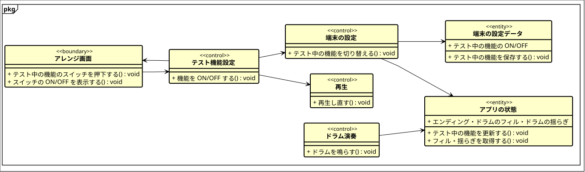

#### A01-9_自動チェック機能

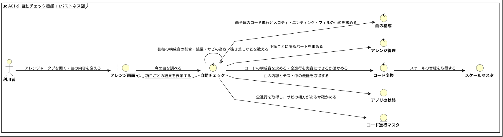

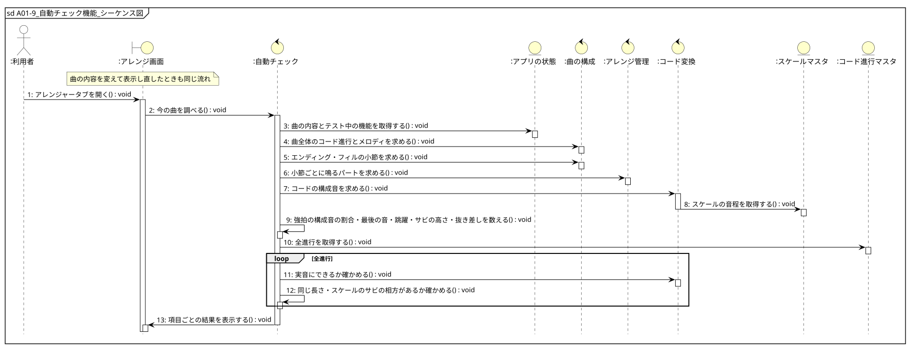

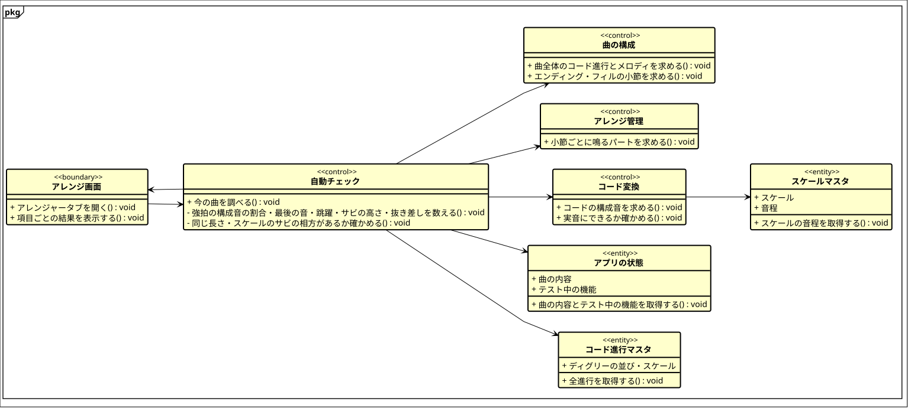

### L01_楽曲再生システム

#### L01-1_楽曲再生機能

### Q01_音楽クイズシステム

#### Q01-1_音楽クイズ機能

### G01_自動作曲システム

#### G01-1_楽曲生成機能

### M01_楽曲管理システム

#### M01-1_楽曲保存機能

#### M01-2_新規作成機能

#### M01-3_楽曲検索機能

#### M01-4_楽曲を開く機能

#### M01-5_楽曲情報変更機能

#### M01-6_楽曲削除機能

#### M01-7_曲ファイル書き出し機能

#### M01-8_曲ファイル読み込み機能

### H01_操作履歴システム

#### H01-1_元に戻す・やり直す機能

### U01_環境設定システム

#### U01-1_配色選択機能

#### U01-2_スキン選択機能

#### U01-3_音名表記選択機能

#### U01-4_ループ再生切替機能

#### U01-5_ドラム音源選択機能

#### U01-6_用語ツールチップ切替機能

#### U01-7_Toniqシンセ切替機能

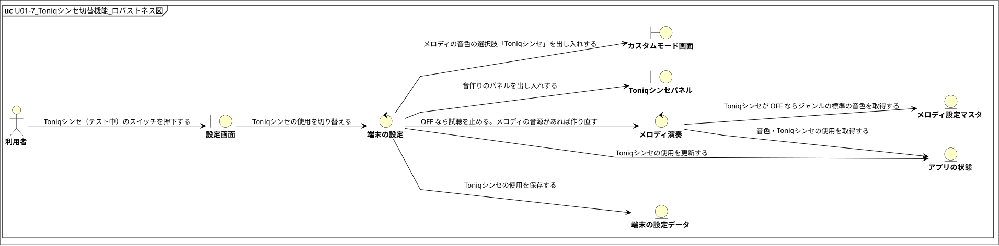

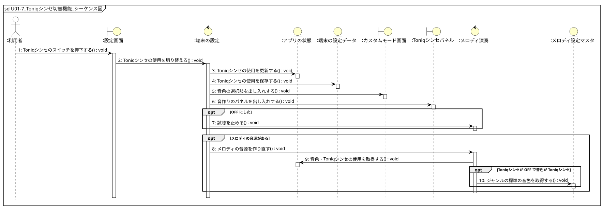

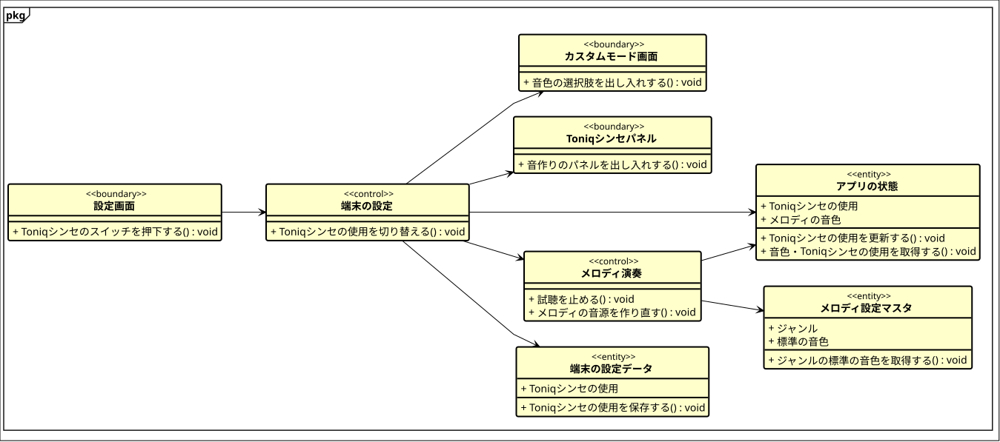

## 10. 画面設計

「アレンジャー」「ピアノロール」「生成後」は独立した画面ではなく、モード画面の中のタブや表示の切り替えとして実装している。

画面IDは「画面の略称（英字）-3桁の番号」とする（例：`MENU-001` メニュー画面）。番号は一度付けたら変えず、使い回さない。元の画面一覧にあった 007 カスタムモード生成後画面・008 書き出し完了画面は、実装に画面がないため一覧から外した（2026-11-05）。007・008 は欠番とする。

### 10.1 画面一覧

利用部門は、その画面を使う人を示す。本システムの利用者は1種類（アクター「利用者」）のため、すべての画面で「利用者」とする。機能IDは、その画面で操作する機能を枝番まで示す（番号が続く機能は「〜」でまとめる）。

| 画面ID | 画面名 | 使用目的 | 利用部門 | 機能ID |
|---|---|---|---|---|
| MENU-001 | メニュー画面 | 起動時に表示し、モードや機能を選ぶ（6枚のカード） | 利用者 | M01-10 |
| SIMPLE-002 | シンプルモード画面 | ジャンル・雰囲気・テンポを選んで楽曲を生成する | 利用者 | B01-2〜B01-4, B01-6, B01-7, C01-2, L01-1, G01-1, M01-1, M01-2, M01-9, H01-1 |
| CUSTOM-003 | カスタムモード画面 | 楽曲の要素を細かく設定する | 利用者 | B01-1, B01-3〜B01-6, B01-8〜B01-10, K01-1〜K01-3, C01-1, C01-3〜C01-7, D01-1〜D01-3, S01-1, P01-2, A01-3〜A01-5, L01-1, M01-1, M01-2, M01-9, H01-1 |
| ARRANGE-004 | アレンジ画面 | パートの配置・セクション・再生開始位置・音量を編集する | 利用者 | C01-3, D01-2, A01-1〜A01-9, L01-1, G01-1 |
| PIANO-005 | ピアノロール画面 | メロディを入力・編集する | 利用者 | P01-1〜P01-3 |
| RESULT-006 | シンプルモード生成後画面 | 生成結果の再生・差し替え・書き出し | 利用者 | C01-3, D01-2, A01-3〜A01-5, L01-1, G01-1, M01-1, M01-2, M01-9, H01-1 |
| LIST-009 | ミュージックリスト画面 | 保存した曲の一覧・再生・管理 | 利用者 | L01-1, M01-3〜M01-8, M01-10, M01-11 |
| QUIZ-010 | 音楽クイズ画面 | 音楽の知識をクイズ形式で学ぶ | 利用者 | Q01-1, U01-3 |
| SETTING-011 | 設定画面（追加） | 見た目・音名・再生の設定、見ただけではわかりにくい操作のヘルプ | 利用者 | U01-1〜U01-6 |

### 10.2 画面遷移図

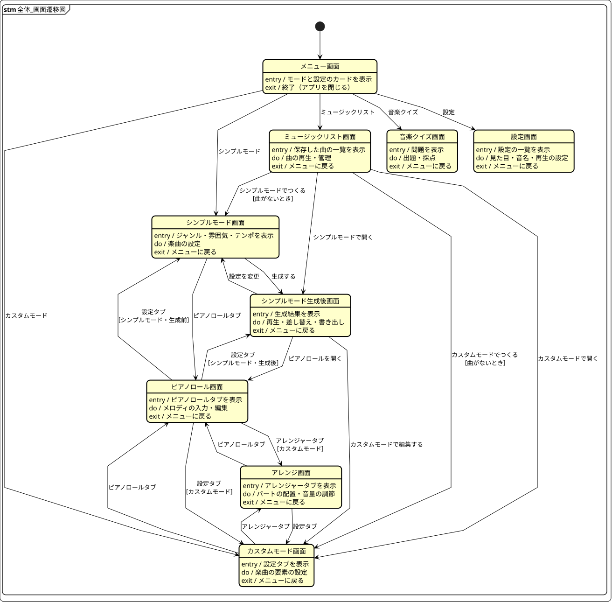

遷移の条件：

- MENU-001 → 各画面：メニューのカード。各画面 → MENU-001：上部のパンくずの「メニューに戻る」。
- SIMPLE-002 → RESULT-006：「✦ 生成する」。RESULT-006 → SIMPLE-002：「‹ 設定を変更」。
- RESULT-006 → CUSTOM-003：「☰ カスタムモードで編集する」（シンプルモードの値を引き継ぐ）。
- 各モード画面 ⇄ ARRANGE-004・PIANO-005：タブ（設定／アレンジャー／ピアノロール。シンプルモードは設定／ピアノロール）。RESULT-006 の「ピアノロールを開く」でも PIANO-005 へ。
- LIST-009 → RESULT-006／CUSTOM-003：曲の「○○モードで開く」。曲がないときの「シンプルモードでつくる」「カスタムモードでつくる」。
- MENU-001・LIST-009 → RESULT-006／CUSTOM-003：「作業ファイルを開く」で作業ファイルを開いたとき（作業ファイルに保存したモードの画面。シンプルモードは生成後の画面）。

### 10.3 画面定義

#### 10.3.1 画面レイアウト

（スクリーンショットは未作成）

#### 10.3.2 画面項目定義

画面ごとの表に、項目を1行ずつ示す。No は表ごとの項目の連番とする。複数の画面に出る項目は「共通」の表にまとめる。「操作時の挙動」には、操作したときに働く機能の機能ID、または移る先の画面IDを書く。

**共通（複数の画面に出る項目）**

| No | 項目 | 種類 | 値・表示条件 | 操作時の挙動 |
|---|---|---|---|---|
| 1 | メニューに戻る | パンくず | MENU-001 以外のすべての画面に表示 | MENU-001 へ |
| 2 | 元に戻す | ボタン | SIMPLE-002・CUSTOM-003 の情報バー。戻せないときは無効 | H01-1 |
| 3 | やり直す | ボタン | SIMPLE-002・CUSTOM-003 の情報バー。やり直せないときは無効 | H01-1 |
| 4 | 新規作成 | ボタン | SIMPLE-002・CUSTOM-003 の情報バー | M01-2 |
| 5 | 保存 | ボタン | SIMPLE-002・CUSTOM-003 の情報バー。リストの曲なら「上書き保存」 | M01-1 |
| 6 | 作業ファイル | ボタン | SIMPLE-002・CUSTOM-003 の情報バー。「⇩ 作業ファイル」 | M01-9 |
| 7 | 停止 | ボタン | SIMPLE-002・CUSTOM-003 の情報バー | L01-1 |
| 8 | 再生 | ボタン | SIMPLE-002・CUSTOM-003 の情報バー。再生中は「↺ 最初から」 | L01-1 |

**MENU-001 メニュー画面**

| No | 項目 | 種類 | 値・表示条件 | 操作時の挙動 |
|---|---|---|---|---|
| 1 | シンプルモード | カード（ボタン） | ― | SIMPLE-002 へ |
| 2 | カスタムモード | カード（ボタン） | ― | CUSTOM-003 へ |
| 3 | ミュージックリスト | カード（ボタン） | ― | LIST-009 へ |
| 4 | 音楽クイズ | カード（ボタン） | ― | QUIZ-010 へ |
| 5 | 作業ファイルを開く | カード（ボタン） | 横長 | M01-10（RESULT-006／CUSTOM-003 へ） |
| 6 | 設定 | カード（ボタン） | 横長 | SETTING-011 へ |

**SIMPLE-002 シンプルモード画面**

| No | 項目 | 種類 | 値・表示条件 | 操作時の挙動 |
|---|---|---|---|---|
| 1 | 情報バー | 表示 | BPM（プリセット名）・ジャンル・雰囲気 | ― |
| 2 | 雰囲気 | チップ5 | 初期：明るい | C01-2 |
| 3 | ジャンル | チップ8 | 初期：EDM。選んでいる雰囲気に合うジャンルだけを表示し、「「○○」に合うジャンル」と添える | B01-6 |
| 4 | ジャンルのサンプルを聴く | ボタン＋説明 | 選んだジャンルの一言の説明を併記（説明の中の用語にツールチップ） | B01-7 |
| 5 | テンポ | チップ3 | 初期：普通。BPM値を併記 | B01-2 |
| 6 | タップ | ボタン | ― | B01-3 |
| 7 | クリックで試聴 | ボタン | ― | B01-4 |
| 8 | メロディの入力方法 | カード2 | 自動生成／自分で入力 | メロディの入力方法を更新 |
| 9 | 生成する | ボタン | ― | G01-1、RESULT-006 へ |

**RESULT-006 シンプルモード生成後画面**

| No | 項目 | 種類 | 値・表示条件 | 操作時の挙動 |
|---|---|---|---|---|
| 1 | 情報バー | 表示 | BPM（プリセット名）・ジャンル・雰囲気・キー・小節数 | ― |
| 2 | 設定を変更 | ボタン | ― | SIMPLE-002 へ |
| 3 | 生成された楽曲 | 波形風表示＋再生位置 | 拍ごとの棒。時間目盛り5点 | ―（実際の音声ではなく表示用） |
| 4 | メロディ差し替え | カード＋ボタン | 「自動生成 フレーズA」等 | 再生成（G01-1）／ピアノロールを開く（PIANO-005 へ） |
| 5 | コード差し替え | カード＋ボタン | コード名（サビの進行があれば併記） | C01-3 |
| 6 | ドラム差し替え | カード＋ボタン | 「#番号 パターン名」 | D01-2 |
| 7 | MIDI 書き出し | ボタン | ― | A01-3 |
| 8 | WAV 書き出し | ボタン | 書き出し中に進み具合のダイアログを出す | A01-5 |
| 9 | MP3 書き出し | ボタン | 書き出し中に進み具合のダイアログを出す | A01-4 |
| 10 | もう一度生成する | ボタン | ― | G01-1 |
| 11 | カスタムモードで編集する | ボタン | シンプルモードの値を引き継ぐ | CUSTOM-003 へ |

**CUSTOM-003 カスタムモード画面**

| No | 項目 | 種類 | 値・表示条件 | 操作時の挙動 |
|---|---|---|---|---|
| 1 | 情報バー | 表示 | BPM・キー・拍子・小節・周回（再生中） | ― |
| 2 | BPM | ノブ | 40〜220 | B01-1 |
| 3 | タップ | ボタン | ― | B01-3 |
| 4 | 試聴（BPM） | ボタン | ― | B01-4 |
| 5 | 拍子 | ドロップダウン | 4/4 のみ（3/4 は準備中） | ― |
| 6 | 小節数 | ドロップダウン | ― | B01-5 |
| 7 | ジャンル | ドロップダウン | ― | B01-6 |
| 8 | インスト（メロディの音色） | ドロップダウン | grow／ジャンルに合わせる／8種の音色。初期：grow | B01-8 |
| 9 | スウィング | ノブ | 0〜100。初期：ジャンルの標準 | B01-9 |
| 10 | サイドチェイン | ノブ | 0〜100。初期：ジャンルの標準 | B01-9 |
| 11 | 標準（グルーヴ） | ボタン | ジャンルの標準に戻す | B01-9 |
| 12 | ルート音 | ドロップダウン | ― | K01-1 |
| 13 | スケール | ドロップダウン | ― | K01-2 |
| 14 | スケールロック | スイッチ | 初期：有効 | P01-2 |
| 15 | 響き | スケールの音名＋試聴ボタン | 鳴っている音を強調 | K01-3 |
| 16 | コード進行カテゴリ | ドロップダウン | ― | C01-1 |
| 17 | コード進行 | ドロップダウン（◀▶） | 「コード名（進行名）」 | C01-3 |
| 18 | 試聴（コード進行） | ボタン | ― | C01-5 |
| 19 | サビ | ドロップダウン＋差し替えボタン | 「なし（Aメロと同じ進行）」と、同じ長さ・スケールの進行 | C01-7 |
| 20 | リズム | ドロップダウン | ― | C01-4 |
| 21 | 音色（コード） | ドロップダウン | ジャンルに合わせる（標準のプリセット名）／grow のプリセット8種。初期：ジャンルに合わせる | C01-6 |
| 22 | ドラムカテゴリ | ドロップダウン | ― | D01-1 |
| 23 | ドラムパターン | ドロップダウン（◀▶） | ― | D01-2 |
| 24 | 試聴（ドラム） | ボタン | ― | D01-3 |
| 25 | FX / SE | ドロップダウン＋試聴ボタン | 初期：ジャンルの標準 | S01-1 |
| 26 | パッド | ON/OFF ボタン | 初期：ON | S01-1 |
| 27 | アルペジオ | ON/OFF ボタン | 初期：ON | S01-1 |
| 28 | シグネチャー | ON/OFF ボタン | 初期：ON | S01-1 |
| 29 | MIDI 書き出し | ボタン | ― | A01-3 |
| 30 | WAV 書き出し | ボタン | 書き出し中に進み具合のダイアログを出す | A01-5 |
| 31 | MP3 書き出し | ボタン | 書き出し中に進み具合のダイアログを出す | A01-4 |
| 32 | 対象（grow） | ドロップダウン | grow のパネル（テスト中。いつも表示）。コード／ベース／パッド／アルペジオ／シグネチャー（メロディは音色が grow のときだけ） | B01-10 |
| 33 | プリセット（grow） | ドロップダウン | grow のプリセット（メロディ以外は「ジャンルの標準（プリセット名）」も） | B01-10 |
| 34 | プリセットに戻す | ボタン | 値を変えていないときは無効。変えているときは「プリセットから変更しています」と表示 | B01-10 |
| 35 | 音作りのつまみ | つまみ・セレクト・チェック | モジュールごとに並べる（並び・名前・範囲は grow から読む）。grow を読み込めないときは出さず、その旨を表示 | B01-10 |

**ARRANGE-004 アレンジ画面**

| No | 項目 | 種類 | 値・表示条件 | 操作時の挙動 |
|---|---|---|---|---|
| 1 | 小節の目盛り | クリック | 再生開始位置を表示 | A01-6 |
| 2 | 再生位置の時間 | 表示 | 「再生位置 / 曲全体の長さ」（分:秒.1/100秒） | L01-1 |
| 3 | セクションの行 | 周回ごとのボタン | Aメロ／サビ。サビの進行の番号を併記 | A01-7 |
| 4 | タイムライン | パートごとのレーン＋ブロック | ドラム・FX のブロックはパターン／種類を選べる | A01-1 |
| 5 | 先頭へ | ボタン | ― | A01-6 |
| 6 | 標準に戻す | ボタン | ― | A01-1 |
| 7 | エンディング | スイッチ | 初期：ON | A01-8 |
| 8 | ドラムのフィル | スイッチ | 初期：ON | A01-8 |
| 9 | ドラムの揺らぎ | スイッチ | 初期：ON | A01-8 |
| 10 | 自動チェック | 表示 | 項目ごとの結果 | A01-9 |
| 11 | ミキサー | フェーダー8本＋ON ボタン＋メーター＋マスター | OFF のパートはグレー | A01-2 |
| 12 | コードの差し替え | ボタン | ― | C01-3 |
| 13 | ドラムの差し替え | ボタン | ― | D01-2 |
| 14 | メロディの差し替え | ボタン | ― | G01-1 |
| 15 | MIDI 書き出し | ボタン | ― | A01-3 |
| 16 | WAV 書き出し | ボタン | 書き出し中に進み具合のダイアログを出す | A01-5 |
| 17 | MP3 書き出し | ボタン | 書き出し中に進み具合のダイアログを出す | A01-4 |
| 18 | スペースキー | キー操作 | 再生開始位置から再生／停止。文字の入力欄・ドロップダウンの操作中とダイアログの表示中は効かない | L01-1 |

**PIANO-005 ピアノロール画面**

| No | 項目 | 種類 | 値・表示条件 | 操作時の挙動 |
|---|---|---|---|---|
| 1 | 編集するセクション | ボタン2 | Aメロ／サビ | P01-1 |
| 2 | 音符長 | ボタン群 | ― | P01-1 |
| 3 | スケールロック | ボタン | ― | P01-2 |
| 4 | オクターブ | ボタン | ― | P01-1 |
| 5 | 自動生成 | ボタン | Aメロとサビを作り直す | P01-1 |
| 6 | クリア | ボタン | ― | P01-1 |
| 7 | 鍵盤・グリッド | クリック・ドラッグ | C3〜C7、コード進行1周分 | P01-1・P01-3 |
| 8 | ステータスバー | 表示 | ロック・キー・音符長・オクターブ・操作キー | ― |

**LIST-009 ミュージックリスト画面**

| No | 項目 | 種類 | 値・表示条件 | 操作時の挙動 |
|---|---|---|---|---|
| 1 | 検索 | 入力欄 | ― | M01-3 |
| 2 | 並び替え | ボタン | ― | M01-3 |
| 3 | お気に入り | ボタン | ― | M01-3 |
| 4 | ファイルを読み込む | ボタン | ― | M01-8 |
| 5 | すべて書き出す | ボタン | ― | M01-7 |
| 6 | 作業ファイルを開く | ボタン | ― | M01-10 |
| 7 | 出力フォルダ | ボタン | アプリ（Electron）で起動したときだけ表示 | M01-11 |
| 8 | ジャンルの絞り込み | チップ9 | すべて＋8ジャンル | M01-3 |
| 9 | 曲の一覧 | リスト | 再生・曲名・長さ・日付・☆・⋮。曲がないときは作成への案内 | L01-1・M01-4〜M01-7 |

**QUIZ-010 音楽クイズ画面**

| No | 項目 | 種類 | 値・表示条件 | 操作時の挙動 |
|---|---|---|---|---|
| 1 | カテゴリ | チップ4 | ― | Q01-1 |
| 2 | 音名の表記 | ボタン2 | CDE／ドレミ | U01-3 |
| 3 | 出題モード | タブ | カテゴリごと | Q01-1 |
| 4 | 問題・音・回答・正誤・解説・次の問題 | 表示＋ボタン | 成績（正解・連続）を表示 | Q01-1 |
| 5 | 出題設定 | チェック | モードごと | Q01-1 |

**SETTING-011 設定画面**

| No | 項目 | 種類 | 値・表示条件 | 操作時の挙動 |
|---|---|---|---|---|
| 1 | 配色 | チップ3 | ライト／ダーク／OS に合わせる | U01-1 |
| 2 | スキン | チップ4 | デフォルト／フラット／スタジオ／ポップ | U01-2 |
| 3 | 音名の表記 | チップ2 | CDE／ドレミ | U01-3 |
| 4 | ループ再生 | スイッチ | ― | U01-4 |
| 5 | ドラムの音源 | チップ3 | grow／シンセ／サンプル音源。初期：grow | U01-5 |
| 6 | 用語の説明 | スイッチ | ― | U01-6 |
| 7 | ヘルプ | 開閉式の説明8つ | ピアノロール・アレンジャー・ノブ／フェーダー・テンポ・元に戻す・保存の種類・試聴・テスト中の機能の操作の説明 | ―（開く・閉じるだけ） |

## 11. 帳票設計

印刷する帳票はない。本システムが出力するファイルを帳票として扱う。アプリ（Electron）では出力フォルダ（output/）の audio（WAV・MP3）・midi（MIDI）・projects（作業ファイル）に保存し、ブラウザで開いたときはダウンロードにする。

| 帳票ID | 帳票名 | 使用目的 | 機能ID | 入出力区分 |
|---|---|---|---|---|
| R01 | MIDIファイル（.mid） | DAW での編集用。Melody／Chord／Pad／Arpeggio／Bass／Drums の6トラック、テンポ、4/4、曲全体 | A01-3 | 出力 |
| R02 | WAVファイル（.wav） | 試聴・配布用の音声（16bit PCM ステレオ、曲の長さ＋2秒） | A01-5 | 出力 |
| R03 | MP3ファイル（.mp3） | WAV の圧縮版（192kbps） | A01-4 | 出力 |
| R04 | 曲ファイル（.toniq.json）（追加） | 曲のバックアップ・持ち運び。`{ format: "toniq-song", version, exportedAt, songs[] }`（version は 2。1 の形式も読める） | M01-7・M01-8 | 入出力 |
| R05 | 作業ファイル（.toniq.json）（追加） | 今の曲1曲分を保存し、あとで開いて続きを編集する。形式は曲ファイルと同じ（songs が1曲） | M01-9・M01-10 | 入出力 |

## 12. データベース設計

RDB は使わず、アプリに同梱した読み取り専用の JSON ファイルをテーブル（マスタ）として扱う。利用者が作った曲と端末の設定は localStorage に保存する。

### 12.1 テーブル定義

件数は、各テーブルに入っているデータ（1件）の数で、括弧の中に何を1件と数えたかを書く。

| ID | 名称（図での名前） | 実体 | 件数 | 主な項目 |
|---|---|---|---|---|
| T01 | コード進行マスタ | chord_progressions.json | 61（コード進行の数） | id, name, mood[], genre[], bpm_range{min,max}, base_scale, length_bars（2/4/8）, progression[{bar, degree, type, inversion, duration_bars}], chord_rhythm, notes |
| T02 | ドラムパターンマスタ | drum_patterns.json | 42（ドラムパターンの数） | id, name, genre[], mood[], bpm_range, steps（16）, step_unit（16n）, tracks{kick, snare, hihat_closed, hihat_open, clap, rim → pattern[16], velocity[16], note} |
| T03 | シンプルモード表マスタ | easy_mode_table.json | 40（ジャンル8×雰囲気5の組み合わせの数） | ジャンル→雰囲気→{bpm, chord_ids[], drum_ids[]} |
| T04 | テンポマスタ | tempo_presets.json | 8（ジャンルの数） | ジャンル→{ゆっくり, 普通, 速い} の BPM |
| T05 | メロディ設定マスタ | melody_params.json | 8（ジャンルの数） | ジャンル→{rhythmPatterns[], chorusRhythmPatterns[], phraseForms[], maxLeap, preferStepwise, octaveRange, accentProbability, instrument} |
| T06 | ミックス設定マスタ | mix_presets.json | 8（ジャンルの数） | ジャンル→{reverb, eq, compressor, limiter, gain, swing, sidechain} |
| T07 | ベース設定マスタ（追加） | bass_params.json | 8（ジャンルの数） | ジャンル→{patterns[], fill, octaveShift, synth} |
| T08 | アルペジオ設定マスタ（追加） | arp_params.json | 8（ジャンルの数） | ジャンル→{instrument, step, pattern, octaves, gate, cutoff, delay} |
| T09 | 楽曲データ（追加） | localStorage `toniq.songs` | 可変（保存した曲の数） | id, name, favorite, createdAt, updatedAt ＋曲の内容（mode, genre, mood, key, bpm, tempoPreset, bars, chordPattern, drumPattern, melodyNotes, chorusPattern, chorusMelodyNotes, sections, melodyMethod, melodyVersion, melodyInstrument, chordRhythm, chordInstrument, fxType, swing, sidechain, scaleLock, drumCategory, growPreset, growParams, growChordPreset, growChordParams, growSounds, arrangement, parts, volumes） |
| T10 | 端末の設定データ（追加） | localStorage `toniq.theme` / `toniq.skin` / `toniq.noteNames` / `toniq.loop` / `toniq.drumSource` / `toniq.tooltips` / `toniq.test.ending` / `toniq.test.drumFill` / `toniq.test.drumHumanize` | 9（設定の保存キーの数） | 各設定の値（テスト中の機能は on／off） |
| T11 | grow プリセット（追加） | public/grow/grow.wasm（grow のコア grow/core/GrowPresets.cpp の表をビルドしたもの） | 50（プリセットの数。初期化を除く） | id, 名前, パラメーターの値。パラメーターの表（ID・名前・範囲・表示）もコアが持つ |

### 12.2 ER図

（図は未作成）

- T03 の chord_ids → T01.id、drum_ids → T02.id（多対多）。
- T03・T04・T05・T06・T07・T08 はジャンル名をキーに 1 対 1。
- T09 の growPreset・growChordPreset・growSounds の preset → T11.id（null はジャンルの標準）。
- T09 は T01・T02 の内容を1件ずつ複製して持つ（id の参照ではなく、進行・パターンそのものを保存する）。サビの進行（chorusPattern）も T01 の1件の複製。

## 13. コード設計

### 13.1 業務コード

業務コードは、楽曲データやマスタの1件を一意に決めるために、データ（JSON・localStorage）の側で管理する値である。同じ値を指定すれば、必ず同じデータが決まる。

| ID種別 | 説明 | コード体系 | 備考 |
|---|---|---|---|
| コード進行ID | T01 の主キー。1つのコード進行（ディグリーの並び・スケール・長さなど）が決まる | chord_ + 3桁連番（chord_001〜chord_061） | 画面では「#番号」で表示。T03 の chord_ids から参照する |
| ドラムパターンID | T02 の主キー。1つのドラムパターン（トラックごとの16ステップ）が決まる | drum_ + 3桁連番（drum_001〜drum_042） | 画面では「#番号」で表示。T03 の drum_ids、アレンジャーのドラムのブロックから参照する |
| 楽曲ID | T09 の主キー。ミュージックリストに保存した1曲が決まる | song_ ＋時刻と乱数 | 今の曲がどの曲かを AppState.songId に持つ（null＝未保存） |
| ジャンル | T03〜T08 のキー。ジャンルごとの BPM・メロディ・ミックス・ベース・アルペジオの設定が決まる | EDM／8bit／ローファイ／ゲームBGM／テクノ／ハウス／トランス／アンビエント | 見つからないときはローファイ |
| 雰囲気 | T03 のキー。ジャンルとの組で BPM とコード進行・ドラムパターンの候補が決まる | 明るい／暗い／落ち着いた／切ない／激しい | 見つからないときは落ち着いた |
| grow プリセットID | T11 の主キー。grow の音作りのひな形1つが決まる | 英小文字と _（lead、soft_pad、drum_kick、fx_riser_noise など） | 曲には ID で保存する（以前は番号。番号で保存した曲は開くときに ID に読み替える）。今の grow にない ID はジャンルの標準（メロディは初期値の lead）で鳴らす |
| 設定キー | T10 のキー。端末の設定1つが決まる | toniq. ＋設定名（toniq.theme など） | toniq.songs は T09 の保存先 |

### 13.2 システム制御コード

システム制御コードは、プログラムが処理の進み具合や結果を判断し、利用者への通知や次の処理を決めるために使う値である。エラー番号のような数字のコードは使わず、決まった文字列の値と通知文で表す。

#### 正常処理に関するコード

| 区分 | コード（値） | 意味 | 使う機能 |
|---|---|---|---|
| 書き出しの段階 | prepare | 準備（音源・響きの用意） | A01-4・A01-5（WAV / MP3 の書き出し。進み具合のダイアログに段階の文を出す） |
| 書き出しの段階 | schedule | 演奏の予定の組み立て | 同上 |
| 書き出しの段階 | render | 音声の合成 | 同上 |
| 書き出しの段階 | encode | WAV / MP3 ファイルへの変換 | 同上 |
| 曲ファイルの読み込み結果 | added（追加した曲の数） | 「○曲をミュージックリストに追加しました。」と通知する | M01-8 |
| 出力フォルダへの保存 | 「○○」を output/audio（output/midi）フォルダに保存しました。フォルダを開きますか？ | 書き出したファイルを保存した。OK ならそのファイルをエクスプローラーで表示する | A01-3〜A01-5 |
| 保存の完了 | ✓ 保存しました | ミュージックリスト・作業ファイルに保存した（ボタンの表示） | M01-1・M01-9 |
| grow の読み込み | grow を読み込んでいます… | grow（wasm）を読み込んでいる | B01-10 |

#### 異常処理に関するコード

| 区分 | コード（通知文・値） | 原因 | 処理 |
|---|---|---|---|
| 曲ファイルの読み込み | skipped（読み込めなかった曲の数） | 鳴らすのに必要な項目（コード進行・ドラムなど）がない曲がある | その曲だけ飛ばし、「○曲は内容が足りないため読み込めませんでした。」と通知する |
| 曲ファイルの読み込み | ファイルの形式が正しくありません（JSON として読めません） | ファイルが JSON ではない | そのファイルを読み込まず、ファイル名とともに通知する。ほかのファイルは続けて読み込む |
| 曲ファイルの読み込み | Toniq の曲ファイルではありません | JSON だが曲ファイルの形式ではない | 同上 |
| 曲ファイルの読み込み | 読み込める曲がありませんでした。 | 追加できた曲が1曲もない | 通知する |
| 曲ファイルの書き出し | 書き出す曲がありません | ミュージックリストに曲がない（すべて書き出す） | 書き出さずに通知する |
| 音声の書き出し | 曲が生成されていません | コード進行・ドラムパターンが決まっていない | 「WAV（MP3）の書き出しに失敗しました。」と原因を通知する |
| 音声の書き出し | 書き出した音声が無音でした | 進み具合付きの合成がうまく動かなかった | 利用者には通知せず、進み具合なしの方法（Tone.Offline）で書き出し直す |
| 音名の変換 | Unknown scale / degree / key / chord type / note | マスタに未定義のスケール・ディグリー・コード種別などがある | コード名の表示ではその進行の名前だけを出す。再生では例外になる（パターン追加時に確認する） |
| ドラム音源の読み込み | 読み込めない音源ファイル | 音源ファイルがない・壊れている | そのトラックだけシンセで鳴らす（開発者ツールのコンソールに警告） |
| ミュージックリストの読み込み | ミュージックリストの読み込みに失敗 | localStorage の中身が壊れている | 空の一覧として表示する（コンソールにエラー） |
| ミュージックリストへの書き込み | ミュージックリストの保存容量がいっぱいです | localStorage の容量オーバー | 楽曲データを書き込む前のまま残し、「。この曲はミュージックリストに保存されていません。」（保存）・「。変更は保存されていません。」（名前の変更・お気に入り・削除）と整理の案内を通知する。保存では作業ファイルへの保存を勧める |
| ミュージックリストへの書き込み | ミュージックリストに書き込めませんでした | 容量オーバー以外の理由で localStorage に書き込めない | 同上 |
| 作業ファイルを開く | 作業ファイルを開けませんでした。（ファイルの形式が正しくありません（JSON として読めません）／Toniq の作業ファイルではありません） | 作業ファイルが JSON ではない、または曲の形式ではない | 開かずに理由を通知する（今の曲は変わらない） |
| 作業ファイルの保存 | 作業ファイルの保存に失敗しました。 | ファイルに書き込めない | 理由を通知する |
| 書き出すファイル名 | ファイル名を入力してください | ファイル名のダイアログで名前が空 | 書き出さずにダイアログに表示し、入力を待つ |
| grow の読み込み | grow の wasm（public/grow/grow.wasm）がありません。… | grow の wasm がない・読み込めない | grow のパネルにその旨を出し、メロディはジャンルの標準の音色、コードはソフトパッド、ほかのパートは Tone.js の音色で鳴らす |

### 13.3 区分コード

業務コード・システム制御コード以外で、項目が取る値（区分）を示す。

| ID種別 | 説明 | コード体系 | 備考 |
|---|---|---|---|
| テンポプリセット | テンポの段階 | ゆっくり／普通／速い／custom | custom＝タップまたはノブで指定 |
| キー | ルート音 | C, C#, D, D#, E, F, F#, G, G#, A, A#, B | ― |
| スケール | 音階 | major（25件）／minor（27件）／phrygian（4件）／dorian（5件） | 件数はコード進行マスタの件数 |
| ディグリー | コードの度数 | ローマ数字＋m（短）、頭に b（半音下） | 15種使用：I, II, IIm, III, IIIm, IV, IVm, Im, V, Vm, VIm, bII, bIII, bVI, bVII |
| コード種別 | 和音の種類 | major, minor, dim, maj7, min7, dom7 | 6種使用 |
| パート | 楽器パート | drum, chord, bass, arp, pad, signature, melody, fx | 表示名：ドラム／コード／ベース／アルペジオ／パッド／シグネチャー／メロディ／FX/SE |
| コードリズム | コードの刻み | whole／half／quarter／eighth | ― |
| コード音色 | コードの鳴らし方 | grow | いつも grow。音色は AppState.growChordPreset（grow プリセットID。null＝ジャンルの標準）。以前の soft／epiano／strings／organ／square／supersaw は、読み込むときに同じ音の grow プリセット（soft_pad／epiano／strings／organ／square／supersaw）に読み替える |
| メロディ音色 | メロディの音色 | grow／auto／supersaw／epiano／bell／square／acid／lead／pluck／soft | 初期値は grow。auto＝ジャンルの標準。grow を読み込めないときはジャンルの標準で鳴る。以前の toniq は読み込むときに auto にする |
| FX/SE の種類 | 効果音の種類 | auto／riser／build／impact／downlifter／reverse／chip | auto＝ジャンルの標準 |
| 音符長 | ピアノロールで入力する長さ | 2n／4n／8n／16n | Tone.js 表記 |
| ドラムトラック | ドラムの音の種類 | kick／snare／hihat_closed／hihat_open／clap／rim | ― |
| 画面 | 表示中の画面 | menu／simple／custom／musiclist／quiz／settings | AppState.screen |
| タブ | 画面内のタブ | settings／arranger／pianoroll | AppState.tab |
| モード | 利用中のモード | simple／custom | AppState.mode |
| メロディ入力方法 | 自動か手入力か | auto／manual | AppState.melodyMethod |
| 生成済フラグ | 生成前後の表示切替 | true／false | AppState.generated |
| 音量 | パート音量 | 0〜100 の整数 | dB に変換して使用 |
| セクション | 周回ごとの曲の部分 | A（Aメロ）／B（サビ） | AppState.sections（null＝ジャンルの標準） |
| グルーヴの量 | スウィング・サイドチェインの量 | 0〜100 の整数／null | AppState.swing／sidechain（null＝ジャンルの標準） |
| テスト中の機能 | エンディング・ドラムのフィル・ドラムの揺らぎ | true／false（保存は on／off） | AppState.endingEnabled／drumFill／drumHumanize |
| 配色 | 選び方／実際の配色 | light／dark／system ／ light／dark | AppState.themeMode／theme |
| スキン | カスタムモードの見た目 | default／flat／studio／pop | AppState.skin |
| 音名の表記 | 単音の表記 | cde／doremi | AppState.noteNames |
| ドラムの音源 | ドラムの鳴らし方 | grow／synth／sample | AppState.drumSource（初期値は grow） |
| grow の対象パート | grow のパネルで音を作るパート | melody／chord／bass／pad／arp／signature | 表示名：メロディ／コード／ベース／パッド／アルペジオ／シグネチャー（メロディは音色が grow のときだけ） |
| grow の値 | 音作りで変えた値 | パラメーターの ID → 値／null | null＝プリセットのまま。AppState.growParams（メロディ）／growChordParams（コード）／growSounds の params（ベース・パッド・アルペジオ・シグネチャー） |
| 出力先の種類 | 出力フォルダの中のフォルダ | projects／audio／midi | 作業ファイル／WAV・MP3／MIDI |
| 並び順 | ミュージックリストの並び | newest／oldest／name | AppState.musicListSort |

## 14. 性能設計

| 要求性能（目標値） | 実現方法 |
|---|---|
| 「生成する」から結果表示まで 1 秒以内 | マスタは起動時にメモリへ読み込み済み。選出とメロディ生成は数小節分の計算のみ |
| 再生中に音が途切れない・リズムがずれない | Tone.js の Transport で音を先行スケジュールする。画面更新は Tone.Draw で音と同期する |
| 音量・BPM・アレンジの変更が即座に反映される | 音量ノードと Transport の BPM を直接書き換える。アレンジは発音のたびに判定する（再生し直し不要） |
| WAV・MP3 書き出しは楽曲の実時間より短い時間で完了する。待っている間も進み具合が分かる | オフラインで実時間を待たずにレンダリングし、合成の途中で区切って進み具合を表示する。MP3 の変換も区切りながら行い、画面を止めない |
| 動作環境：一般的なノートPC | 音はシンセで作る（ドラムのサンプル音源は短いワンショットのみ）。ウィンドウ最小 800×600 |

## 15. 運用設計

### 15.1 業務内容

インストーラ（`npm run electron:build` で release/ に作成）を配布し、利用者がインストールして起動する。パターンの追加は JSON を編集して再ビルドする。grow の音（grow/core）を変えたときは `npm run grow:wasm` で grow.wasm を作り直す。

### 15.2 管理項目

- アプリのバージョン（package.json の version。現在 1.0.0）
- マスタの件数と ID
- ジャンル追加時にそろえるもの：6つの JSON（easy_mode_table・tempo_presets・melody_params・bass_params・arp_params・mix_presets。mix_presets には swing・sidechain も入れる）、LOOP_SCHEDULE（A A サビ A の4セクション）、画面のジャンル一覧、シンプルモードの雰囲気ごとのジャンル（MOOD_GENRES）とジャンルの説明、grow の標準のプリセット（コード・ベース・シグネチャー）、ドラム音源のフォルダ
- コード進行を追加するときは、サビの相方になる同じ長さ・スケールの進行があり、長さが8小節のセクションに合う（1・2・4・8 小節かその倍数）ようにする（自動チェックの「コード進行DB」で確かめられる）
- メロディ・コード進行・アレンジの生成ルールを変えたときは、一括計測（`npm run quality`）で変更の前後の合格率と多様さを比べる。変更後は自動テスト（`npm test`）を通す

### 15.3 運用体制

リーダ：根井、メンバー：西薗・小手川

### 15.4 運用スケジュール

（未記入）

## 16. 信頼性設計

| 節 | 内容 |
|---|---|
| 16.1 データバックアップ設計 | 楽曲データは利用者がミュージックリストの「すべて書き出す」で曲ファイルに保存する。今の曲は「⇩ 作業ファイル」で作業ファイルにも保存できる。書き出した MIDI／WAV／MP3 と作業ファイルは出力フォルダ（output/）にあり、利用者が管理する。マスタ（JSON）は Git で履歴管理する |
| 16.2 データリストア設計 | 楽曲データは曲ファイルを「ファイルを読み込む」で戻す。作業ファイルは「作業ファイルを開く」で今の曲として開く。マスタは Git の履歴から戻して再ビルドする |
| 16.3 システムバックアップ設計 | ソースコード一式を Git リポジトリで管理する。配布したインストーラはバージョンごとに保管する |
| 16.4 システムリストア設計 | アプリを再インストールする。不具合時は前バージョンのインストーラに戻す |

## 17. 保守設計

### 17.1 監視設計

常時監視は行わない。動作ログは開発者ツールのコンソールに日本語で出力する（周回・パート ON/OFF・音量変更・保存・書き出しエラー等）。

### 17.2 障害対応

- 利用者が不具合を報告 → 担当者が再現・修正 → リーダーが確認して新バージョンを配布する。
- WAV・MP3 書き出しの失敗はメッセージで利用者に知らせる。
- 曲の保存は localStorage の容量を超えると失敗する。そのときは保存されていないことを通知し、作業ファイルへの保存を勧める。
- grow の wasm（public/grow/grow.wasm）がないと grow の音が鳴らない（Tone.js の音色で鳴る）。grow を変えたらビルドし直して全プリセットを確かめる（`npm run grow:render`）。
- 未定義のディグリーがマスタに入ると実行時に例外になるため、パターン追加時はディグリーの定義を確認する。

---

## 付録A 名前の対応表

図で使う日本語の名前と、コードの対応。図はこの表の名前を使う。

### 画面（boundary）

| 図の名前 | コード |
|---|---|
| メニュー画面 | index.html（data-screen="menu"） |
| シンプルモード画面 | src/ui/SimpleScreen.ts |
| カスタムモード画面 | src/ui/CustomScreen.ts |
| アレンジ画面 | src/ui/ArrangerTab.ts |
| ピアノロール画面 | src/ui/PianoRollTab.ts |
| ミキサー | src/ui/MixerPanel.ts（アレンジャータブ） |
| 書き出しダイアログ | src/ui/ExportProgress.ts（WAV・MP3 の書き出しの進み具合） |
| ファイル名ダイアログ | src/ui/FileNameDialog.ts（WAV・MP3・MIDI の書き出すファイル名） |
| growパネル | src/ui/GrowPanel.ts（カスタムモードの設定タブの下） |
| ミュージックリスト画面 | src/ui/MusicListScreen.ts |
| 音楽クイズ画面 | src/ui/QuizScreen.ts |
| 設定画面 | src/ui/SettingsScreen.ts |

### 処理（control）

| 図の名前 | コード |
|---|---|
| 画面切り替え | src/ui/Router.ts |
| パターン選出 | src/engine/SimpleModeResolver.ts |
| メロディ生成 | src/engine/MelodyGenerator.ts |
| タップテンポ | src/engine/TapTempo.ts |
| クリック音 | src/engine/Metronome.ts |
| スケール試聴 | src/engine/ScalePreview.ts |
| 再生 | src/engine/Playback.ts（再生・試聴・サンプル・WAV／MP3 書き出し） |
| 音声合成 | src/engine/Playback.ts の renderSong・renderOffline（WAV／MP3 書き出しの音声を合成する） |
| 音声変換 | src/engine/Playback.ts の audioBufferToWav・audioBufferToMp3（@breezystack/lamejs） |
| パート管理 | src/engine/LayerManager.ts |
| アレンジ管理 | src/engine/LoopArranger.ts |
| 曲の構成 | src/engine/SongForm.ts（セクション・サビの進行・曲全体の並び・エンディング・フィルの小節・Aメロ／サビのメロディ生成） |
| グルーヴ | src/engine/Groove.ts（スウィング・サイドチェイン） |
| 自動チェック | src/engine/QualityCheck.ts |
| ドラム演奏 | src/engine/DrumEngine.ts |
| ドラムキット作成 | src/engine/SynthFactory.ts |
| ドラム音源読み込み | src/engine/DrumSamples.ts |
| コード演奏／ベース演奏／アルペジオ演奏／パッド演奏／シグネチャー演奏／メロディ演奏／効果音演奏 | src/engine/ChordPlayer.ts／BassPlayer.ts／ArpPlayer.ts／PadPlayer.ts／SignaturePlayer.ts／MelodyPlayer.ts／FxPlayer.ts |
| 各パートの演奏 | 上の7つと DrumEngine.ts をまとめて呼ぶとき |
| grow | src/engine/Grow.ts（wasm の読み込み・プリセットとパラメーターの表・各パートの音色 GrowInstrument・applyGrowLive）、src/engine/growWorklet.js（AudioWorklet）、grow/core（C++ のコア） |
| 音量管理 | src/engine/VolumeManager.ts |
| ミックス | src/engine/MixerEngine.ts |
| コード変換 | src/data/degree_resolver.ts（ディグリー → 実音、ボイシング） |
| MIDI書き出し | src/engine/MidiExporter.ts |
| 出力ファイル保存 | src/engine/OutputFiles.ts（saveOutput・openOutputFolder）、electron/main.ts・electron/preload.ts（出力フォルダへの保存・作業ファイルのダイアログ） |
| 曲の管理 | src/engine/SongLibrary.ts |
| 履歴管理 | src/engine/History.ts、src/ui/HistoryControls.ts |
| 端末の設定 | src/ui/Preferences.ts（音名・ループ・ドラムの音源・テスト中の機能） |
| 見た目設定 | src/ui/Theme.ts（配色・スキン） |
| 用語の説明 | src/ui/Glossary.ts |
| 画面切り替え | src/ui/Router.ts |
| クイズ出題 | src/quiz/QuizModes.ts |
| クイズの音 | src/quiz/QuizAudio.ts |

### 画面の中の処理（control）

画面のファイルの中にある、ボタンなどを押したときの処理。図ではモジュールと同じく control として描く。

| 図の名前 | コード |
|---|---|
| BPM設定 | src/ui/CustomScreen.ts の setBpm |
| テンポ選択 | src/ui/SimpleScreen.ts のテンポのチップの処理 |
| 小節数設定 | src/ui/CustomScreen.ts の小節数の処理 |
| ジャンル設定 | src/ui/SimpleScreen.ts・CustomScreen.ts のジャンルの処理 |
| ジャンル試聴 | src/ui/SimpleScreen.ts の playGenreSample |
| 音色設定 | src/ui/CustomScreen.ts のメロディの音色の処理 |
| グルーヴ設定 | src/ui/CustomScreen.ts の setGroove |
| キー設定・スケール設定 | src/ui/CustomScreen.ts のルート音・スケールの処理 |
| スケール試聴の切り替え | src/ui/CustomScreen.ts の「響き」の試聴ボタンの処理 |
| カテゴリ設定・コード進行設定・リズム設定・コード音色設定 | src/ui/CustomScreen.ts のコード進行の処理（シンプルモードの再抽選は SimpleScreen.ts） |
| サビ進行設定 | src/ui/CustomScreen.ts の setChorusPattern・サビの差し替えの処理 |
| 雰囲気選択 | src/ui/SimpleScreen.ts の雰囲気のチップの処理 |
| ドラムカテゴリ設定・ドラムパターン設定 | src/ui/CustomScreen.ts のドラムの処理（シンプルモードの再抽選は SimpleScreen.ts） |
| FX設定 | src/ui/CustomScreen.ts の FX / SE の処理 |
| 音作り設定 | src/ui/GrowPanel.ts（対象・プリセット・つまみ・「プリセットに戻す」の処理） |
| ファイル名入力 | src/ui/FileNameDialog.ts の askFileName |
| 音符編集・スケール判定 | src/ui/PianoRollTab.ts（音の配置・移動・削除と、スケールロックの判定） |
| スケールロック設定 | src/ui/PianoRollTab.ts・CustomScreen.ts のスケールロックの処理 |
| ブロック編集・再生開始位置設定 | src/ui/ArrangerTab.ts |
| セクション切り替え・テスト機能設定 | src/ui/ArrangerTab.ts（セクションの行・テスト中の機能のスイッチ） |
| 楽曲生成 | src/ui/SimpleScreen.ts の generate |
| メロディ再生成 | src/ui/CustomScreen.ts のメロディの差し替えの処理 |
| 楽曲切り替え・楽曲の絞り込み・楽曲削除・曲ファイル書き出し・曲ファイル読み込み・新規作成 | src/ui/MusicListScreen.ts |
| 作業ファイル保存・作業ファイルを開く・出力フォルダを開く | src/ui/ProjectFileControls.ts |
| 採点 | src/ui/QuizScreen.ts の finish |

### データ（entity）

| 図の名前 | コード |
|---|---|
| アプリの状態 | src/engine/AppState.ts |
| コード進行マスタ | src/data/chord_progressions.json |
| ドラムパターンマスタ | src/data/drum_patterns.json |
| シンプルモード表マスタ | src/data/easy_mode_table.json |
| テンポマスタ | src/data/tempo_presets.json |
| メロディ設定マスタ | src/data/melody_params.json |
| ベース設定マスタ | src/data/bass_params.json |
| アルペジオ設定マスタ | src/data/arp_params.json |
| ミックス設定マスタ | src/data/mix_presets.json |
| スケールマスタ | src/data/degree_resolver.ts の SCALE_INTERVALS・SCALE_TONES |
| 標準アレンジマスタ | src/engine/LoopArranger.ts の LOOP_SCHEDULE |
| growプリセット | public/grow/grow.wasm（grow/core/GrowPresets.cpp） |
| クイズ問題マスタ | src/quiz/QuizModes.ts の QUIZ_CATEGORIES |
| ドラム音源ファイル | public/samples/drums/ |
| 楽曲データ | localStorage `toniq.songs` |
| 端末の設定データ | localStorage `toniq.theme` ほか |
| MIDIファイル／WAVファイル／MP3ファイル／曲ファイル／作業ファイル | 書き出すファイル（MIDI・WAV・MP3・作業ファイルは出力フォルダ output/ に保存） |

## 付録B 未決事項

| 項目 | 内容 |
|---|---|
| 更新の間隔 | main へのマージごとか、週1回などか |
| テスト中の機能 | A01-8 テスト中の機能切替・A01-9 自動チェック（聴き比べ用）、U01-5 ドラム音源選択、B01-10 grow音作り（暫定のパネル。最終的にはプリセットを選ぶだけにする予定）を設計書に載せるか |

## 付録C 更新履歴

「図への反映」は、その変更に合わせて図を直す必要があるか（`要：<機能ID・図名>` / `済（日付）` / `不要`）。`/update-spec` が書き、`/update-diagrams` が `済` にする。

| 日付 | 基準のコード | 内容 | 図への反映 |
|---|---|---|---|
| 2026-11-05 | main `2f029f0` | 初版。機能IDを付け、機能一覧にない実装済みの機能（M01・H01・U01、C01-6、A01-6）を追加 | 済（2026-11-05） |
| 2026-11-05 | main `2f029f0` | 007・008 画面を画面一覧から外す。ユースケース図（11枚）と B01 の図（24枚）を作成。名前の対応表に「画面の中の処理」を追加 | 済（2026-11-05） |
| 2026-11-05 | main `2f029f0` | 追加した機能（M01・H01・U01・C01-6・A01-6）を機能一覧に入れることを決定。実装済みの全46機能の図と全体のクラス図、M01・H01・U01 のユースケース図を作成。図での AppState の名前を「曲の状態」から「アプリの状態」に変更 | 済（2026-11-05） |
| 2026-11-10 | main `5087e9d` | K01-3 キー・スケール試聴・A01-4 MP3エクスポートが実装済みに。機能を追加（B01-9 グルーヴ調整、C01-7 サビ進行選択、A01-7 セクション切替、A01-8 テスト中の機能切替、A01-9 自動チェック）。曲の構成（Aメロ／サビ・エンディング・ドラムのフィル）、MIDI 書き出しの曲全体・6トラック化、WAV・MP3 の進み具合のダイアログ、ミキサーをアレンジャーだけに、スキンの切り替えを設定画面だけに、パッドの初期値 OFF、アレンジャーの再生位置の時間を反映。マスタの件数（コード進行 45・ドラム 42）、保存する項目、名前の対応表を更新。付録B の「未実装の機能」は解決したので削除。付録B に「テスト中の機能」を追加 | 済（2026-11-10） |
| 2026-11-10 | main `5087e9d` | 図の章の位置を、作成済みの docx（`作成ファイル/04_2026_卒研_基本設計書(R4SA_アプリオリ)_仕様書から作成.docx`）と同じ形に決定（5章 機能設計と 10章 画面設計の間に、6 ユースケース図・7 ロバストネス図・8 シーケンス図・9 クラス図）。先頭の注記を直し、付録B の「図の章」を削除 | 不要 |
| 2026-11-11 | main `5087e9d` | 書き方の変更（コードの変更なし）。5.1 機能一覧の「状況」の列を削除、10.1 画面一覧に「利用部門」の列を追加、12.1 の件数に何を数えたかを追記、13章を 13.1 業務コード（1件を一意に決める値）・13.2 システム制御コード（正常処理／異常処理）・13.3 区分コード（それ以外の値。旧 13.1・13.2 から移動）に整理 | 不要 |
| 2026-11-11 | main `5087e9d` | 書き方の変更（コードの変更なし）。6章を「ユースケース」に改め、6.1 ユースケース図（今までの図）と 6.2 ユースケース記述（機能グループごとに、全53機能の記述の表：作成日・版数・作者・ユースケース名・概要・主アクタ・支援アクタ・事前条件・事後条件・トリガー・基本フロー・代替フロー・例外フロー・備考・注記）に分けた | 不要 |
| 2026-11-11 | main `5087e9d` | 6.2 ユースケース記述の代替フロー・例外フローを main `5087e9d` のコードで確かめ、確かめた動きを 5.2 に足した（C01-5・D01-3 試聴の押し直し、S01-1 FX/SE の試聴、P01-1 自動生成・クリアの確認、A01-9 調べるタイミング、L01-1 再生中の曲の停止・確認の取り消し、Q01-1 音のない問題、M01-2・M01-4・M01-6 確認の取り消し、M01-5 確定の操作、M01-7・M01-8 の通知、H01-1 ボタンが押せない）。6.2 を 5.2 に合わせて直した | 不要 |
| 2026-11-11 | main `c046898` | Toniq シンセ（テスト中）を反映。機能を追加（B01-10 Toniqシンセ音作り、U01-7 Toniqシンセ切替）、B01-8 リード選択に音色「Toniq シンセ」を追加。6.2 に B01-10・U01-7 の記述を追加し、B01-8 を直した（版数2）。画面項目（003・011）、楽曲データの toniqSynth、端末の設定データの toniq.test.toniqSynth（10件）、区分コード（メロディ音色の toniq、Toniq シンセの使用・プリセット・値）、名前の対応表を更新。付録B の「テスト中の機能」に U01-5・B01-10・U01-7 を追記 | 済（2026-11-11） |
| 2026-11-12 | main `c046898` | 書き方の変更（コードの変更なし）。グループIDごとにシステム名を決めた（B01 曲の基本設定システム／K01 キー・スケール設定システム／C01 コード進行設定システム／D01 ドラム設定システム／S01 特殊音設定システム／P01 メロディ編集システム／A01 アレンジ・書き出しシステム／L01 楽曲再生システム／Q01 音楽クイズシステム／G01 自動作曲システム／M01 楽曲管理システム／H01 操作履歴システム／U01 環境設定システム）。5.1 をシステムごとの表に分け、5.2・7〜9章にシステムの見出しを追加、6.1・6.2 の見出しを「グループID_システム名」に変更。10.1 の画面IDを「略称-番号」（MENU-001 など）、機能IDを枝番までに変更。10.3.2 を画面ごとの表（No を左端、1項目1行）に変更。図：ユースケース図のファイル名・枠の名前をシステム名にし、システム名を境界の外側の上に表示。A01-4・A01-5 のロバストネス図・シーケンス図・クラス図で、合成・変換を処理「音声合成」「音声変換」に分けた（付録A に追加）。ロバストネス図の自己ループのラベルを改行して重なりをなくした | 済（2026-11-12） |
| 2026-11-12 | main `c046898` | 書き方の変更（コードの変更なし）。5.1 の表の1行目と 5.2 のシステムの見出しを「グループID_システム名」に統一（6.1・6.2・7〜9章と同じ形）。10.1 画面一覧の「実装上の位置」の列を削除 | 不要 |
| 2026-11-12 | main `de538b7` | コードの変更を反映（`c046898` → `de538b7`）。Toniq シンセを内部シンセ grow（C++ / WebAssembly）に置き換え：B01-10 を「grow音作り」に改名して中身を直し（対象のパート・プリセット・つまみ）、U01-7 Toniqシンセ切替を削除（欠番。2026-11-12）、B01-8（音色 grow・初期値）・C01-6（grow のプリセット）・U01-5（grow のドラム・初期値）を直した。作業ファイル・出力フォルダを反映：機能を追加（M01-9 作業ファイル保存、M01-10 作業ファイルを開く、M01-11 出力フォルダを開く）、A01-3〜A01-5 にファイル名のダイアログと出力フォルダへの保存を反映。そのほか B01-6・C01-2（雰囲気に合うジャンルだけ表示）、A01-1（8小節の A A サビ A）、A01-9（コード進行の長さ・メロディのリズムDB）、L01-1（アレンジャーのスペースキー）、M01-1・M01-5・M01-6（保存容量オーバーの通知）、G01-1・B01-5（シンプルモード 32 小節、サビのリズム）、S01-1（パートの初期値 ON）、P01-1（試聴の音色）。6.2 に M01-9〜M01-11 を追加し、U01-7 を削除、19機能の記述を直した（版数を上げた）。1〜4章（grow・出力フォルダ・構成表）、画面項目（共通・001・002・003・004・009・011）・画面一覧・遷移の条件、帳票 R05 作業ファイル、マスタの件数（コード進行 61）、T09 の grow の項目、T10（9件）、T11 grow プリセットを追加、コード設計、名前の対応表、付録B を更新 | 要：B01-6・B01-8・B01-10・C01-2・C01-6・A01-3・A01-4・A01-5・L01-1・M01-1・M01-5・M01-6・M01-9・M01-10・M01-11・U01-5（U01-7 の図は削除）・全体_クラス図・全体_ユースケース図・B01_ユースケース図・M01_ユースケース図・U01_ユースケース図・全体_画面遷移図 |
